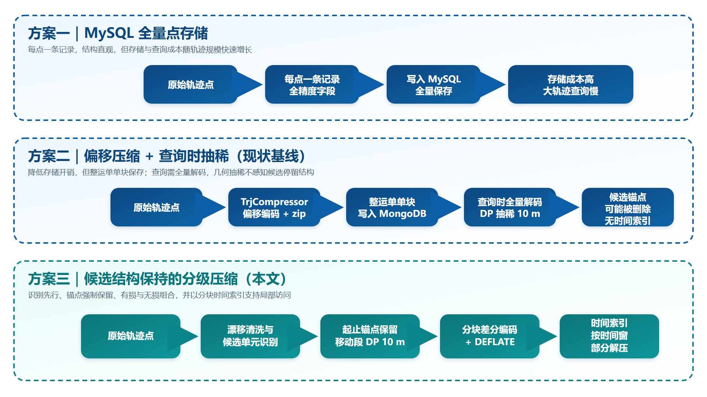
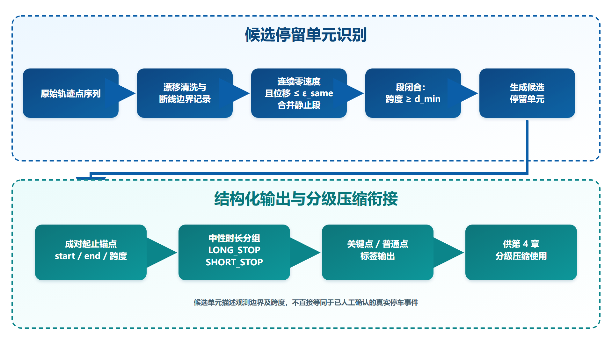
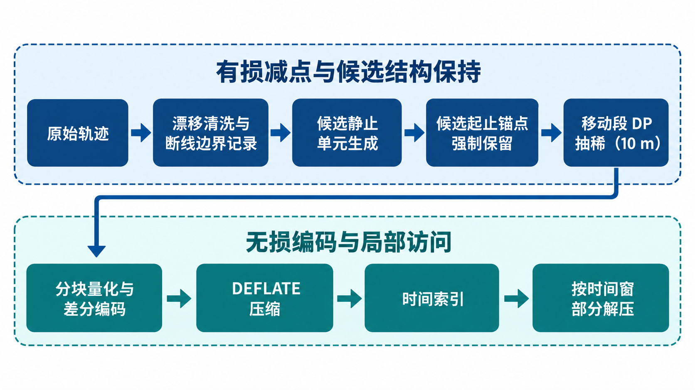
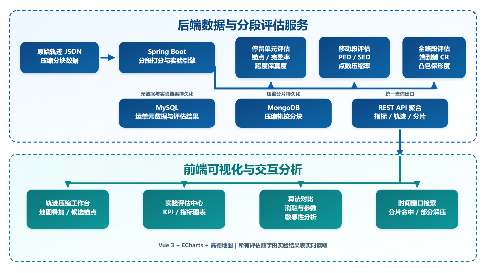
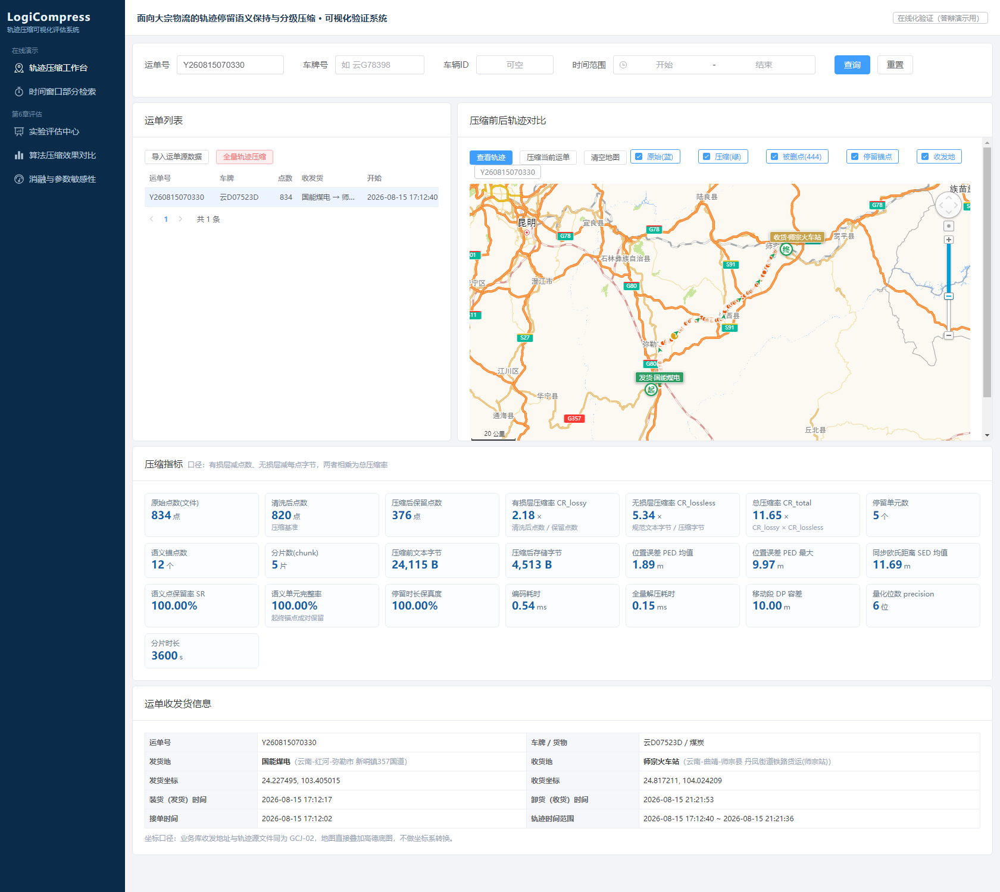
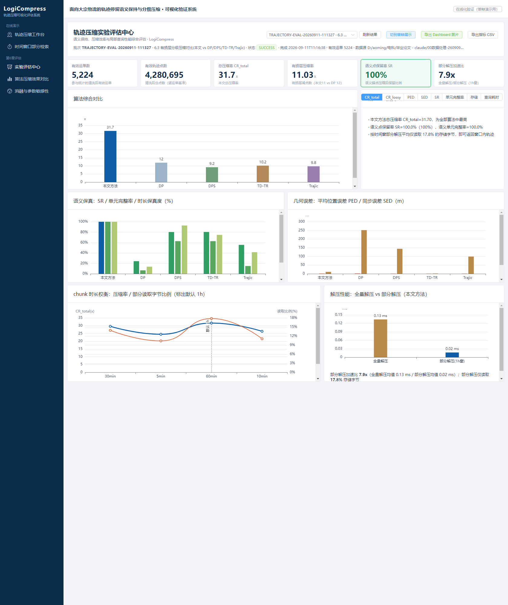
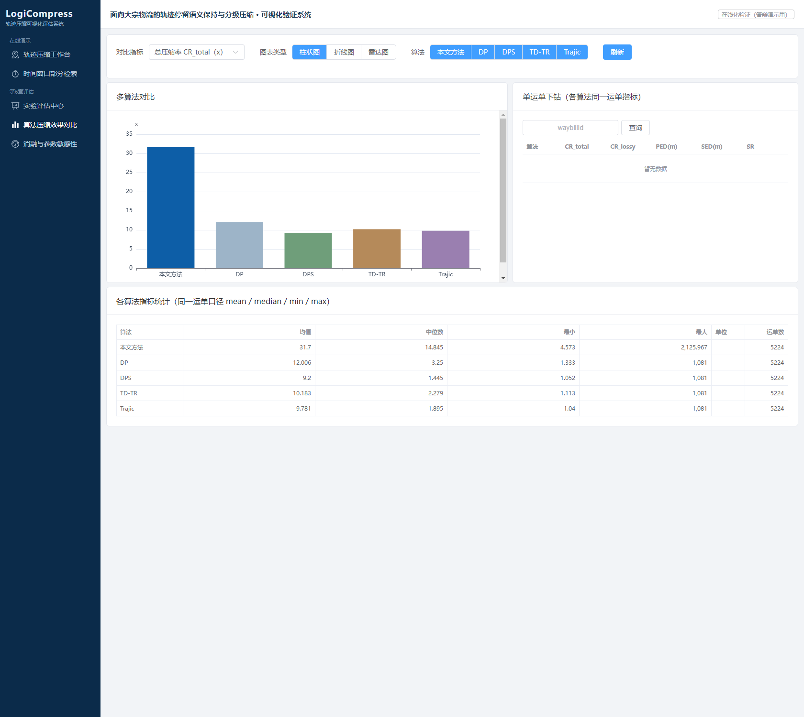
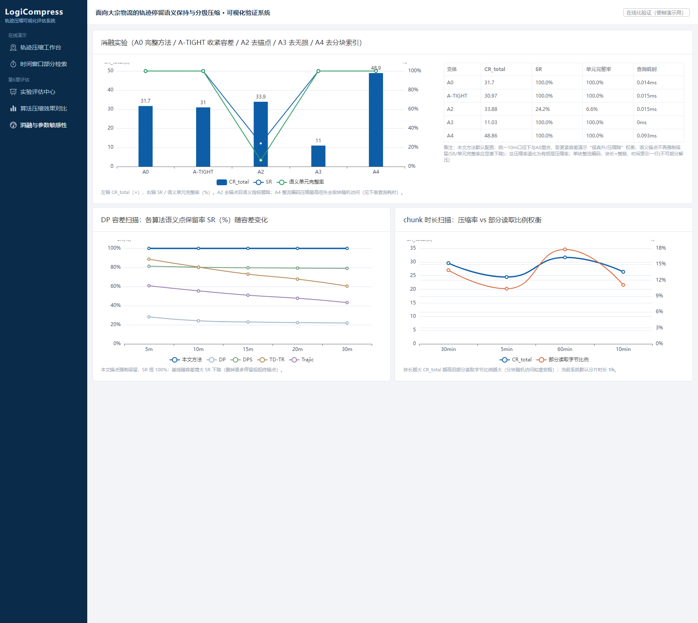
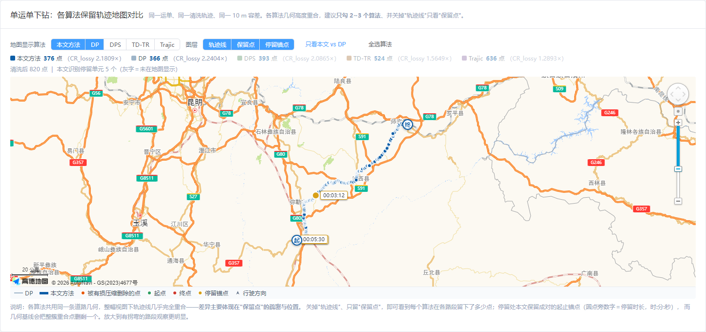
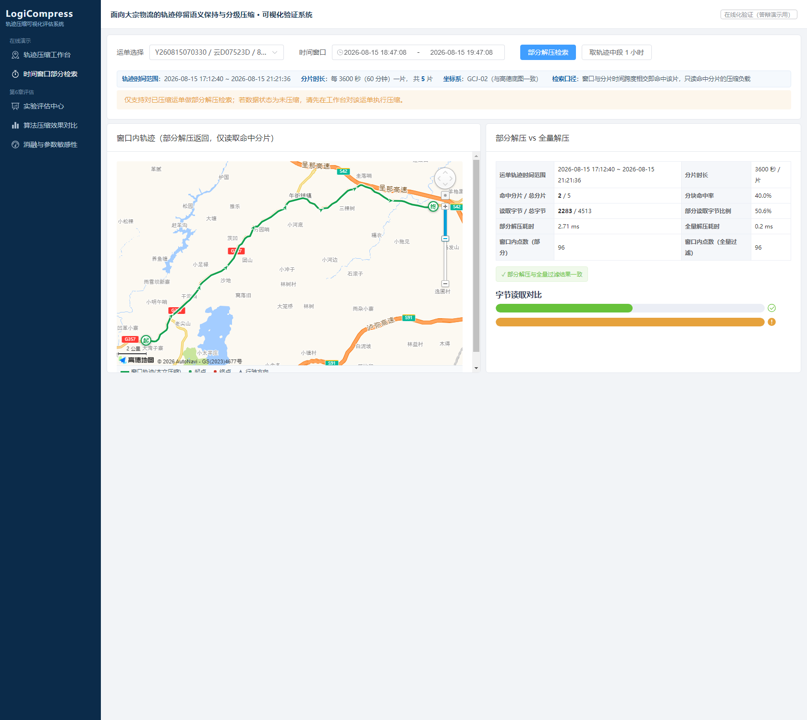

# 面向大宗物流轨迹的候选停留单元识别及分级压缩方法及系统实现

## 摘要

针对大宗物流轨迹数据全量存储导致的存储成本高、查询响应慢及几何压缩易破坏停留时间结构等问题，本文提出一种面向大宗物流的轨迹停留锚点保持与分级压缩方法，并实现配套原型系统。方法首先依据货车北斗终端采样特征，以“近同位置 + 速度为零”合并连续静止点，生成候选静态停留单元及成对起止锚点；继而对候选停留锚点强制保留、对移动段采用 Douglas-Peucker 抽稀，并对保留点序列进行分块偏移量变长编码，建立时间索引支持按时间窗部分解压。实验数据包含 5,224 条运单、4,374,309 个原始轨迹点，漂移清洗后为 4,280,695 点。方法共检测候选停留单元 56,521 个、关键锚点 120,980 个；对这些候选单元，压缩后的锚点保留率、单元完整率与观测时间跨度保真度均为 100%。在所有有损方法叠加相同分块编码器的受控比较中，本文完整方案的全局编码负载压缩率为 16.33，略低于无语义约束 DP 的 17.21，但高于 DPS、TD-TR 与 Trajic 的 13.08、13.30 与 11.75；1 小时时间窗查询平均读取约 17.8% 的编码负载。结果表明，本文方法的主要价值不是取得单一最高压缩率，而是在候选停留结构保持、几何误差、存储开销与局部访问能力之间形成面向物流回放场景的折中。停留检测本身尚缺少独立人工真值，其外部有效性仍需进一步验证。

**关键词**：轨迹压缩；语义感知；停留识别；分级压缩；部分解压

## Abstract

To reduce the storage and retrieval cost of bulk-logistics trajectories while preserving the temporal structure of stationary episodes, this paper proposes a stop-anchor-preserving hierarchical compression method and implements a prototype system. Based on the sampling characteristics of BeiDou vehicle terminals, the method merges consecutive zero-speed points at nearly identical locations into candidate stationary-stop units and represents each unit with paired start/end anchors. It then forcibly retains these anchors, applies Douglas-Peucker simplification to moving segments, encodes the retained points using block-wise differential variable-length coding, and builds a temporal index for partial decompression. The data set contains 5,224 waybills and 4,374,309 raw trajectory points, of which 4,280,695 remain after drift filtering. The method detects 56,521 candidate stop units and 120,980 key anchors; for these candidate units, anchor retention, unit integrity, and observed-duration fidelity are all 100%. In a controlled comparison where every lossy method is followed by the same block encoder, the proposed pipeline achieves a global encoded-payload compression ratio of 16.33, slightly below unconstrained DP at 17.21 but above DPS, TD-TR, and Trajic at 13.08, 13.30, and 11.75. A one-hour query reads about 17.8% of the encoded payload on average. The main contribution is therefore not a universally maximal compression ratio, but a practical trade-off among candidate-stop preservation, geometric error, storage cost, and local access. Independent human ground truth is not yet available for validating the stop detector itself.

**Keywords**: trajectory compression; semantic awareness; stop detection; hierarchical compression; partial decompression

---

## 目录

1. 第 1 章 绪论
   1.1 研究背景与意义
   1.2 国内外研究现状
   1.3 研究内容
   1.4 论文组织结构
2. 第 2 章 相关理论与技术基础
   2.1 轨迹数据与存储演进
   2.2 时空数据挖掘与语义识别
   2.3 有损轨迹压缩理论
   2.4 无损压缩与熵编码理论
   2.5 面向查询的轨迹存储与部分解压
   2.6 本章小结
3. 第 3 章 物流轨迹静态停留识别
   3.1 概述与问题提出
   3.2 数据源采样规则与停留形态
   3.3 同坐标静止段合并算法
   3.4 选型论证：为何不采用围栏区分装卸货与 ST-DBSCAN 聚类
   3.5 复杂度分析与输出
   3.6 本章小结
4. 第 4 章 语义感知的分级压缩与无损编码方法
   4.1 分级压缩框架
   4.2 静止段锚点保真与移动段统一抽稀
   4.3 分块偏移量可变长无损编码器
   4.4 分块时间索引与部分解压
   4.5 本章小结
5. 第 5 章 轨迹压缩效果评估与可视化对比系统
   5.1 系统概述
   5.2 评估子系统设计
   5.3 可视化子系统设计
   5.4 评估流程
   5.5 本章小结
6. 第 6 章 实验与结果分析
   6.1 实验设计
   6.2 候选静止单元生成结果与分析
   6.3 层次一：有损抽稀与候选停留结构保持
   6.4 层次二：无损编码与分块索引
   6.5 层次三：完整组合方案端到端对比
   6.6 时间索引与部分解压实验
   6.7 消融、扩展与外部有效性
   6.8 本章小结
7. 第 7 章 总结与展望
   7.1 研究工作总结
   7.2 主要创新点
   7.3 研究局限
   7.4 未来展望
参考文献

---

## 数据来源与脱敏说明

本文实验数据来源于网络货运平台大宗物流运单轨迹数据，由数据所属企业授权本课题研究使用。为扩大实验规模、覆盖更长的观测周期，实验集合并了两批企业导出数据（2025 年 4 月批次与 2026 年 8 月批次），统一坐标系与字段格式，并在合并阶段剔除点数少于 100 的噪声轨迹，最终纳入 **5,224 个运单、4,374,309 个原始轨迹点**（涉及云南、广西等地电煤、煤炭等大宗货物运输）。实验管线随后按 120 km/h 的相邻点推算速度阈值剔除 93,614 个漂移关联点，得到 **4,280,695 个清洗后轨迹点**；全文凡涉及停留识别、压缩率及误差评价，均以清洗后点列为算法输入，原始点数仅用于说明数据接收规模。在实验与分析过程中，已对运单号、车牌号、司机证件号与联系方式等可识别字段做匿名化/去标识化处理，正文与插图仅使用去标识化后的样例轨迹与聚合统计结果，不含可定位到具体车辆与司机个体的信息。论文送审与公开所需的数据使用及知识产权授权尚待正式书面确认，本文全部结论仅基于上述脱敏数据得出。

---


---

# 第 1 章 绪论

## 1.1 研究背景与意义

### 1.1.1 大宗物流轨迹数据的存储与查询挑战

近年来，车联网与物流信息平台的发展使货运车辆的 GPS 轨迹数据呈现爆发式增长。以大宗物流（煤炭、建材、大宗原材料等）运输企业为例，其运营系统每天需要采集海量定位点位。每个点位通常包含经纬度、速度、方向角、海拔、里程、上报时间等多维属性，构成以"轨迹—运单—车辆—电子围栏"为主线的关联数据体系。

早期系统的轨迹存储方案为**轨迹点位全量存储于关系型数据库**：每个点位对应一条数据记录，经纬度以全精度小数（最高 6–11 位）存储。该方案在数据量较小时简单可用，但随着业务增长暴露三方面问题：

1. **存储成本高**：点位级全量存储导致数据量随业务线性膨胀，存储与索引开销巨大；
2. **查询响应慢**：历史轨迹查询需在大表上扫描、跨表关联，响应时间从秒级到数十秒不等，影响前端展示体验；
3. **压缩处理与语义保真缺失**：传统压缩多基于几何信息，忽略装卸货、加油、休息等业务语义，压缩过程易丢失关键业务点。

上述问题在数据量达到 TB 级后尤为突出，已成为制约物流平台数据资产利用效率的核心瓶颈。

### 1.1.2 轨迹压缩研究的两难困境

轨迹压缩的根本目标是**在尽量小的存储/传输开销下，尽量保留轨迹的有效信息**。现有方法大体分为两类：

- **有损压缩（几何简化）**：如 Douglas-Peucker（DP）[5]、方向保持 DPS [6]、误差有界在线算法 SQUISH [4] 等。这类方法压缩率高，但以几何误差为代价，可能删除关键业务点。
- **无损压缩（编码）**：如预测编码 Trajic [7]、Polyline Encoding 等。这类方法可精确还原，但压缩率有限，且直接对原始点编码无法利用"可丢弃点"的冗余。

单一使用任一类方法，都无法同时满足大宗物流"高压缩率 + 业务语义保真 + 高效局部查询"的实际需求。

### 1.1.3 研究意义

**应用价值**：本研究直接源于企业物流轨迹数据治理中的真实挑战。在异常追踪、私停核查等场景中，“在哪一位置出现连续静止观测、其首尾观测跨度多长”具有分析价值。通过“候选静止单元生成 + 锚点约束抽稀 + 分块无损编码 + 时间索引部分解压”，可避免压缩阶段进一步删除已生成的候选边界，并降低存储与局部查询开销。候选单元是否对应真实停车仍需人工或独立业务记录核验。

**理论价值**：本研究把候选静止单元的成对边界作为显式压缩约束，并通过“分块独立编码 + 时间索引”研究候选结构保持、压缩率与局部查询能力之间的权衡，为面向查询的组合式轨迹压缩提供可复用的实验框架。

## 1.2 国内外研究现状

### 1.2.1 轨迹压缩算法研究

该领域已形成较为完整的技术体系。早期工作集中于几何线简化，如经典的 DP 算法 [5]、快速多边形近似算法 [3] 及其效率改进 [9]；方向保持的 DPS 算法 [6] 在简化中引入方向约束，保证复杂路段形态一致性；SQUISH 算法 [4] 提供误差有界的在线压缩。另一条重要技术路线是预测编码，如 Trajic 系统 [7]，通过预测模型估计下一数据点、存储残差以降低熵。近年来研究呈现从"固定策略"向"上下文感知"的转变 [11][13]。2024—2026 年的新工作进一步把压缩目标从单纯几何误差最小化推进到语义约束、上下文感知和在线停留感知：Zhou 等将信息熵与同步欧氏距离结合，构造时空语义约束压缩方法[21]；Mehri 等提出上下文感知的 Douglas-Peucker 方法，将空间、环境和语义上下文纳入压缩决策[22]；Hirota 提出的 DOTSSA 在在线简化中显式保留 stay areas，说明停留语义已经进入在线压缩框架[23]。面向 AIS 航迹的 2024 年综述也系统比较了批处理和在线压缩方法，强调压缩率、轨迹相似度与长度损失之间的综合权衡[24]。此外，2024 年也出现了基于深度学习的轨迹压缩探索[28]。国内相关研究同样开始向语义化和场景化收敛：在轨迹压缩技术层面，丁梦婷系统总结了轨迹大数据压缩技术[14]，覃梦逗提出时空语义约束的轨迹压缩方法[15]，廖宇威研究了面向轨迹数据的有限压缩[18]，刘海砚等提出时空和语义结合的船舶轨迹压缩方法[19]，舒田伦等提出基于改进 DP 算法的船舶轨迹自适应压缩[20]；在语义化应用层面，集卡拖车语义停留点识别[25]、语义编码虚假轨迹重构[29] 等研究表明，轨迹压缩正在从单纯点位删减演化为“语义保留 + 表达优化”的复合问题。从研究趋势看，轨迹压缩正由“几何主导”转向“语义参与”，但既有方法多聚焦压缩效率或单一形态保持，尚未把物流场景中“停留语义显式建模—分级压缩—可检索存储”贯通起来。

### 1.2.2 轨迹语义识别与停留点检测

语义识别是实现语义感知压缩的前提。停留点检测（Stay Point Detection）的方法大体分为两类：一类是基于时空聚类的无监督方法，如 ST-DBSCAN 算法 [1]，通过空间半径与时间阈值发现时空相邻的停留簇；另一类是基于运动状态规则的静止段检测，如利用"速度为零 + 坐标不变"识别同坐标静止段。在物流领域，已有研究开始融合运单、POI、轨迹几何特征等多源信息提升识别精度 [12]。2025 年的集卡拖车研究基于轨迹几何特征识别语义停留点，说明在运输场景下，停留检测已从一般聚类逐步走向面向业务语义的精细识别[25]；2025 年的城市车辆停留区域识别研究进一步把停留点识别与区域预测结合起来，体现出“停留区域”而非孤立点的分析趋势[26]；2026 年车辆滞留成因分析则从轨迹自识别角度研究滞留事件识别与成因判断，说明“停留/滞留”正在演化为可解释的交通语义问题[27]。此外，作为业务先验的电子围栏在卸货侧大面积失效（收货地址距实际停靠点 51% 超过 2km），依赖围栏区分装卸货段并不稳健，这也促使本文转向基于北斗采样规则的静态停留识别。整体上，通用停留检测多以时空聚类发现“停留簇”，往往把停留当作待压缩的几何冗余而删减，尚未把“位置不变的整段时长”作为不可分割的语义单元并与下游压缩耦合设计，这正是本文与既有工作形成差异之处。

### 1.2.3 面向查询的压缩轨迹存储与组织

为使压缩数据支持高效查询，围绕轨迹压缩后的存储与部分解压，TrajStore [8] 提出自适应存储系统，通过分块与元数据索引支持按时空范围的部分访问。总体而言，压缩轨迹的"分块可检索 + 按时间窗部分解压"仍缺乏针对物流场景的系统性研究。近年的研究开始把语义表示与轨迹重建结合起来，例如 2025 年的语义编码虚假轨迹重构方法通过 BiLSTM、POI 语义标注与层次化语义编码增强轨迹表示能力[29]；而 2026 年的在线简化方法则尝试把 stay areas 直接纳入简化过程[23]。这些工作说明轨迹研究正在从“压缩后再分析”转向“表示阶段即携带语义”，但与物流运单的时间窗查询、块级随机访问和部分解压之间仍有明显距离。

### 1.2.4 研究现状评述

现有研究主要存在三方面不足：一是压缩目标多为几何失真最小化，缺乏对业务语义的显式建模；二是压缩后的存储多采用"整条轨迹单块"组织，缺乏时间索引，难以支持局部查询；三是评估手段多依赖抽象数值指标，缺乏直观的对比与验证工具。综合近年的英文与中文文献可以看到，轨迹压缩、停留识别与语义编码已经开始相互渗透，但多数研究仍停留在“语义增强的压缩”或“语义停留的识别”单点改进阶段，尚未形成同时满足“停留语义不丢、压缩率高、支持按时间窗部分解压”的一体化方案[21]-[29]。这也正是本文的切入点。

## 1.3 研究内容

针对上述问题，本研究设计并实现一个集"语义识别—分级压缩—分块存储—可视化评估"于一体的物流轨迹压缩系统，主要研究内容如下：

**研究内容一：基于北斗采样规则的候选静止单元与分级模型。** 依据货车北斗终端采样特征，将连续近同位置零速度点合并为候选静止段，输出成对起止锚点与观测时间跨度，形成关键点/普通点标注，作为后续压缩输入；同时明确跨无观测间隔续接的不确定性。

**研究内容二：语义感知的分级压缩与无损编码方法。** 关键点强制保留、非关键段可调容差有损简化；对抽稀后点序列做分块偏移量可变长无损编码；建立"时间范围→块"索引实现按时间窗部分解压。

**研究内容三：轨迹压缩效果可视化评估与对比系统。** 构建基于 Web 的多算法并行对比与多维指标可视化平台。

## 1.4 论文组织结构

本文共七章，组织结构如下：第 1 章为绪论；第 2 章介绍相关理论与技术基础；第 3 章研究语义识别与分级模型；第 4 章研究语义感知分级压缩与无损编码方法（核心）；第 5 章介绍可视化评估与对比系统；第 6 章为实验与结果分析；第 7 章为总结与展望。

---


---

# 第 2 章 相关理论与技术基础

## 2.1 轨迹数据与存储演进

本节从企业轨迹存储的演进角度，梳理三套方案及其关系。三者对应论文叙事的"现状—问题—改进"主线。

### 2.1.1 方案一：轨迹点位全量存储（MySQL）

最初系统将每个轨迹点位作为一条记录存入 MySQL 关系库，经纬度以全精度小数存储。该方案直观、易查询，但存在存储成本高、查询慢、压缩缺失等问题（见 1.1.1）。

### 2.1.2 方案二：偏移量压缩 + 查询时抽稀（现状基线）

为降低存储，企业开发了偏移量压缩组件 `TrjCompressor`：将一条运单的轨迹点编码后压缩存入 MongoDB。该方案在存储上取得显著收益（存储大小下降约 38.5 倍、总占用空间下降约 52.6 倍、全量查询响应由秒级降至百毫秒级），但存在两大缺陷：

1. **关键轨迹点可能被稀释**：查询路径上的几何抽稀（固定 10 米阈值）不感知业务语义，可能删除装卸货等关键点；
2. **缺少时间索引**：整条运单存为单个压缩块，查询部分时间段需全量解码，无法部分解压。

### 2.1.3 方案三：语义感知分级压缩 + 分块时间索引（本研究）

在方案二基础上，本研究：先基于采样规则做静态停留识别（同坐标静止段合并、保留成对起止锚点）；将抽稀前移到压缩阶段并做语义感知分级（关键点强制保留）；对抽稀后点序列分块偏移量编码；建立时间索引实现按时间窗部分解压。图 2-1 给出三套方案流程对比。



**图 2-1 企业轨迹存储三套方案演进对比**

## 2.2 时空数据挖掘与语义识别

### 2.2.1 轨迹数据挖掘概述

轨迹数据挖掘 [2] 旨在从原始轨迹中发现行为模式与语义信息。本文沿用"原始轨迹 → 静态停留识别 → 语义标注"的基本流程，为分级压缩提供关键点标签。

### 2.2.2 数据源采样规则与静止段定义

货车北斗定位终端的上报行为由既定采样规则支配，并随终端工况变化：行驶/ACC 档约 30 s 上报一次，拔钥匙后进入心跳模式仍会以 5–6 min 为主的间隔上传定位点，直至小电瓶耗尽或断大闸后彻底停止，弱信号时段上报中断、信号恢复后按原始时间戳补传。这使得轨迹中的“停车”在数据上表现为同一位置上一段或密或疏的点序列，而“行驶”则必然伴随速度非零或位移变化。上述采样规则的完整归纳、实测统计及其对停留识别算法设计的含义见 3.2 节（表 3-1），此处仅作为相关理论背景，不再展开。

### 2.2.3 ST-DBSCAN 时空聚类（对比基线）

ST-DBSCAN [1] 扩展 DBSCAN 至时空域，同时考虑空间半径与时间阈值（典型参数如 epsM=50m、epsTS=300s、minPts=3），可发现时空上相邻的轨迹点簇。在物流场景中，该方法可用于识别停留簇，但其效果受限于 2.2.2 所述的采样规律：密集簇与稀疏心跳点之间存在较大时间间隔，导致长停留漏检或时长低估。因此本文将 ST-DBSCAN 作为第 6 章选型对比实验的基线方法，而非主识别方法。

### 2.2.4 电子围栏业务先验（对比基线）

物流企业掌握装卸货地点的电子围栏（多边形或圆心+半径）。早期方案曾设想将其作为区分装卸货段的高置信度强约束，将围栏内轨迹点直接标记为业务关键点。然而实测发现，收货地址到实际停靠点的距离有 51% 超过 2km（P95 达 22km），围栏在卸货侧大面积失效，依赖围栏区分装卸货段的方案并不稳健。因此本文将围栏匹配降为第 6 章的对比基线，不再作为本文方法的主识别依据。

## 2.3 有损轨迹压缩理论

### 2.3.1 Douglas-Peucker 算法

DP 算法 [5] 是经典线简化算法：在给定容差 ε 下，递归寻找偏离当前线段距离最大的点，若超过 ε 则保留该点并递归二分。本文非关键段的抽稀采用 DP 的工程实现 `GisDouglasUtil`，通过两点间大圆距离计算点到线段的垂直距离。

### 2.3.2 方向保持与误差有界算法

DPS [6] 在简化中约束方向角变化，适合城区复杂路段；SQUISH [4] 提供误差有界的在线压缩。本文在实验部分以 DP 为基座，并与上述算法对比（见第 6 章）。

## 2.4 无损压缩与熵编码理论

### 2.4.1 差分编码与 ZigZag

相邻 GPS 点经纬度差值远小于绝对值，用差值（偏移量）替代绝对值可显著降低取值范围。对可能为负的偏移量，采用 ZigZag 变换将负数映射为正整数（符号存于最低位），便于后续编码。

### 2.4.2 变长分片编码（类 Varint）

对量化后的整数偏移量，每 5 位取一个分片，末分片不设标记、非末分片置第 6 位作为"后续还有分片"的边界标记，再整体加 63 转为 ASCII 可打印字符。该编码可无歧义解码，且小偏移量占字节少。

### 2.4.3 熵编码二次压缩

对变长编码得到的 ASCII 序列再施以 zip（DEFLATE），利用大量重复字节进一步压缩。整体构成"量化 → 差分 → ZigZag → 5 位分片 → ASCII → zip"的无损编码链，复杂度 O(n)。

### 2.4.4 与信息熵下界的对比

设偏移量序列的信息熵为 H（bit/偏移量）。5 位分片编码对取值范围为 k 的整数近似产生 ⌈log₁₆₀ k⌉ 个 ASCII 字符/偏移量，即约 8·⌈log₁₆₀ k⌉ bit/偏移量。该长度与熵下界 H 存在差距，zip 层可进一步逼近 H。论文第 4 章将给出针对物流轨迹偏移量分布（高度集中于小值）的编码长度与熵下界对比。

## 2.5 面向查询的轨迹存储与部分解压

### 2.5.1 整块存储的问题

方案二将整条运单编码为单个 blob 存储。对"查询某运单某时间段的轨迹"这类局部查询，必须解码整条轨迹后过滤，存在 I/O 与 CPU 浪费，且无法并行处理。

### 2.5.2 分块独立编码

将抽稀后的点序列按固定时间窗切块，每块以块首点为基准、块内点存相对偏移，每块独立编码、可独立解压。块首点作为锚点保证编解码一致性。

### 2.5.3 时间索引与部分解压

建立稀疏时间索引（运单号、块号、起止时间、点数、字节偏移、长度、是否含关键点）。查询某时间窗时，仅读取并解压命中块；边界块只取窗内点。块长是压缩率与局部查询粒度间的权衡参数。

## 2.6 本章小结

本章从轨迹存储演进出发，梳理了"MySQL 全量 → 偏移量压缩+查询时抽稀 → 语义感知分级压缩+分块时间索引"三套方案，介绍了货车北斗终端的采样规则与静止段定义、语义识别（ST-DBSCAN、电子围栏作为对比基线）、有损压缩（DP 等）、无损编码（差分、ZigZag、变长分片、熵编码）与分块部分解压相关的理论基础，为后续章节的方法设计提供支撑。

---


---

# 第 3 章 物流轨迹静态停留识别


---

## 3.1 概述与问题提出

本章解决"什么该保"的问题——在压缩之前，从原始轨迹中识别出具有业务价值的关键语义单元，为后续分级压缩（第 4 章）提供强制保留的锚点。

### 3.1.1 问题的提出

物流轨迹的价值不仅在于“车辆走过哪些路”，还在于其可能反映装货、卸货、途中休息和交通停驻等业务过程。这些过程常伴随车辆在局部空间范围内保持静止，但仅凭轨迹形态不能直接判定具体事件类别。因此，本文首先检测**候选静态停留**，其目标是提取“近同位置上的观测时间跨度”，而不是直接识别装卸货、加油或休息等真实业务事件 [2][12]。

在传统轨迹压缩中，停留段是最具挑战性的部分：

- 停留簇的点在空间上**近乎重合**，几何简化算法（如 Douglas-Peucker）会因点间距离极小而大量删除；
- 更关键的是，几何算法**不理解停留的语义结构**——它只保留几何上"重要"的点（如偏离直线最远的拐点），而停留簇的几何特征恰恰是"没有拐点"，因此往往只保留簇的两端或一个孤立点；
- 结果：**"车辆在此停留 20 分钟加油"和"车辆瞬时经过此处"在压缩后无法区分**，停留时长这一关键业务语义丢失。

对大宗物流企业而言，轨迹回放重点关注“**候选停留出现在哪里、两个静止观测边界相隔多久**”，而非停留期间的点位密度。因此，压缩前需要把候选静止点序列作为一个结构单元提取出来，而不能只保留孤立单点。需要强调的是，在长时间无观测的区间内，仅凭首尾同位置点无法排除车辆离开后返回等情况；本文恢复的是观测边界定义的时间跨度，其物理真实性仍需独立标注或业务记录验证。

### 3.1.2 本章思路

本文提出“**候选停留单元**”的概念，将关键点处理从“识别单点”扩展为“**候选停留单元（开始点 + 结束点成对）**”。每个单元携带起、终两个锚点的时间戳，使压缩后能够恢复该候选静止段的观测起止时刻与时间跨度；锚点本身不提供无观测区间内车辆状态的直接证据。

识别依据来自企业数据源确认的北斗车载终端采样规则。本文将“连续零速度且近同位置”作为候选静态停留的可观测判据：在有点上报的区间内，静止点应保持在 GPS 漂移容忍范围内；出现 spd>0 或明显位移时则闭合当前候选段。据此，本文采用**近同位置静止段合并**作为主方法：

- 依据实测数据归纳北斗终端采样规则与停留形态（3.2 节）；
- 以同坐标容差 ε_same 合并"spd=0 且位移极小"的连续点，跨大间隔（心跳点/补传点）合并为静止段，段闭合生成停留单元（3.3 节）；
- 从围栏失效、聚类漏检、参数耦合三个维度论证不采用"围栏区分装卸货 + ST-DBSCAN 聚类"作为主识别（3.4 节）。

本章整体框架如图 3-1 所示。



**图 3-1 语义识别总体框架**

### 3.1.3 符号与停留单元定义

一条运单的原始轨迹为有序点序列：


**公式：** T = {p_1, p_2, …, p_n}；p_i = (lat_i, lon_i, t_i, spd_i, f_i)


其中 lat_i, lon_i 为经纬度，t_i 为时间戳，spd_i 为终端上报速度，f_i 为其他辅助属性（方向角、海拔、状态字等，若可获取）。

**定义 3-1（静止段）** 轨迹 T 的一个子序列 p_a, p_b, …, p_c，若其任意相邻两点速度均为零（spd = 0）且空间位移不超过同坐标容差 ε_same，即


**公式：** 对任意 i ∈ [a+1, c]，spd_(i−1) = spd_i = 0，且 dist(p_(i−1), p_i) ≤ ε_same


则称该子序列为一个静止段（候选停留段）。

**定义 3-2（候选停留单元）** 由时间跨度满足 Δ t = t_c - t_a ≥ D_min 的静止段抽象出的结构对象：


**公式：** S = (p_start, p_end, Δt, ℓ)


其中 p_start 为开始点、p_end 为结束点、Δ t=t_end-t_start 为观测时间跨度，ℓ∈LONG_STOP,SHORT_STOP 为中性时长分组标签。既有实现中的 REST/TRAFFIC 在论文展示层统一映射为 LONG_STOP/SHORT_STOP，不再把时长阈值解释为休息或交通拥堵事件。

### 3.1.4 为什么是"开始/结束点成对"

停留单元的语义信息主要包含两点：

1. **发生了停留**（空间证据）；
2. **停留了多久**（时间证据，Δ t）。

其中时间跨度必须由两个时间戳才能表达。若只保留候选静止段中的任意一个点，则 t_start 与 t_end 无法同时恢复。因此：

- **开始点 p_start**：进入停留状态的时刻点；
- **结束点 p_end**：离开停留状态的时刻点；
- 二者**成对保留**，是压缩时不可删除的锚点（见第 4 章 4.2）；
- 停留段中间的点因空间近似重合，对几何贡献极小，可不参与压缩（见 3.3.3）。

这一“成对锚点”设计将候选静止段的观测时间跨度物化为两个时间戳。只要锚点成对保留，候选单元的观测边界即可无损恢复。第 6 章分别评价停留检测结果与压缩保持结果：100% 锚点保持是算法约束产生的内部一致性结果，不等同于停留检测相对于真实车辆状态的准确率。

### 3.1.5 停留时长下限

为避免把"短暂减速"或"等红灯"误判为业务停留，设置最短停留时长 D_min。静止段时长小于 D_min 的，**降级为普通点**，不构成停留单元。默认 D_min = 3\ min（180 s，可配置，见 3.3.1）。


---

## 3.2 数据源采样规则与停留形态

停留识别方法的设计必须从数据本身的产生机制出发。本节归纳企业北斗车载终端的采样规则，并结合全量实测数据给出停留的形态特征，为 3.3 节算法提供依据。

### 3.2.1 北斗终端采样规则

企业授权的大宗物流轨迹数据来自货车北斗终端。经向数据源方确认，终端在不同工况下的上报行为如表 3-1 所示。

| 场景 | 上报行为 |
|---|---|
| 行驶中 / ACC 档（通电未打火） | 30 秒上报一次定位 |
| 拔钥匙 / 司机离开驾驶舱 | 进入心跳模式，心跳点仍会上传轨迹数据（低频点位） |
| 心跳点实测间隔 | 以 5–6 min 为主（全数据 300 s~1 h 心跳点共 1396 个，其中 5–6 min 档 1268 个），与标称 10 min 有出入，以实测为准 |
| 小电瓶维持时间 | 约 2–5 小时（期间心跳点照常上传，之后静默） |
| 断大闸（总电源断开） | 彻底失联，无任何上报 |
| 弱信号（隧道/山区/地库） | 上报中断，信号恢复后按原始时间戳补传 |

**表 3-1 北斗终端采样规则**

表 3-1 揭示的关键事实是：**停车不等于失联**。拔钥匙后终端进入心跳模式，仍会以 5–6 分钟为主的时间间隔上传"同坐标"的轨迹点；只有当小电瓶耗尽或断大闸后，上报才真正停止。这决定了停留识别必须能够跨越分钟级乃至小时级的大间隔，把稀疏的心跳点与停车前后密集点归并为同一次停留，而不能仅依赖"相邻点时间连续"这一弱假设。

### 3.2.2 实测数据事实

在本批 5,224 个运单的 4,374,309 个原始定位点上，先按 120 km/h 相邻点推算速度阈值执行漂移剔除，删除 93,614 个与异常高速边关联的点，形成 4,280,695 个清洗后定位点。以下停留形态统计以清洗后点列为基础；原始点数用于说明数据接收规模。

1. **采样间隔**：平均 45.0 s、中位 30 s；主档位 15 s / 30 s，两档合计约 58.3%（行驶段以 30 s 为主）。
2. **停车判据**：经纬度**完全相等**的相邻点对仅占 2.5%，但**"前点 spd=0 且位移 ≤10 m"的相邻点对占 42.8%**——终端上报的静止点存在轻微 GPS 抖动，判据必须用"速度为零 + 位移容差"而非严格坐标相等，这直接支撑 3.3 节取 ε_same=10 m 的取值。在 2.5% 的严格同坐标点对中，**97.4% 前点 spd=0**——即"坐标严格不变"几乎必然是停车。
3. **静止段形态**：按"连续点 spd=0 且位移 ≤10 m"合并，共得静止段 98,142 段；段内点数中位 6 个、P90 35 个；段时长中位 249 s、P90 2,342 s、最长 212.0 h；段时长 <1 min 占 22.9%、3–10 min 占 32.8%、>30 min 占 12.2%。
4. **长间隔归因**：间隔 >10 min 的点对 7,928 个（0.18%），其中 80.5% 前后点 spd=0 且位移 ≤100 m——即绝大多数为"停车休眠"（小电瓶耗尽/断大闸），而非信号丢失。
5. **心跳点证据**：静止段内部间隔落在 300 s~1 h 的点对共 137,871 个，其中 **5–6 min 档 129,211 个（93.7%）**——心跳点确实以 5–6 min 为主进入轨迹数据，与 3.2.1 的采样规则相符（与标称 10 min 不符，论文以实测为准），也说明停留识别必须能够跨越该量级的大间隔。
6. **覆盖率**：99.9%（5,218/5,224）的运单至少含 1 个静止段，每运单段数中位 17 段。

### 3.2.3 停留的物理形态

上述事实共同指向一个物理结论：**"停留 = 位置不变的一段时间"**。停车期间，无论点位是密集（ACC 段 30 s 上报）还是稀疏（心跳段 5–6 min 上报），其坐标都保持在同一位置（GPS 漂移容差内）、速度均为零；真正的行驶点必然伴随 spd>0 或明显位移。典型停车采样形态如下：

```
样例A(短停):  spd=0 同坐标 +15s, +4s, +299s(心跳), +854s(心跳) → 起步
样例B(过夜):  30s×4 个同坐标点(ACC段) → 静默3.9h → 1个同坐标心跳点(小电瓶) → 静默1.4h → 起步
```

两个样例揭示两个对算法设计有决定意义的性质：

- **密集段往往只有几十秒**：候选长停的密集簇常只有 4 个点左右（≈90 s），其后可能由稀疏心跳点续接。若只使用密集簇跨度，可能把长时间同位置观测拆成短段；反之，跨无观测间隔续接也可能把离开后返回误并，因此只能作为候选生成规则；
- **大间隔不可丢弃**：样例 B 中 3.9 h 与 1.4 h 的静默段两端仍是同坐标、spd=0，说明停留期间即使长时间无点上报，也属于同一次停留，必须跨大间隔合并。

这两点正是 3.3 节"同坐标静止段合并"算法要解决的问题，也是 ST-DBSCAN 等时空聚类方法失效的根源（见 3.4 节）。


---

## 3.3 同坐标静止段合并算法

### 3.3.1 算法参数

同坐标静止段合并方法仅需三个物理意义明确的参数，均可在工程中直接配置：

| 参数 | 含义 | 默认值 |
|---|---|---|
| ε_same | 同坐标容差（GPS 漂移容忍），两点位移不超过此值视为"同一位置" | 10 m |
| d_minS | 最短停留时长（即 D_min），静止段时长不小于此值才生成停留单元 | 180 s（3 min） |
| T_long | 候选长/短停分组阈值 | 1800 s（30 min） |

**表 3-2 同坐标静止段合并参数**

三个参数依据数据分布与业务经验设置：ε_same 对应 GPS 漂移量级；d_min 用于滤除极短候选段；T_long 只作观测跨度分组，不直接判定休息或交通拥堵。参数外部有效性仍需标注集验证。

### 3.3.2 合并过程

漂移清洗首先剔除异常点，并在相邻点时间差大于 600 s 处记录连续子段边界；该边界用于后续 DP 抽稀，避免跨断线区间进行几何插值。停留识别随后在完整清洗点列上按时间升序单遍扫描，因而 600 s 子段边界本身不阻断近同位置零速度点的候选合并。扫描过程维护当前候选静止段起点 start：对相邻点对 (p_i-1, p_i)，若两点速度均为零且位移不超过 ε_same，则继续当前段；否则闭合 [start,i-1] 并令 start=i。形式化如下。

**算法 3-1：同坐标静止段合并**

```
输入：清洗后轨迹点 pts（时间升序），参数 ε_same, d_min, T_long
输出：停留单元集合 S = {S_1, ..., S_m}

1  start ← 0；S ← ∅
2  for i = 1 .. n-1：
3      sameStationary ← spd(pts[i]) == 0 且 spd(pts[i-1]) == 0
4                       且 dist(pts[i-1], pts[i]) ≤ ε_same
5      if sameStationary == false：
6          if i-1 > start 且 time(pts[i-1])-time(pts[start]) ≥ dMinS：
7              S ← S ∪ { 生成StopUnit(pts, start, i-1) }
8          start ← i
9  if n-1 > start 且 time(pts[n-1])-time(pts[start]) ≥ dMinS：
10     S ← S ∪ { 生成StopUnit(pts, start, n-1) }
11 return S
```

### 3.3.3 段闭合与停留单元生成

段闭合时（算法 3-1 第 7、10 行）按下述规则判定并生成停留单元：

- **闭合条件**：段长 > 1（至少两个点）且段时长 Δ t = t_end - t_start ≥ d_minS；
- **类别标注**：


**公式：** 当 Δt ≥ T_long 时，ℓ = LONG_STOP；否则，ℓ = SHORT_STOP


- **锚点保留**：该段**只保留 start、end 两个锚点**（startIdx、endIdx 下标对应的首尾点），段内其余点不参与压缩。

其中“只保留起止锚点”是压缩联动设计：候选段内部点在空间上近重合，对轨迹形状贡献较小；成对时间戳足以恢复压缩前候选单元的首尾观测跨度。因此内部点删除不会破坏本文定义的候选边界结构，但可能丢失段内采样密度和微小漂移等信息。Δ t 按首尾点时间差计算，是观测边界跨度，不是经人工真值确认的实际停车时长。

### 3.3.4 跨大间隔合并及其适用边界

算法 3-1 具有两个对停留识别至关重要的性质：

1. **跨大间隔形成候选单元**：合并条件只检查“相邻观测点速度为零且位移 ≤ ε_same”，不设置额外时间上限。漂移清洗阶段虽然在间隔大于 600 s 处生成连续子段边界，但实现中的停留合并仍扫描完整清洗点列；因此相隔 >300 s 乃至数小时的近同位置零速度观测点可以进入同一候选单元，Δ t 按首尾观测时间差计算。
2. **有观测行驶点时及时切断**：若相邻观测中出现 spd>0 或位移超过 ε_same 的点，算法立即闭合当前候选段，避免把已观测到的行驶过程合并进静止段。

上述机制能够续接稀疏心跳观测，但不能证明无观测间隔内车辆始终静止。若车辆在断线上报期间离开后返回近同位置，算法仍可能误合并。此外，当前判据约束相邻点距离而非整段最大直径，连续小位移可能产生链式漂移。本文因此将输出称为“候选停留单元”，并在 7.3 节把无观测状态与链式漂移列为局限；严格识别精度需要由独立人工标注或外部车辆状态记录评价。


---

## 3.4 为何不采用围栏区分装卸货 + ST-DBSCAN 聚类（选型论证）

在方法设计初期，本文曾考虑以"电子围栏强匹配锁定装卸货 → ST-DBSCAN 时空聚类发现其余停留 → 运动学阈值精修边界"的多层路线作为主识别。但实测数据与原型对照表明，该路线在企业数据上存在三处结构性缺陷，故仅将其降为对比基线（第 2 章理论背景 + 第 6 章选型对比实验），主方法收敛为 3.3 节的静态合并。

### 3.4.1 卸货侧电子围栏大面积失效

围栏匹配依赖"收货地址 → 电子围栏"的准确对应。但大宗物流中收货地址与实际停靠点往往相差很远：实测**收货地址到实际停靠点 51% 超过 2 km，P95 达 22 km**。这意味着在卸货侧，围栏几乎无法锁定真实停靠位置，依赖围栏区分装卸货段在卸货侧大面积失效，作为主识别不可靠。

### 3.4.2 ST-DBSCAN 长停漏检与语义弱化

ST-DBSCAN [1] 同时以空间邻域 ε 与时间邻域 ε_t 定义点的邻域，其连通性要求邻域内点对在 ε_t 时间内相邻。当 ε_t = 300 s 时，稀疏心跳点（间隔 5–6 min 乃至数小时）**连不上**前序密集点，成为噪声点，导致：

- **长停漏检 / 时长低估**：过夜/装卸长停的密集簇只有几十秒，之后由心跳点续接，ST-DBSCAN 只能把几十秒的密集簇判成短停甚至丢弃，真实长停被漏检或时长被严重低估；
- **语义弱化**：ST-DBSCAN 相对静态合并多抓出的停留，多为 0~11 km/h 的**低速爬行停**（走走停停的低速滑行），这类"停留"不具备"在哪停、停多久"的业务语义，对企业关心的异常追踪、偷货、私停场景价值很低。

### 3.4.3 装卸货内事件锚点多阈值耦合难标定

若进一步在装卸货段内做“角度 + 距离 + 累计时间”的事件锚点细分，需引入多个互相耦合的阈值。这些阈值缺乏独立真值支撑，难以可靠标定。本文候选生成使用三个参数（ε_same、d_min、T_long），其敏感性与适用边界在第 6 章报告。

### 3.4.4 实测对比

在同一批 5,224 个运单上，用工程原型对静态合并（本文方法）与 ST-DBSCAN（epsM = 50 m / epsTS = 300 s / minPts = 3）做对照，结果如表 3-3 所示。

**表 3-3 静态合并 vs ST-DBSCAN 停留识别对比（5,224 运单）**

| 指标 | 静态合并（本文方法） | ST-DBSCAN |
|---|---|---|
| 停留单元总数 | **56,521** | 45,018 |
| 长停（>30 min） | **11,986** | 11,731 |
| 时长中位 / 最大 | 540 s / **212.0 h** | 635 s / 40.7 h |
| 与围栏装卸货单元时间重叠数 | 2,073 | 2,494 |
| 交集 / 仅静态 / 仅 ST-DBSCAN | 36,359 / **20,162** / 8,659 | — |

对比表明：静态合并**多识别 11,503 个停留单元（+25.6%）**，独有单元 20,162 个 vs 8,659 个；**最长停留 212.0 h vs 40.7 h（约 5.2 倍）**——这些长停正是 ST-DBSCAN 因心跳间隔（ε_t = 300 s）连不上而被拆散、低估的部分。**需如实说明两处与直觉相反的实测结果**：(1) 长停数量两者接近（11,986 vs 11,731，+2.2%），并非量级差异；(2) 与围栏装卸货单元的时间重叠数 ST-DBSCAN 反而略高（2,494 vs 2,073），说明本数据集上围栏锚定**不能**作为本文方法更优的证据（原因见 6.2.3：轨迹与收发货地址常有数公里偏差，围栏本身是弱基准）。静态合并的优势收敛为三条明确且可佐证的：**单元覆盖更全、长停时长可跨心跳点完整续接（212.0 h）、不依赖围栏数据与 εs/εt/MinPts 三个难标定参数**。

综上，本文收敛到静态同坐标合并作为唯一主方法：它是"够用、稳、可解释"的选择；复杂度与算力应投入到第 4 章的压缩与无损编码，而非停留识别这一环。


---

## 3.5 复杂度分析与输出

### 3.5.1 复杂度分析

算法 3-1 对轨迹做**单遍扫描**，每个点仅参与一次"与前一点比较"（spd 判定 + 位移计算）与至多一次"段闭合"操作，无需空间索引、无需邻域查询、无需迭代收敛。因此时间复杂度为 O(n)，空间复杂度为 O(1)（仅维护当前静止段）。相比 ST-DBSCAN 的 O(n log n)（需空间索引与邻域查询），静态合并在海量轨迹离线批量处理上具有明显优势。

### 3.5.2 输出结构

每条运单轨迹经算法 3-1 处理后，输出：

1. **候选单元集合** S=S_1,S_2,…,S_m，每个单元携带成对锚点 (p_start,p_end)、观测跨度 Δ t 与中性类别 ℓ∈LONG_STOP,SHORT_STOP；
2. **关键点/普通点标注**：
   - **关键锚点**：所有停留单元的 p_start, p_end（每个单元 2 个，成对保留）；
   - **普通点**：其余点（含被剔除的静止段内部点与纯移动段点），可在分级压缩中按更大容差抽稀。

据此，原始轨迹被划分为两类区段：

- **停留段（关键段）**：仅保留起止锚点，强制保留、不做有损简化；
- **移动段（非关键段）**：统一以 DP 容差做有损简化。

这一划分直接为第 4 章"语义感知分级压缩"提供输入。


---

## 3.6 本章小结

本章从企业北斗终端的采样规则出发，用实测数据确立"**停留 = 位置不变的一段时间**"这一物理事实，并将语义识别收敛为**同坐标静止段合并**单一主方法：

- 以 ε_same = 10 m 同坐标容差合并"spd=0 且位移极小"的连续点，跨大间隔（心跳/补传点）合并为静止段，段时长按首尾点时间差计；
- 段闭合（段长 >1 且观测跨度不小于 d_min=180 s）生成候选单元，类别按 T_long=1800 s 分为 LONG_STOP / SHORT_STOP；
- 每个停留单元**只保留 start/end 成对锚点**，内部点不参与压缩，从而把"停留时长"这一业务语义物化为两个时间戳，保证压缩后仍可无损恢复；
- 从"卸货围栏失效、ST-DBSCAN 长停漏检/语义弱化、事件锚点参数耦合"三个维度论证了不采用多层识别路线的理由，并以实测对照支撑选型。

本章输出的停留单元集合与关键/普通点标签，是第 4 章语义感知分级压缩的直接输入。第 4 章将介绍如何将成对锚点嵌入压缩流程，并设计移动段的有损简化与分块无损编码。

---


---


---

# 第 4 章 语义感知的分级压缩与无损编码方法


---

## 4.1 分级压缩框架

### 4.1.1 问题定义

第 3 章已将轨迹划分为**静止段**（停留单元所在区段）与**移动路段**（纯行驶区段），并输出成对的开始/结束锚点。本章在此基础上设计压缩方法，需同时满足三个目标：

1. **高压缩率**：在存储空间上取得显著收益；
2. **候选结构保持**：规则生成的候选起止锚点及其观测跨度不被压缩阶段删除；该目标不等同于真实停车事件识别正确；
3. **可检索**：压缩后的轨迹支持按时间窗的部分解压，而不是每次全量解码。

### 4.1.2 总体流程

本章方法采用"**有损抽稀（减点数）→ 无损编码（减字节）→ 分块存储（可检索）**"三段式流水线：



**图 4-1 候选锚点保持的分级轨迹压缩总体流程**

- **有损层（4.2）**：以第 3 章停留单元锚点为输入，静止段只保留起止锚点、移动段统一 DP 抽稀，压缩点数量；
- **无损层（4.3）**：对抽稀后的点序列做分块偏移量可变长编码 + zip，压缩每点字节数；
- **存储层（4.4）**：每块独立编码，建立时间索引，支持按时间窗部分解压。

### 4.1.3 压缩率口径

论文统一采用两级压缩率定义（第 6 章实验沿用同一口径），二者**相乘**为总压缩率：

- **有损层压缩率**（减点数）：CR_lossy = dfracN_cleanN_kept，即清洗后点数 / 抽稀后保留点数；
- **无损层压缩率**（减每点字节数）：CR_lossless = dfracB_naiveB_zipped，即保留点规范文本字节数 / 编码存储字节数；
- **总压缩率**：CR_total = CR_lossy × CR_lossless。

其中 N_clean 为清洗后点数、N_kept 为抽稀后保留点数；B_naive 为保留点按"每字段全精度十进制"写的规范文本字节数（无损层压缩前基准，详见 4.3），B_zipped 为分块偏移量编码 + DEFLATE 后的总字节数。

> ⚠️ 有损层减的是**点数**、无损层减的是**每点字节数**，二者相乘才是总压缩率；必须将两级口径分开定义并讲清相乘关系，避免与单级压缩率混淆（第 6 章各表均按此口径统计）。

## 4.2 静止段锚点保真与移动段统一抽稀

### 4.2.1 压缩策略的两级划分

第 3 章输出的停留单元由成对的开始/结束锚点（p_start, p_end）标识，其内部为空间上**同坐标**的静止点序列（第 3 章同坐标静止段合并的输入条件）。据此，本文将轨迹划分为两类区段并施以不同压缩策略：

1. **静止段（停留单元内部）**：只保留开始/结束两个锚点，**内部不执行 DP**。理由：静止段内部点同坐标、无几何信息，其携带的业务语义是"停多久"，而这一语义已由起止锚点的时间戳完整承载（Δ t = t_end - t_start），内部点即便全部丢弃也不损失停留时长；
2. **移动路段（相邻停留单元之间）**：统一用 Douglas-Peucker 抽稀 [5]，容差 ε_move（默认 15 m）。移动段是压缩收益的主要来源——高速/直线段几何冗余大，抽稀充分。

据此，压缩策略**收敛为两级处理**：静止段锚点保真 / 移动段有损抽稀。不再沿用"关键段细容差 / 非关键段粗容差"的双容差分级——静止段的保真由"锚点强制保留 + 内部点全部丢弃"这一离散操作保证，而非靠更小的容差逼近；移动段统一单一容差即可，避免了多容差参数难以标定的问题。

### 4.2.2 锚点保真的抽稀算法

以 Douglas-Peucker 抽稀为基础，扩展为"**带锚点的抽稀**"：将第 3 章输出的停留单元开始/结束锚点设为**禁删点**，作为线段划分的固定锚点，仅对移动路段执行 DP 抽稀；静止段内部点直接丢弃，不进入 DP。

**算法 4-1：静止段锚点保真 + 移动段统一 DP 抽稀**

```
输入：清洗后轨迹点序列 T（时间升序），停留单元集合 S = {S_j = (p_start, p_end, Δt, ℓ)}
     移动段容差 ε_move（默认 15 m）
输出：抽稀后保留点序列 T'
1  构造锚点集合 A ← {所有 S_j 的 p_start, p_end} ∪ {轨迹起止点 p_1, p_n}
2  按时间序，用 A 将 T 划分为交替的静止段与移动路段：
3      静止段 I_j ← [p_start, p_end]（第 j 个停留单元内部）
4      移动路段 M_k ← 相邻两个锚点之间的纯行驶子段
5  T' ← {轨迹起止点}
6  for each 静止段 I_j：
7      T' ← T' ∪ {p_start, p_end}         // 内部同坐标点不参与 DP，直接丢弃
8  for each 移动路段 M_k：
9      T' ← T' ∪ DP(M_k, ε_move)          // 统一容差 DP 抽稀
10 return 按时间序拼接去重后的 T'
```

### 4.2.3 两级处理的差异化效果

**表 4-1 静止段与移动路段的差异化处理**

| 区段 | 锚点 | 压缩策略 | 效果 |
|---|---|---|---|
| 静止段（停留单元内部） | start/end **强制保留** | 内部点全丢，不跑 DP | 停留语义（时长）不丢；内部同坐标点本就无几何贡献 |
| 移动路段 | 两端为相邻锚点 | 统一 DP（ε_move=15 m） | 高速/直线段删点充分，压缩率高 |
| 轨迹起止点 | 强制保留 | — | 保证轨迹整体连通 |

### 4.2.4 为什么能保持"停留时长"

停留单元 S_j 的时长 Δ t = t_end - t_start。由于 p_start, p_end 被强制保留，压缩后仍可从这两个锚点的时间戳恢复 Δ t。这正是"关键点从单点升级为成对锚点"的意义所在：**保留的是时间证据，而不仅仅是空间点**。

静止段内部点虽被全部丢弃，但它们与被保留的起止锚点共享同一坐标，丢弃它们不损失任何空间信息；而起止锚点的时间戳已完整记录"何时停、何时走"，因此停留时长 Δ t 可无损恢复。这一设计使静止段的保真**不依赖于"容差够不够小"，而依赖于"锚点是否成对保留"**——一个可严格保证的性质（见 4.2.5）。

### 4.2.5 与固定阈值抽稀的对比

现状方案（方案 A）在查询时对全量点做固定 10 m 的 DP 抽稀。几何 DP 对静止段（空间同坐标、无几何拐点）只按"偏离直线距离"判断重要性，静止段内同坐标点的偏离距离近乎为 0，因此 DP 会将其视作"几何上不重要"而**整段删除至仅剩 1 个点**：

- **停留时长不可恢复**：只剩单点后，t_start 与 t_end 同时丢失，无法知道"停了多少久"；
- **"停留"与"路过"无法区分**：压缩后"在此停留 30 分钟加油"与"瞬时经过此地"在点序列上无法分辨，关键业务语义被破坏。

这一差异是本文方法的核心设计之一：几何抽稀从空间误差出发，近重合点最容易被删除；本文则把规则生成的候选边界作为禁删点。第 6 章量化同压缩率下候选锚点与候选单元结构保持率的差距。该实验评价的是压缩保持性，不评价候选检测正确性。

## 4.3 分块偏移量可变长无损编码器

### 4.3.1 编码总体结构

对抽稀后的点序列，先**分块**，再对每块做"量化 → 差分偏移 → ZigZag → 5 位分片变长编码 → ASCII → zip"的编码。分块与编码的详细设计如下。

### 4.3.2 分块策略

将抽稀后的点序列按**固定时间窗**切块（块长参数化，本文默认 1 h/块）。每块满足：

- **块首点存绝对坐标**，作为该块锚点；
- **块内点存相对前一点的偏移**（差分）；
- 每块**独立编码、独立可解压**；
- 关键锚点（停留单元 start/end）所在块标记为"含关键锚点"，确保解压后仍可获得锚点。

### 4.3.3 字段量化与精度

轨迹点 p_i 的每个数值属性 x_i（经纬度、海拔、速度等）先量化：


**公式：** v_i = round(x_i × 10^p)


其中 p 为保留小数位数（默认 6）。量化后 v_i 为整数，在统一坐标系下（经纬度单位一致）进行差分。坐标量化误差随 p 变化，取 p=6 时最大约 0.08 m，远小于 GPS 定位噪声与移动段抽稀容差（实测见 6.4.3）。

### 4.3.4 差分偏移与 ZigZag

相邻点同一属性的偏移量为：


**公式：** Δ_i = v_i − v_(i−1)


对可能为负的偏移量做 ZigZag 变换，映射为非负整数：


**公式：** 估计偏移量 Δ̂_i：当 Δ_i ≥ 0 时取 2Δ_i；当 Δ_i < 0 时取 −2Δ_i − 1


ZigZag 将符号信息存于最低位，负值不再占用符号位，小绝对值偏移量编码更紧凑。

### 4.3.5 5 位分片变长编码（类 Varint）

对 估计(Δ)_i 按每 5 位取一个分片，从低位到高位；非末分片在第 6 位置 1（`0x20`）作为"后续还有分片"的边界标记，末分片不置位：

```
while (ẟ >= 0x20) { 输出 ((0x20 | (ẟ & 0x1f))) + 63; ẟ >>= 5; }
输出 (ẟ + 63)
```

- 加 63 转为 ASCII 可打印字符，产生大量重复字节，便于后续熵编码；
- 边界标记保证**解码无歧义**：解码循环以"字节值 − 63 ≥ 0x20"判断是否还有分片。

**算法 4-2：块内偏移量编码（对应 TrjCompressor.write）**

```
输入：块内量化值序列 [v_0, v_1, ..., v_m]（多字段按点序交错）
输出：ASCII 字符串 out
1  for each 字段 f：
2      prev ← 默认值(0)
3  for i ← 0 .. m：
4      for each 字段 f：
5          offset ← v_i[f] − prev[f]
6          prev[f] ← v_i[f]
7          offset ← ZigZag(offset)
8          while offset ≥ 0x20：out += char((0x20 | (offset & 0x1f)) + 63); offset >>= 5
9          out += char(offset + 63)
10 return out
```

### 4.3.6 zip 熵编码二次压缩

对分块编码得到的 ASCII 序列再施以 DEFLATE（zip），利用变长编码产生的重复字节进一步压缩。整体无损编码链：


**编码流程：** 轨迹 → 量化 → 差分 → ZigZag → 5 位分片 → ASCII → DEFLATE → 编码负载


**算法 4-3：解码（对应 TrjCompressor.read + decode）**

```
输入：压缩存储数据（zip 后）
输出：还原点序列
1  s ← zip 解压(压缩数据)
2  for each 块：
3      vals[f] ← 0（各字段累计值初始为 0）
4      i ← 块起点
5      while i < 块终点：
6          for each 字段 f：
7              (result, i) ← Read 5位分片(s, i)      // 带边界标记的变长读
8              去 ZigZag：offset = result & 1 ? ~result : result  // 还原差分
9              vals[f] += offset
10              point[f] ← vals[f] / 10^p（浮点还原）
11     输出该块所有点
```

### 4.3.7 编码特性

**表 4-2 分块偏移量编码特性**

| 特性 | 说明 |
|---|---|
| 可逆性 | 差分+ZigZag+分片边界标记保证无歧义解码，无损还原 |
| 复杂度 | 编码/解码均单遍扫描，每点每字段常数次位运算，**O(n)** |
| 流式 | 分块后各块独立，可流式/并行处理 |
| 偏移量统计优势 | 相邻 GPS 点偏移量集中在小值，5 位分片对小数占位更少 |

### 4.3.8 与信息熵下界的对比

设某字段偏移量 Δ 的取值范围为 K，信息熵为 H(Δ)（bit）。5 位分片编码每个偏移量产生约 ⌈ log_32 K ⌉ 个 ASCII 字符（每字符近似 1 字节）。**编码长度与熵下界之间存在差距，该差距由 zip 层进一步逼近**。第 6 章针对物流轨迹偏移量实际分布（高度集中小值）给出"编码长度 vs 熵下界"的实测对比，验证了该论断。

> 说明：本章编码器对物流轨迹数值字段（经纬度/速度等）的差分编码是工程化设计；其学术增量不在于编码本身（差分+变长分片是成熟技术 [17]），而在于"分块独立 + 可检索 + 与语义分级衔接"的**框架层贡献**（见 4.4 与第 6 章）。

## 4.4 分块时间索引与部分解压

### 4.4.1 问题：整块存储的局限

若将整条运单编码为单个 blob 存储（现状方案 A），对"查询某运单某时间段轨迹"这类**局部查询**，必须解码整条轨迹后过滤，I/O 与 CPU 浪费，且无法并行。

### 4.4.2 稀疏时间索引

对每条运单的分块结果，建立稀疏时间索引表：

**表 4-3 稀疏时间索引字段**

| 字段 | 含义 |
|---|---|
| waybill_id | 运单号 |
| chunk_id | 块号（0,1,2,…） |
| t_start / t_end | 块覆盖的时间范围 |
| point_count | 块内点数 |
| byte_offset / length | 编码数据在存储中的偏移与长度 |
| has_key_point | 是否含关键锚点（停留单元） |

该"时间范围 → 块"索引与 TrajStore 等面向大规模轨迹的自适应存储系统的分块检索思路一致 [8]，但本文块首点存绝对坐标、块内点存偏移，使每块可独立解压。

**算法 4-4：时间范围查询与部分解压**

```
输入：运单号 id，时间窗 [t1, t2]
输出：解压后落在窗口内的轨迹点
1  从索引表取出该运单所有块
2  命中块 ← 满足 t_start ≤ t2 且 t_end ≥ t1 的块
3  for each 命中块：
4      读 byte_offset 起的 length 字节
5      块内解码（算法 4-3）
6      边界块仅保留 t ∈ [t1, t2] 的点
7  return 所有命中块的点（按时间序拼接）
```

### 4.4.3 块长权衡

**表 4-4 块长权衡**

| 块长 | 局部查询粒度 | 压缩率 | 索引行数 |
|---|---|---|---|
| 短（如 5 min） | 细 | 略降（块内偏移比整链偏移大） | 多 |
| 长（如 1 h） | 粗 | 略高 | 少 |

第 6 章给出了"块长–压缩率–部分解压延迟"权衡曲线的实测结果。

### 4.4.4 锚点一致性与编解码一致性

- 块首点为绝对坐标锚点，块内点相对累积还原，块间由各块锚点保证坐标一致；
- 与现状方案"以第一个点为基准、后续点存相对前一点偏移"的语义一致，仅把基准从"整条链首个点"改为"每块块首点"；
- 关键锚点（停留单元 start/end）所在块被标记，解压后可直接恢复停留单元。

## 4.5 本章小结

本章设计并实现了"**静止段锚点保真与移动段统一抽稀 → 分块偏移量可变长无损编码 → 分块时间索引与部分解压**"三段式压缩方法：

1. **4.2 有损层**：以第 3 章停留单元成对锚点为禁删点，静止段内部不执行 DP、只保留起止锚点（起止时间戳承载停留时长语义），移动路段统一 DP 抽稀（容差 10 m），在保持停留语义（时长）的前提下提高压缩率；
2. **4.3 分块无损编码**：基于"量化→差分→ZigZag→5 位分片→ASCII→zip"的编码链，O(n) 复杂度、可逆、可流式，每点字节数大幅降低；编码器/分块/索引与第 3 章识别方法解耦；
3. **4.4 分块时间索引**：块内独立编码 + 稀疏时间索引，支持按时间窗部分解压，避免全量解码。

三者结合后，在候选结构保持、字节压缩与局部查询之间形成统一流水线。第 5 章介绍可视化评估与对比系统，第 6 章给出三层对比实验。

---


---


---

# 第 5 章 轨迹压缩效果评估与可视化对比系统


---

## 5.1 系统概述

### 5.1.1 为什么需要评估系统

第 3 章、第 4 章分别提出了语义识别与分级压缩方法，但要证明其有效性，仅凭抽象数值指标难以直观说明 [2]：

1. **指标多、关联复杂**：压缩涉及压缩率、位置误差、语义保留、耗时等多个维度，单一数值表格难以综合呈现；
2. **需要直观对比**：答辩与企业技术选型时，需要把"压缩前后""不同算法"的差异可视化呈现；
3. **评估要落地到业务语义**：不能只看"压了多少"，更要看"在哪停、停多久"等关键语义保住了没有。

因此本章设计一个**轨迹压缩效果评估与可视化对比系统**，作为方法的验证平台与展示工具。

### 5.1.2 系统定位

系统由两部分构成：

- **评估子系统（打分引擎）**：对一条轨迹/一次压缩结果，按"停留单元（静止段）—移动路段—全路段"分段打分，输出多维评估指标（含第 4 章锚点保真对应的语义保真指标）；
- **可视化子系统（Web）**：地图叠加对比、指标图表、语义点标注，为论文与答辩提供直观展示。

整体架构如图 5-1 所示。



**图 5-1 轨迹压缩效果评估与可视化对比系统架构**

## 5.2 评估子系统设计

### 5.2.1 分段框架

受企业运单轨迹评价系统的启发，本章评估子系统沿用其"**按段打分**"框架：一条轨迹按语义划分为三类评估对象，每类独立评估、指标独立呈现，避免"整体平均掩盖局部差异"。

- **停留单元（静止段）**：以第 3 章输出的每个停留单元为对象，重点检查压缩后起/终锚点是否**成对保留**、停留时长是否可恢复；
- **移动路段**：相邻停留单元之间的纯行驶区段，重点检查压缩是否过度删点、是否造成密度/速度失真；
- **全路段**：整条轨迹，重点检查整体几何保形（凸包）。

三类评估对象分别对应三个独立的评估规则（停留单元评估 / 移动段评估 / 全路段评估），评估规则可配置。

### 5.2.2 候选单元评估：内部结构完整率与观测跨度保真度

针对第 4 章"静止段锚点强制保留"的效果，停留单元评估量化两个核心语义指标：

- **候选单元完整率**（内部指标）：压缩后开始/结束锚点成对保留的候选单元数，除以压缩前候选单元总数。该指标只说明算法生成的候选结构是否被压缩破坏。设压缩前候选单元集合 S = S_1, …, S_m，压缩后保留点集合 T'，则：


**公式：** R_unit = |{S_j：p_start 和 p_end 均属于 T′}| / m


- **候选单元观测跨度保真度**（内部指标）：压缩后可由成对锚点恢复的观测时间跨度之和，除以压缩前候选单元观测跨度之和。若某单元的起/终锚点均保留，则 估计(Δ t)_j = t_end - t_start = Δ t_j；若任一端丢失，恢复跨度按 0 计：


**公式：** R_span = Σ(估计 Δt_j) / Σ(Δt_j)；若 p_start、p_end 均属于 T′，估计 Δt_j = Δt_j；否则取 0


> 这两个指标均属于内部一致性指标：前者按单元计数，后者按观测跨度加权。二者不能替代相对于人工真值的 Precision、Recall、F1 或边界时间误差。

### 5.2.3 移动段评估：移动段缺失率与压缩失真速度比

移动路段重点检查"有损抽稀是否过度"：

- **移动段缺失率**：移动路段被抽稀删除的点数 / 移动路段原始点数。移动段是压缩收益的主要来源，允许较高缺失率（这正是压缩的收益来源），但需与静止段形成对照——静止段内部点被"删除"是设计使然（同坐标、无几何信息，不构成失真），移动段删点才是真正意义上的"简化"；
- **压缩失真速度比**：压缩后若相邻点间距增大导致区间速度虚高（超过限速），说明删点跨度过大，是失真的信号；
- **移动段完整性**：压缩后移动路段不应被压成空（至少保留两端锚点）。

### 5.2.4 全路段评估：凸包保形度评估

借鉴评价系统的 Graham 扫描凸包算法，对全路段计算压缩前后的**凸包面积比**：


**公式：** R_hull = A_compressed / A_clean


- 凸包由压缩前后各自的轨迹点构成（均含轨迹起止点，保证可比）；
- 凸包面积对"删掉极端点/拐角点"敏感：若压缩把轨迹形状压走形，凸包明显缩小 → 保形度远离 1；
- 该指标是"整体几何未压坏"的**基础检查**，不承载细粒度语义（区分度较低，第 6 章将如实呈现各方法均 ≈1 的结果）。

### 5.2.5 评估指标汇总

综合第 4 章压缩率口径与上述分段指标，评估子系统输出的核心指标如下：

**表 5-1 压缩评估核心指标**

| 维度 | 指标 | 区段 |
|---|---|---|
| 有损层（点数） | 压缩率 CR | 全路段 |
| 有损层（几何） | SED / PED 位置误差 | 全路段 |
| **候选结构层** | **候选单元完整率**（起终锚点成对保留） | 候选单元 |
| **候选结构层** | **候选单元观测跨度保真度**（跨度加权恢复） | 候选单元 |
| 移动段失真 | **移动段缺失率**、压缩失真速度比 | 移动路段 |
| 整体几何 | **凸包保形度**（面积比） | 全路段 |
| 无损层 | 字节压缩率、编码/解码耗时 | 全路段 |
| 查询 | 全量解压 vs 部分解压延迟 | 全路段 |

### 5.2.6 评估的工程实现

评估子系统基于企业运单轨迹评价系统重构，主要工程特点：

- **可配置规则**：分段权重、阈值（速度上限、缺失率区间）通过配置管理，无需改代码即可调整评估口径；
- **并发评估**：三类评估并行执行，单运单评估毫秒级完成；
- **漂移点预处理**：评估前复用漂移点剔除，剔除相邻速度异常的漂移点，避免噪声点干扰缺失率与凸包计算；
- **解耦与复用**：统一的评估结果结构（指标项 + 分值），便于可视化子系统直接消费。

> ⚠️ **重构说明（重要）**：企业内部运单轨迹评价系统面向的是"运单轨迹是否真实"（如超速率越高越假），本章评估子系统面向的是"压缩是否保真"。同一算法（凸包、缺失率）在两个场景下的**指标语义不同**，本章均已重新定义（如"超速率"→"压缩失真速度比"），并非直接照搬。

> 实现口径说明：评估子系统的核心指标统计（压缩率、SED/PED、候选单元完整率、候选单元观测跨度保真度、凸包保形度、压缩失真速度比等）已在第 6 章实验工程中落地并产出实测结果；为直观展示压缩效果，本文基于第 6 章抽样轨迹与聚合结果实现了可交互的可视化原型（功能与入口见 5.3.4、5.4），用于论文插图与答辩演示。

## 5.3 可视化子系统设计

### 5.3.1 功能需求

可视化子系统服务于三方面：论文插图、答辩演示、企业技术选型。核心功能：

1. 多算法并行对比（本系统 vs 方案 A vs 纯几何 DP 等）；
2. 压缩前后轨迹叠加展示；
3. 语义点（停留单元锚点）保留状态标注；
4. 多维指标图表（雷达图、散点图、柱状图）。

### 5.3.2 地图叠加对比

地图叠加是评估系统最核心的视图：把"原始轨迹"与"压缩后轨迹"放在同一张底图上，让"压缩到底丢了什么"一眼可见。本文实现要点：

- **两条轨迹分色分层**：原始轨迹画**蓝色**实线（更宽、压在下层），压缩后轨迹画**绿色**实线（较窄、压在上层）。两线几何高度重合，故重合段呈"蓝边绿芯"、两条线同时可见；而在抽稀抄近道（DP 丢掉拐点）处，蓝线绕弯、绿线走直线，**压缩带来的形状变化直接呈现**；
- **被有损压缩删除的点高亮**：后端对原始轨迹逐点标注"是否被有损层保留"，前端把被删除的点画成**橙色圆点**压在最上层。图上橙色越密，说明该处被丢弃的点越多；悬停可见该点时间。为避免密集点糊成一片，单运单高亮点超过 3000 个时按等间隔抽样并在图上注明；
- **行驶方向与起讫点**：沿绿线按里程均匀绘制方向箭头（自绘 SVG，不依赖地图 SDK 的方向线支持），起、终点用"起/终"白底徽标标注，避免"一条线看不出往哪开"；
- **收发地标记**：从运单业务数据取发货地/收货地坐标，以标签牌落图，为"轨迹是否到达收发地、在何处停留"提供业务参照；
- **停留锚点标注**：停留单元起止锚点单独标记，悬停显示起止时间与停留时长。

**图 5-2 轨迹压缩效果可视化对比系统 —— 轨迹压缩工作台**



图 5-2 为工作台实测界面（运单 Y260815070330，834 点）：左侧为运单列表，右侧为叠加地图；图中橙色圆点为有损层删除的点，蓝色为清洗后全量轨迹，绿色为压缩后保留点。页面下方同时给出该运单的压缩指标卡（原始/清洗后/保留点数、有损层与无损层压缩率、总压缩率、PED/SED、候选锚点保留率、候选单元完整率、观测跨度保真度、编解码耗时、容差与分片参数）与收发货信息卡。

### 5.3.3 指标可视化

- **算法综合对比（Dashboard）**：聚合一次实验批次的全部结果，给出 KPI 卡片（有效运单数、清洗后点数、总压缩率、有损层压缩率、语义点保留率、部分解压加速比）、算法综合对比图（压缩率/语义保真可切换指标）、语义保真与几何误差双视图、块长权衡曲线、消融与参数敏感性，并自动生成 ≤3 条**基于真实返回值的结论摘要**；支持"答辩展示"与"日常分析"两种版式与图片导出；
- **算法压缩效果对比页**：支持对比指标多选、柱状/折线/雷达图切换、算法勾选，并给出各算法在**同一运单口径**下的 mean/median/min/max 统计与单运单下钻；
- **消融与参数敏感性页**：消融变体（A0/A-TIGHT/A2/A3/A4）柱图与表格、DP 容差扫描的 SR 曲线、块长权衡曲线。

**图 5-3 实验评估中心（Dashboard）**



**图 5-4 算法压缩效果对比**



**图 5-5 消融与参数敏感性**



**单运单下钻：各算法保留轨迹地图对比**：算法级指标对比（图 5-4）回答了"哪个算法压得更狠"，但不回答"压掉的点落在哪"。为此在对比页提供单运单下钻视图（图 5-6）：输入运单号后，系统对该运单在**同一清洗轨迹、同一 10 m 容差**下重跑本文与 4 条几何基线，把各算法**最终保留的轨迹**叠加到同一张地图上。

- **逐算法显隐**：地图有**独立**的算法勾选（与上方驱动图表的勾选互不干扰），可只显示其中 2~3 条线。各算法共用同一条道路几何、线条高度重合，全画会糊成一片，故默认只显示"本文 vs DP"这一组最具对比意义的组合（语义锚点保留 vs 纯几何抽稀），并提供"只看本文 vs DP""全选算法"两个预设；未在地图显示的算法在摘要条中以灰字标出，避免被误读为数据缺失；
- **保留点图层**：除轨迹线外，可单独开关"保留点"图层，把每个算法**最终留下的点**画成对应颜色的小圆点。各算法线条重合但**点集不同**——停留处本文保留成对的起止锚点，而几何基线会把整簇同坐标点删剩一个——因此关掉"轨迹线"、只留"保留点"，即可直接读出各算法在各路段留下了多少点；
- **候选停留标注**：候选锚点与观测跨度只随本文算法给出，候选点旁显示观测跨度（时:分:秒），悬停另显示起止时间与中性类别（LONG_STOP/SHORT_STOP）；
- **画序处理**：先画基线（细、半透明、层级低），**本文最后画**（粗、不透明、层级高），避免粗线被后画的细线盖住；停留锚点与时长标签压在最上层。

**图 5-6 单运单下钻：各算法保留轨迹地图对比**



图 5-6 为系统实测界面（运单 Y260815070330，清洗后 820 点）：顶部为算法勾选与图层开关，中部摘要条给出**全部算法**的保留点数与有损层压缩率（该运单：本文 376 点 / 2.18×、DP 366 点 / 2.24×、DPS 393 点、TD-TR 524 点、Trajic 636 点），下方为叠加地图；本文为粗蓝线并压在最上层，其上黄/红圆点即停留单元，圆点旁标签为该次停留的时长（时:分:秒，图中 5 个停留单元分别为 `00:03:46`、`00:12:30`、`00:05:30`、`00:12:33`、`00:03:12`）。需要如实说明的是：**各算法共用同一条道路几何，整幅视图下轨迹线几乎完全重合，差异主要体现在保留点的疏密与位置**（以及拐弯处的"抄近道"程度），放大到有拐弯的路段观察更明显——这也是本视图把"保留点"单列为一个图层的原因。

可视化子系统将语义点标注与几何叠加相结合，使压缩评估从"数值表格"升级为"可交互地图"。

> 图 5-3~5-7 均为系统实测界面截图（第 6 章全量实验批次，5,224 运单）；图中数字由系统实时读取实验结果表渲染，非人工录入。

### 5.3.4 技术选型

- **前端**：Vue 3 + Vite + TypeScript，Element Plus 组件库，ECharts 图表库，高德地图 JS API（地图叠加与停留锚点标注）；
- **后端**：Spring Boot + MyBatis-Plus + Spring Data MongoDB，提供运单查询、轨迹压缩、分块存储、时间窗部分解压与实验结果查询的 REST 接口；
- **数据存储**：轨迹原始文件与运单业务信息入 MySQL（元数据），压缩分片入 MongoDB（只存压缩块，不存原始点数组），第 6 章实验结果入 MySQL 结果表；
- **可复现性**：每次实验批次把参数快照写入结果表，前端按批次切换查看，杜绝"论文数字与系统展示不一致"。

**图 5-7 时间窗口部分检索**



图 5-7 为按时间窗部分检索界面：给定时间窗后，系统只读取与窗口相交的分片并解码，展示命中分片数、读取字节及占比。界面中的“取回点数一致”只作快速提示；第 6 章正式实验进一步对时间戳、经纬度、速度、方向、高程、点顺序逐项比较，并校验规范序列 SHA-256。

## 5.4 评估流程（一次压缩评估的完整链路）

```
输入：原始轨迹 + 压缩后轨迹 + 停留单元标注
  → 1. 分段（停留单元 / 移动路段 / 全路段）
  → 2. 三类并行评估（候选单元完整率 · 观测跨度保真度 / 移动段缺失率 · 失真速度比 / 凸包保形度）
  → 3. 聚合：指标列表 + 总分 + 压缩率/位置误差/耗时
  → 4. 可视化：地图叠加 + 指标图表 + 语义点标注
输出：评估报告（供论文第 6 章实验与答辩演示）
```

> 系统演示建议：在工作台选一个含长停的运单，交替勾选"原始(蓝) / 压缩(绿) / 被删点"三个图层，观察同一停留处锚点成对保留的差异；再切到"时间窗口部分检索"页，观察按时间窗只解命中分片的效果（图 5-7）。


## 5.5 本章小结

本章设计了轨迹压缩效果评估与可视化对比系统，并基于第 6 章抽样轨迹与聚合结果实现了可交互可视化原型：

- **评估子系统**采用“候选静止单元—移动路段—全路段”分段打分框架，输出候选单元完整率、观测跨度保真度、移动段缺失率和凸包保形度等指标；前两项量化压缩阶段对算法候选结构的内部保持性，相关统计已在第 6 章实验工程中落地；
- **可视化子系统**已实现为在线系统（前端 Vue 3 + ECharts + 高德地图，后端 Spring Boot + MongoDB），提供轨迹叠加对比（原始蓝 / 压缩绿 / 被删除点橙，图 5-2）、实验评估中心（图 5-3）、算法对比（图 5-4）、消融与参数敏感性（图 5-5）、单运单下钻的各算法保留轨迹地图对比（逐算法显隐 + 保留点图层 + 停留时长标注，图 5-6）以及按时间窗口部分解压检索（图 5-7），直接支撑论文插图与答辩演示；系统中所有数字由实验结果表实时渲染，与第 6 章保持一致。

---


---


---

# 第 6 章 实验与结果分析

## 6.1 实验设计

### 6.1.1 实验环境

实验为单机批处理，全部算法以 Java 11 实现，数据加载与指标统计使用 Jackson 解析 JSON、无第三方数值库，保证算法口径可控。环境配置见表 6-1。

**表 6-1 实验环境**

| 类别 | 配置 |
|---|---|
| CPU | Intel Core i5-1155G7 @ 2.50GHz（4 核 8 线程） |
| 内存 | 16 GB |
| 操作系统 | Windows 11 家庭中文版 |
| 运行环境 | JDK 11.0.27（编译目标 Java 8）、Maven 3.8.2 |
| 数据形态 | 企业导出 JSON（`source_data_full/`，两批导出统一格式后合并），单进程顺序批处理 |

全量 5,224 个运单的**完整管线**（数据加载 → 清洗 → 语义识别 → 分级压缩 → 无损编码 → 部分解压 → 指标统计，含 4 种基线算法）为单机顺序批处理，单运单均值约 36 ms（含 IO 与结果入库，非严格微基准；编码/解码的严格耗时基准见表 6-13）。

### 6.1.2 实验数据集

实验数据来自公司授权的大宗物流运单轨迹数据，按"轨迹–运单–电子围栏–车辆属性"四元关联组织。两批导出数据的轨迹逐点记录（时间戳、经纬度、瞬时速度、高程、航向）已统一为同一 JSON 结构存于 `source_data_full/`；运单业务信息（收发货地址经纬度、装货/卸货时间、车牌与货物属性）存于运单库，按运单号与轨迹关联。入湖前已剔除点数少于 100 的噪声轨迹（多为设备离线产生的零星点位）。数据统计见表 6-2。

**表 6-2 实验数据集统计**

| 项目 | 数值 |
|---|---|
| 运单总数 | 5,224 |
| 有效运单（清洗后点数 ≥ 5） | 5,224 |
| 原始轨迹点合计 | 4,374,309 |
| 漂移清洗剔除点数 | 93,614 |
| 有效运单轨迹点合计（清洗后） | 4,280,695 |
| 单运单点数：均值 / 中位数 / 最长 | 819 / 676 / 15,700 |
| 有停留的运单 | 5,191（99.4%） |
| 识别停留单元总数 | 56,521（单运单均值 10.8、中位数 9、最长 106） |
| 关键锚点总数 | 120,980（单运单均值 23.2、中位数 20） |

从原始导出到实验输入的数据流转见表 6-2a。两批数据合并阶段的“少于 100 点”过滤决定了最终纳入的运单集合；进入算法管线后不再按 100 点重复过滤，而是先执行漂移剔除，再以清洗后不少于 5 点作为有效性检查。本批 5,224 条运单均通过该检查。

**表 6-2a 数据流转与统计口径**

| 阶段 | 运单数 | 点数 | 处理说明 |
|---|---:|---:|---|
| 两批数据统一格式并完成小轨迹过滤后 | 5,224 | 4,374,309 | 原始输入规模；合并时剔除少于 100 点的轨迹 |
| 漂移清洗后 | 5,224 | 4,280,695 | 剔除 93,614 个与推算速度超过 120 km/h 的异常边关联点 |
| 本文有损层保留后 | 5,224 | 1,257,300 | 候选停留锚点强制保留，移动段 DP 容差 10 m |

清洗代码先在原始序列上标记漂移点，随后在清洗点列中把相邻时间差大于 600 s 的位置记录为连续子段边界。该边界用于分段运行 DP、避免跨断线区间插值；停留识别实现仍扫描完整清洗点列，因此可跨该边界连接近同位置零速度观测点。这一执行顺序与两类规则的作用范围在 3.3.2 节和 6.1.5 节分别说明。

### 6.1.3 评估指标与压缩率口径

实验按三个层次报告压缩效果。层次一只评价有损抽稀，回答不同方法保留多少点以及造成何种几何和候选停留结构损失；层次二固定本文保留点序列，只评价无损编码、分块代价和部分访问能力；层次三把每一种有损方法的输出都送入同一分块编码器，以统一输入字节和编码负载直接计算完整组合方案的端到端压缩率。

有损层与本文保留点序列上的无损层指标定义为：


**公式：** CR_lossy = N_clean / N_kept；CR_lossless = B_kept,text / B_payload；CR_total = CR_lossy × CR_lossless


其中 N_clean 为清洗后点数、N_kept 为有损抽稀后保留点数；B_kept,text 为保留点按统一字段格式形成的规范文本字节数，B_payload 为分块偏移量编码 + DEFLATE 后的压缩负载。CR_total 保留为本文方案内部的分层诊断指标，但不再用于与只执行有损抽稀的基线直接比较。

层次三的主要比较指标为端到端编码负载压缩率：


**公式：** CR_e2e,global = Σ_w B_clean,text^(w) / Σ_w B_payload^(w)


其中所有方法使用同一清洗点列规范文本作为输入，输出均经过相同的量化精度、1 h 分块、差分/5 位分片与 DEFLATE。该指标直接使用全局字节合计，不受逐运单压缩率算术均值的重尾影响。本文同时报告逐运单端到端压缩率的均值与中位数，用于呈现运单间分布。受控实验统计编码负载及块数，不包含 MongoDB/BSON 文档封装、集合索引和数据库管理开销，因此不能直接等同于生产数据库占用。

**表 6-3 压缩率口径说明**

| 指标 | 定义 | 聚合口径 |
|---|---|---|
| CR_lossy（有损层/点数） | 清洗后点数 ÷ 抽稀后保留点数 | 逐运单计算后取均值/中位数 |
| CR_lossless（无损层/字节） | 保留点规范文本字节 ÷ 编码负载字节 | 全局合计口径 |
| CR_total（内部组合指标） | CR_lossy × CR_lossless | 仅用于本文方案内部诊断，不与未编码基线比较 |
| CR_e2e,global（端到端编码负载压缩率） | 清洗后完整点列规范文本总字节 ÷ 编码负载总字节 | 所有方法叠加同一编码器后的主要公平比较口径 |
| CR_lossy,global（全局点数压缩率） | 全部运单清洗后点数合计 ÷ 保留点数合计 | 全局合计口径 |

> 口径说明：31.70 是“逐运单 CR_lossy× CR_lossless 后取均值”，而 DP 等有损层结果只表示点数压缩率，两者不能直接比较。因此，31.70 仅作为本文方案内部诊断结果，完整方案比较统一采用表 6-15 的 CR_e2e,global。本文全局点数压缩率为 4,280,695/1,257,300=3.40；完整点列规范文本总量为 273,073,284 B，本文编码负载为 16,724,572 B，对应全局端到端编码负载压缩率 16.33。

几何与语义指标：

- **位置误差 PED**：原始点到压缩折线的垂直距离（Haversine + 海伦公式，口径与公司 `GisDouglasUtil` 一致），统计平均值与最大值；
- **同步欧氏距离 SED**：原始点到"按时间比例落在压缩折线上的同步点"的距离，衡量压缩是否破坏时间对齐；
- **语义点保留率 SR**：压缩后保留的关键锚点数 / 锚点总数。锚点为停留单元的起/止点（成对出现），本文方法对锚点强制保留，理论恒为 100%；
- **候选单元完整率**：起/终锚点成对保留的候选单元数 / 候选单元总数（任一端丢失即该单元不完整）；
- **候选单元观测跨度保真度**：压缩后可由成对锚点时间戳恢复的观测跨度总和 / 压缩前候选单元观测跨度总和；
- **部分解压**：按固定时间窗 [t_1,t_2] 查询，记录命中块字节占比（部分解压字节比）；正确性同时校验点数、时间戳、经纬度、速度、方向、高程、点顺序及规范序列 SHA-256，不再把“点数相同”作为唯一判据。

> SR、候选单元完整率与候选单元观测跨度保真度均以候选单元成对锚点为判定对象，属于内部保持指标；本章 6.3 给出实测结果，外部检测指标方案见 6.7.4。

### 6.1.4 对比方法

**层次一（有损抽稀）**对比本文分级 DP 与 4 种离线基线，全部作用于同一清洗轨迹并统一采用 10 m 容差。本文移动段容差与四条基线相同，差异来自候选停留锚点约束及各算法自身的分裂准则；6.3.4 进一步给出同点数压缩率下的候选锚点保持比较。

| 方法 | 说明 |
|---|---|
| **本文：静态锚点 + 移动段 DP** | 停留单元内部不抽稀、只保留起/止锚点；移动路段统一 DP 容差 10 m；锚点强制保留 → SR 恒 100% |
| DP [5] | 纯 Douglas-Peucker，固定容差 10 m，无语义信息 |
| DPS [6] | 方向保持：DP 后回插大转向角点（阈值 30°） |
| TD-TR [10] | 分裂准则用同步欧氏距离 SED（10 m），保时间对齐 |
| Trajic [7] | 线性外推预测 + SED 误差界（10 m），预测误差有界 |

**识别层**：ST-DBSCAN [1] 与电子围栏匹配不再作为停留识别主方法，而作为识别层的对比基线，在 6.2.3 与本文静态合并单独对比（两方法共用同一批 5,224 运单）。

**层次二（无损编码与分块索引）**固定使用本文有损层产生的 1,257,300 个保留点，对比分块偏移量编码、整流编码与通用熵编码，评价字节效率、分块代价及局部访问能力（见 6.4）。

**层次三（完整组合方案）**分别将本文、DP、DPS、TD-TR 与 Trajic 的保留点序列送入同一个分块编码器，统一量化精度、块长与 DEFLATE 参数，直接比较编码负载字节和 CR_e2e,global（见 6.5）。因此，本文不再通过“只有本文叠加无损层”的方式获得表面上的总压缩率优势。

### 6.1.5 参数设置

全部超参数集中配置（`trajectory.experiment.*`，运行时快照随每个实验批次写入数据库，保证可复现），见表 6-4。

**表 6-4 实验参数设置**

| 模块 | 参数 | 值 |
|---|---|---|
| 清洗 | 漂移速度阈值 | 120 km/h |
| | 断线子段标记间隔 | 600 s（>10 min；用于分段 DP，不直接阻断候选停留合并） |
| | 最小有效点数 | 5 |
| 停留识别 | 同坐标容差 ε_same | 10 m（容忍 GPS 抖动） |
| | 最短停留时长 dMinS | 180 s |
| | LONG_STOP 分组阈值 | 1800 s（30 min） |
| 压缩 | 移动段 DP 容差（本文与基线统一） | 10 m |
| | 基线容差（DP/DPS/TD-TR/Trajic） | 10 m |
| 无损编码 | 量化精度（×10^p） | 6 |
| | 块长（固定时间窗） | 3600 s（1 h） |
| | DEFLATE 压缩级别 | 6 |
| 部分解压 | 查询时间窗 | 3600 s（1 h），位于轨迹约 60% 处 |
| ST-DBSCAN（对比基线）[1] | 空间邻域 εs | 50 m |
| | 时间邻域 εt | 300 s |
| | 最小点数 MinPts | 3 |

实现顺序为：先执行漂移点剔除并在清洗点列上生成 600 s 断线子段元数据，再运行候选停留识别。`CleanedTrack.segments` 被 DP、DPS、TD-TR 与 Trajic 用来避免跨断线区间进行几何抽稀；当前 `StationaryMerger` 接收的是完整 `cleaned.points`，未以该子段元数据为硬边界，因而仍可跨大于 600 s 的间隔连接近同位置零速度观测。该设计服务于心跳点续接，但也带来无观测期间状态不可确认的局限。

---

## 6.2 候选静止单元生成结果与分析

### 6.2.1 数据源采样规则调研

货车北斗终端的采样规则（行驶/ACC 档约 30 s 上报、拔钥匙后进入心跳模式且心跳点继续上传、小电瓶维持约 2–5 h、断大闸失联、弱信号补传）已在 3.2 节（表 3-1）详述。数据规模分为两个口径：原始输入为 4,374,309 点；剔除 93,614 个漂移关联点后，停留识别与压缩实验使用 4,280,695 个清洗点。以下统计事实均应结合具体统计脚本的输入阶段解释，停留段统计以清洗点列为准：

1. **采样间隔**：平均 45.0 s、中位 30 s，主档位 15 s/30 s（两档合计约 58.3%）；
2. **停车判据**：严格同坐标点对仅占 2.5%（其中 97.4% 前点 spd=0），而**"前点 spd=0 且位移 ≤10 m"占 42.8%**——故本文判据取"速度为零 + 10 m 容差"而非严格同坐标；
3. **静止段形态**：共 98,142 段，段内点数中位 6 个、段时长中位 249 s，>30 min 的长段占 12.2%；静止段内部 300 s~1 h 的心跳间隔共 137,871 个，其中 **5–6 min 档 93.7%**。该现象解释了 ST-DBSCAN 与静态合并的输出差异，但在缺少人工真值时不能解释为前者“漏检”或后者“识别正确”；
4. **长间隔（>10 min）**：7,928 个（0.18%），其中 80.5% 前后点 spd=0 且位移 ≤100 m，即绝大多数为"停车休眠"（小电瓶耗尽/断大闸）而非信号丢失；有静止段的运单占 **99.9%**，每运单段数中位 17 段。

据此，本文停留识别收敛为**静态同坐标合并**（算法与参数见 3.3 节），电子围栏匹配在卸货侧大面积失效（收货地址→实际停靠 51% 超 2 km、P95 达 22 km），故不再依赖围栏区分装卸货段。

### 6.2.2 静态停留识别结果

在 5,224 个运单上，近同位置静止段合并共检测候选停留单元 **56,521 个**（单运单均值 10.8、中位数 9、最长 106），**5,191/5,224 运单存在候选停留**（33 个运单无 ≥3 min 候选静止段），生成关键锚点 **120,980 个**（均值 23.2、中位数 20）。关键锚点由各候选单元的成对起止锚点与各运单的轨迹起止点组成：56,521 个候选单元提供 113,042 个起止锚点，5,224 个运单提供至多 10,448 个轨迹端点，两者按轨迹下标去重 2,510 个后合计 120,980 个。候选单元的时长分组见表 6-5。

**表 6-5 停留单元类别分布（5,224 运单，56,521 单元）**

| 类别 | 单元数 | 占比 |
|---|---|---|
| LONG_STOP（候选长停，观测跨度 ≥30 min） | 11,986 | 21.2% |
| SHORT_STOP（候选短停，观测跨度 <30 min） | 44,535 | 78.8% |
| 合计 | 56,521 | 100% |

> 说明：论文统一采用 LONG_STOP/SHORT_STOP 中性名称。既有实现和历史导出中的 REST/TRAFFIC 仅作兼容映射，不表示已经识别出真实休息或交通拥堵。本文未对装卸货、加油、休息和堵车做事件分类。

候选静止段观测时间跨度分布见表 6-6。该数值由段首尾点时间戳差直接给出，可以跨心跳点续接；它描述两个静止观测边界之间的跨度，不等同于已经由独立真值确认的真实停车时长。

**表 6-6 停留时长分布（5,224 运单，56,521 单元）**

| 指标 | 数值 |
|---|---|
| 中位停留时长 | 540 s（9.0 min） |
| P90 停留时长 | 4,320 s（1.2 h） |
| 最长观测时间跨度 | 约 212.0 h（跨周候选单元，由近同位置零速度点跨大间隔续接得到） |

### 6.2.3 静态合并 vs ST-DBSCAN 选型对比

为比较两种候选停留提取策略的输出特征，对同一批 5,224 运单分别运行本文静态合并与 ST-DBSCAN [1]（εs=50 m / εt=300 s / MinPts=3），结果见表 6-7。由于没有独立人工真值，表中单元数量、最长跨度和围栏重叠均属于输出特征或弱锚定观察，不能直接解释为 Precision、Recall 或方法优劣。

**表 6-7 静态合并 vs ST-DBSCAN 对比（5,224 运单）**

| 指标 | 静态合并（本文） | ST-DBSCAN [1] |
|---|---|---|
| 停留单元总数 | **56,521** | 45,018 |
| 长停留单元数（>30 min） | **11,986** | 11,731 |
| 停留时长中位 | 540 s | 635 s |
| 停留时长 P90 | 1.2 h | 1.4 h |
| 停留时长最长 | **212.0 h** | 40.7 h |
| 与围栏装卸货单元时间重叠数 | 2,073 | 2,494 |
| 交集单元数 | 36,359 | 36,359 |
| 仅本方法独有 | 20,162 | 8,659 |

选型结论（如实呈现，含对本方法不利的数据）：

1. **单元覆盖更全**：静态合并识别单元 56,521 个，比 ST-DBSCAN 多 25.6%（45,018），独有单元 20,162 个 vs 8,659 个——差异主要来自静态合并对"短时停"（<30 min，占 78.8%）更敏感，ST-DBSCAN 受 MinPts=3 与 50 m 空间邻域约束，零散短停难以成簇；
2. **长停数量相当，但长停时长上限差异显著**：两者长停（>30 min）数接近（11,986 vs 11,731，+2.2%），但**最长停留 212.0 h vs 40.7 h（约 5.2 倍）**。机理是 ST-DBSCAN 的时间邻域 εt=300 s 连不上 5–6 min 档的心跳点，过夜/跨周长停被拆散或低估时长；静态合并按"同坐标 + spd=0"跨大间隔合并，心跳点自然归位。需要指出的是停留时长**中位数**反而更低（540 s vs 635 s），因为本文多识别的正是大量短停，拉低了分位数；
3. **围栏锚定不作为判据**：两方法与围栏装卸货单元的时间重叠数分别为 2,073 与 2,494（占各自单元 3.7% / 5.5%），ST-DBSCAN 略高。原因见 6.2.1：本数据集轨迹与收发货地址常有数公里偏差，围栏+装卸货时窗仅能锚定少量单元，本身就是弱基准；且无人工标注真值（见 6.7.4），故**本节不把围栏重叠数当作识别精度证据**，仅作业务先验的间接观察。

综合上述数据与 6.2.1 的采样特征，本文选择静态合并作为候选单元生成方法，理由是：能够跨心跳间隔续接观测边界、规则轻量且可解释，并减少 εs/εt/MinPts 的联合调参需求。其代价包括候选短停较多、围栏弱锚定比例较低，以及长时间无观测区间的真实状态不可确认。ST-DBSCAN 保留为输出特征对比基线；两者的检测准确性需要在独立标注集上进一步评价。

---

## 6.3 层次一：有损抽稀与候选停留结构保持

### 6.3.1 整体指标对比

各方法在 5,224 个运单上的有损层指标均值（括号内为中位数）见表 6-8。

**表 6-8 有损层整体指标对比（5,224 运单，均值/中位数）**

| 方法 | CR_lossy | PED_avg(m) | SED_avg(m) | SR(%) |
|---|---|---|---|---|
| **本文 静态锚点分级压缩** | 11.03 / 3.02 | 1.26 | 10.82 | **100** |
| DP [5] | **12.01 / 3.25** | 1.78 | 251.48 | 24.2 |
| DPS [6] | 9.20 / 1.45 | 0.84 | 144.02 | 80.2 |
| TD-TR [10] | 10.18 / 2.28 | 0.74 | **1.39** | 80.4 |
| Trajic [7] | 9.78 / 1.89 | 0.81 | 98.95 | 55.5 |

> **层次一口径说明**：本表只比较有损抽稀后的点数压缩率与几何/候选结构指标，不混入任何无损编码收益。本文移动段与四条基线均采用 10 m 主容差；不同算法的内部机制并不完全相同，因此本节同时给出固定参数结果和 6.3.4 的同压缩率结果。完整组合方案的公平字节对比统一放在 6.5：五种有损输出均接入同一无损编码器。

结果分析：

1. **有损层压缩率：本文高于三条几何基线，但低于纯几何 DP**。本文 CR_lossy 均值 11.03 / 中位 3.02，高于 DPS（9.20）、TD-TR（10.18）、Trajic（9.78），低于 DP（12.01）。DP 会删除近重合点而不保候选单元边界，其 SR 为 24.2%；本文强制保留成对锚点，因此保留点更多。结果说明点数压缩率与候选结构保持之间存在权衡；
2. **本层不比较总字节压缩率**：本文不能把“本文有损+无损”的结果与“基线仅有损”的结果直接比较。统一编码后的端到端结果见 6.5；在该口径下，DP 的纯字节压缩率略高于本文，而本文的优势体现为候选停留结构保持与字节压缩之间的折中；
3. **位置误差 PED**：本文 PED_avg 1.26 m，处于可控范围。移动段以 10 m 分裂容差抽稀，运单级 PED 最大值均值约 9.36 m，均处于业务可接受范围；10 m 是分裂容差而非全局严格上界，停留段不抽稀、锚点取原始点、误差为 0；
4. **时间对齐 SED**：本文 SED_avg 10.82 m 明显高于 TD-TR（1.39 m）。这是**纯几何抽稀的固有代价**：DP 按空间误差分裂、不保时间对齐，长停留段/慢速段的同步点会被错放到压缩弦上（见 6.3.3）。TD-TR 以 SED 为分裂准则，其 SED_avg=1.39 m ≤ 10 m 容差，反向验证本文 SED 口径正确。

### 6.3.2 已识别候选结构保持（内部指标）

按运单一对一比较本文与各基线的锚点保留率 SR，结果见表 6-9。

**表 6-9 候选锚点与单元结构保持率对比（5,224 运单，配对均值）**

| 指标 | 本文 | DP [5] | DPS [6] | TD-TR [10] | Trajic [7] |
|---|---|---|---|---|---|
| SR（锚点保留率，%） | **100** | 24.2 | 80.2 | 80.4 | 55.5 |
| 候选单元完整率（%） | **100** | 6.6 | 62.7 | 62.7 | 14.9 |
| 候选单元观测跨度保真度（%） | **100** | 13.6 | 92.7 | 74.7 | 41.4 |

本文方法将候选静止单元首末锚点作为抽稀的强制保留点，**在所有运单上 SR、候选单元完整率与候选单元观测跨度保真度三项恒为 100%**。基线 SR 大幅下降的机理在于：候选单元由连续近同位置零速度点构成，簇内点几乎重合；纯几何 DP 认为这些点没有新的几何信息，容易把整簇抽稀到仅剩 1 点，从而丢失成对的起、终边界。DP 的 SR 为 24.2%、候选单元完整率为 6.6%；DPS/TD-TR 虽因回插转向点或同步点使 SR 达到约 80%，候选单元完整率仍只有 62.7%。

这里的 100% 是**压缩前算法输出与压缩后结果之间的内部结构保持率**，说明已生成的候选锚点没有被压缩阶段删除；它不等于停留检测 Precision/Recall，也不能证明候选单元均为真实停车。外部有效性需要独立人工标注，具体方案见 6.7.4。

### 6.3.3 讨论：误差与压缩率的权衡

- **PED 处于可控范围**：本文 PED_avg 为 1.26 m；10 m 是移动段 DP 的分裂容差而非全局严格上界，实际位置误差以表 6-8 实测为准，整体处于业务可接受范围内；
- **SED 是本文的短板，也是后续融合方向**：长停留、慢速跟车段的 SED 偏大（均值 10.82 m）。这是因为本文分级策略把压缩收益主要放在移动段，而停留段只留锚点后时间对齐仍可能失配。若应用需要严格的时间对齐（如等时插值回放），可在分级 DP 中引入 TD-TR 的同步点准则（以 SED 作为移动段分裂的次级判据）——作为第 7 章展望的改进方向，不在本章展开；
- **有损层的压缩收益来源与其边界**：候选静止段内部只保留成对锚点，移动段以 10 m 容差抽稀。需如实指出，**该策略的有损层压缩率（11.03）低于无约束 DP（12.01）**，因为本文额外保留候选单元边界；其价值在于已识别候选结构的可恢复性，而不是本层点数压缩率绝对最高。

### 6.3.4 候选结构保持曲线：同压缩率对比

6.3.1/6.3.2 是固定参数对比。为检验在相同点数压缩率下，已识别候选锚点能否得到更完整的保持，对 4 种基线做容差扫描（5/10/15/20/30 m），得到“点数压缩率—候选锚点保持率”曲线。基线的锚点保留率 SR 随容差变化见表 6-10。

**表 6-10 基线容差扫描下的候选锚点保留率 SR（%，5,224 运单）**

| 方法 | 5 m | 10 m | 15 m | 20 m | 30 m |
|---|---|---|---|---|---|
| DP [5] | 28.3 | 24.2 | 22.9 | 22.3 | 21.8 |
| DPS [6] | 81.3 | 80.2 | 79.7 | 79.4 | 79.1 |
| TD-TR [10] | 88.7 | 80.4 | 73.0 | 67.8 | 60.5 |
| Trajic [7] | 60.9 | 55.5 | 51.0 | 47.8 | 43.3 |

本文方法在全部容差档位下 SR、候选单元完整率、候选单元观测跨度保真度均为 100%，这是强制保留规则的预期结果。DP 的候选单元完整率全档位仅约 6%～8%。本文部署档（移动容差 10 m）的全局点数压缩率 CR_lossy,global=3.40（全局合计口径；逐运单均值 11.03）。上述指标仍是内部保持指标，不代表候选检测准确率。

**同压缩率下的插值对比**：CR 随容差单调（容差越松、保留点越少、压缩率越高），故可在容差空间对基线线性插值，读取指定压缩率下的 SR（表 6-11）。取基准 **CR≈11.08**——即本文可达区间 [CR_lossy 10.46–12.68]、DP [CR_lossy 11.08–14.41]、TD-TR [CR_lossy 9.74–11.72] 三者的交集下沿。

**表 6-11 同压缩率（CR≈11.08）下的候选锚点保留率**

| 方法 | 同 CR(≈11.08) 下的 SR | 相对本文 |
|---|---|---|
| **本文（移动容差 10 m 档）** | **100%** | — |
| DP [5] | 28.3%（5 m 档，CR=11.08） | −71.7 pt |
| TD-TR [10] | ≈67%（容差插值 ≈21 m） | −33 pt |
| DPS [6] | 不可达（可达上界 CR=9.58 < 11.08） | — |
| Trajic [7] | 不可达（可达上界 CR=10.63 < 11.08） | — |

在相同点数压缩率下，本文对**已识别候选锚点**的保持率比 DP、TD-TR 高约 33～72 个百分点。DPS 与 Trajic 在该参数扫描内达不到 CR≈11.08，因而不作外推比较。该结果支持“显式锚点约束可以避免候选结构被几何抽稀破坏”，但不支持“候选停留识别本身准确”这一更强结论。

---

## 6.4 层次二：无损编码与分块索引

对同一抽稀后点序列（5,224 运单合计 1,257,300 点、37,701 个块）做分块偏移量编码 + DEFLATE，无损层结果见表 6-12。

**表 6-12 无损层压缩结果（5,224 运单合计，1,257,300 点）**

| 指标 | 数值 |
|---|---|
| 朴素文本字节（基准，6 字段各保留 6 位小数） | 80,939,028（约 64.38 B/点） |
| 分块偏移量编码 + DEFLATE 后字节 | 16,724,572（**13.30 B/点**） |
| 无损层压缩率 | **4.84×** |
| 部分解压与全量解压一致性（点数） | **5,224 / 5,224（100%）** |
| 部分解压与全量解压一致性（六字段及顺序逐点比较） | **5,224 / 5,224（100%）** |
| 部分解压与全量解压一致性（规范序列 SHA-256） | **5,224 / 5,224（100%）** |

分析：

1. **无损层整体贡献**：分块偏移量编码 + DEFLATE 在本文有损输出上实现 4.84×（全局合计字节口径；逐运单均值 4.60×）的字节压缩。本节只回答“同一保留点序列还能压缩多少字节”，不把该结果与仅完成有损抽稀的基线混比；完整端到端口径见 6.5；
2. **与通用熵编码的关系（如实说明）**：本文无损层 4.84× 的字节收益主要来自"量化 + DEFLATE 熵编码"，差分/ZigZag/5 位分片本身并不带来明显字节优势——对同一保留点序列直接用通用 gzip 做熵编码，其字节量与本文分块编码**基本相当**。因此本文无损层的差异化价值**不在于字节数，而在于分块结构支撑的按时间窗部分解压**（见 6.6）——通用 gzip 为流式压缩，无法定位到任意时间窗的块独立解压。本文结论表述为"无损层在提供随机访问能力的同时，字节效率与通用熵编码持平"，而非"字节效率显著优于 gzip"；
3. **单点编码负载**：编码负载为 13.30 B/点，相对规范文本基准 64.38 B/点。规范文本不是 MySQL、MongoDB/BSON 或 packed binary 的真实物理占用，因此该结果只能说明受控编码负载收益，不能直接解释为数据库节省比例。块头、时间索引、文档元数据和数据库索引的统一实存基准尚未完成，列为 7.3 节局限。

### 6.4.1 编码/解码耗时基准

对 5,224 个运单的全部保留点（1,257,300 点）做 JVM 预热 3 轮并重复测量 30 轮。查询窗口按固定随机种子改变位置，并在 15、60、120 min 三种长度间轮换；编码环节只包含“分块编码 + DEFLATE”，不包含抽稀、磁盘读取、数据库查询、网络传输或 API 框架开销。结果见表 6-13。

**表 6-13 编码/解码内存微基准（5,224 运单 / 1,257,300 点，30 轮）**

| 环节 | 轮次总耗时P50(ms) | 单运单P50(ms) | P95(ms) | P99(ms) | 标准差(ms) |
|---|---:|---:|---:|---:|---:|
| 编码（分块编码 + DEFLATE） | 2,359.30 | 0.4659 | 1.5135 | 3.1427 | 2.6278 |
| 全量解压 | 676.30 | 0.1300 | 0.4093 | 0.8500 | 1.7817 |
| 部分解压（随机 15/60/120 min 窗） | 133.81 | 0.0186 | 0.1193 | 0.2251 | 0.8048 |

> 30 轮中，轮次总耗时 P50 的全量/部分解压比为 5.05。该数值只描述当前 JVM、内存中编码负载和本批随机窗口下的纯解码微基准，不能外推为生产数据库或端到端 API 提速倍数。生产查询性能还受磁盘、MongoDB、网络、并发和缓存影响。

### 6.4.2 熵下界对比

第 4 章指出：5 位分片变长编码长度与信息熵下界之间存在差距，由 zip 层进一步逼近。为验证该论断，统计 1,257,300 个保留点各字段量化后差分偏移量的经验熵，与编码后字节率对比，见表 6-14。

**表 6-14 偏移量经验熵 vs 编码后字节率（1,257,300 点）**

| 指标 | 数值 |
|---|---|
| 经验熵下界 | 49.73 bit/点 |
| 整流编码（整链单块）+ DEFLATE 后 | 89.63 bit/点（11.20 B/点） |
| 相对熵下界 | **1.80×** |

分析：

1. **整流编码接近熵下界**：DEFLATE 将整流（整链单块）编码字节率降至 89.63 bit/点（约 11.20 B/点，与 6.7.1 消融 A4 整流编码的字节量同量级，交叉验证口径正确），达到经验熵下界的 1.80 倍；
2. **差距来源**：本文量化精度取 6 位小数，坐标误差不超过 0.08 m（见 6.4.3），偏移量经验熵下界降至 49.73 bit/点；残余差距主要来自 zip 对混合字段流统一建模、难以精确匹配各字段各自的熵分布；这解释了"编码器在字节层面与通用 gzip 持平、而非更优"（见 6.4 表 6-12 分析），**本文无损层的差异化价值在分块随机访问而非熵最优**。


### 6.4.3 量化精度与坐标误差

分块编码器对轨迹点各数值字段做 × 10^p 取整量化，量化位数 p 决定坐标在无损层存储中的小数位及其对应误差。为检验 p 的取值是否损失坐标精度，对 5,224 个运单的全部轨迹点，按不同精度 p 对经纬度做四舍五入取整，统计量化前后坐标的实测大圆距离误差，并与理论最坏上界对照。实测最大误差随 p 呈十倍递减：p=4（保留 4 位小数）约 7.51 m，p=5 约 0.75 m，p=6 约 0.075 m（7.5 cm），p=7 约 0.0075 m，p=8 约 0.0008 m；理论最坏上界为经纬度各自最多偏差 0.5×10^-p 度后的大圆距离，实测最大误差与之一致。相比 GPS 定位噪声（米级）与移动段 10 m 抽稀容差，p=6 的坐标误差（不超过 7.5 cm）可忽略。因此本文无损层默认取 p=6（保留小数点后 6 位）：相较 p=8 显著缩小差分偏移量的取值域、降低存储字节与偏移量熵（见 6.4.2），同时不损失业务所需的坐标精度。

---

## 6.5 层次三：完整组合方案端到端对比

为消除“本文包含无损层、基线不包含无损层”的口径差异，本层将本文方法、DP、DPS、TD-TR 和 Trajic 的有损输出全部接入**同一个** `BlockEncoder`：坐标精度均为 6 位小数、块长均为 3,600 s、DEFLATE 等级均为 6、编码字段与字节统计边界完全相同。分母为同一批清洗后原始轨迹的六字段文本字节数，分子只统计编码负载，不含 MongoDB/BSON、索引和文档元数据开销。全局端到端压缩率定义为：


**公式：** CR_e2e,global = Σ_i B_input,i / Σ_i B_payload,i


**表 6-15 统一无损编码器下的完整方案对比（5,224 运单）**

| 方法 | 保留点数 | 全局点数 CR | 编码负载(B) | 全局端到端 CR | 逐运单 CR 均值/中位数 | SR(%) | 候选单元完整率(%) | 观测跨度保真度(%) | PED(m) | SED(m) | 块数 |
|---|---:|---:|---:|---:|---:|---:|---:|---:|---:|---:|---:|
| **本文候选锚点+DP** | 1,257,300 | 3.40 | 16,724,572 | **16.33** | 31.56 / 14.75 | **100** | **100** | **100** | 1.26 | 10.82 | 37,701 |
| DP [5] | 1,178,580 | **3.63** | **15,864,466** | **17.21** | 33.73 / 15.65 | 24.17 | 6.55 | 13.57 | 1.78 | 251.48 | 35,450 |
| DPS [6] | 2,641,941 | 1.62 | 20,879,723 | 13.08 | 27.70 / 11.77 | 80.23 | 62.68 | 92.66 | 0.84 | 144.02 | 49,194 |
| TD-TR [10] | 1,661,042 | 2.58 | 20,532,949 | 13.30 | 28.69 / 11.94 | 80.36 | 62.72 | 74.72 | **0.74** | **1.39** | 38,258 |
| Trajic [7] | 1,999,157 | 2.14 | 23,248,896 | 11.75 | 27.30 / 10.47 | 55.46 | 14.91 | 41.41 | 0.81 | 98.95 | 39,419 |

逐运单压缩率呈明显右偏和重尾，因此工程存储收益以全局总字节比为主，逐运单统计以中位数和四分位区间为主，均值仅作辅助。完整分位数见表 6-15a。

**表 6-15a 逐运单端到端压缩率分布**

| 方法 | P10 | P25 | P50 | P75 | IQR | P90 | P95 |
|---|---:|---:|---:|---:|---:|---:|---:|
| 本文候选锚点+DP | 8.72 | 10.66 | 14.75 | 19.91 | 9.25 | 32.90 | 92.39 |
| DP [5] | 9.18 | 11.39 | 15.65 | 21.53 | 10.14 | 37.57 | 101.21 |
| DPS [6] | 7.81 | 9.00 | 11.77 | 14.66 | 5.66 | 21.90 | 66.50 |
| TD-TR [10] | 7.30 | 8.95 | 11.94 | 16.17 | 7.22 | 26.60 | 85.79 |
| Trajic [7] | 6.93 | 8.34 | 10.47 | 13.91 | 5.57 | 24.07 | 84.85 |

五种方法的统一输入字节数均为 273,073,284 B。结果表明，本文方案并非所有指标绝对最优：无约束 DP 的负载比本文少约 5.1%，全局端到端压缩率高约 5.4%（17.21 vs 16.33）；TD-TR 的 SED 最低。本文的优势是以较小的字节代价完整保留算法已识别的候选锚点、候选单元边界和观测跨度，并在端到端字节压缩率上高于 DPS、TD-TR 和 Trajic。因此，本文应定位为“**有损抽稀与无损编码的组合方案在压缩率、空间误差、时间误差及候选结构保持之间取得折中**”，而不是宣称压缩率普遍优于所有基线。

该实验完成了三层口径闭环：6.3 单独评价有损抽稀，6.4 单独评价无损编码与索引，6.5 在相同输入、相同编码器和相同字节边界下评价完整方案。复现实验输出见 `table6_end_to_end_common_encoder.csv/md`。

---

## 6.6 时间索引与部分解压实验

对每个运单在其轨迹约 60% 处取 1 小时查询窗，通过"时间范围→块"稀疏索引只解压命中块，验证部分解压的字节收益与正确性，结果见表 6-16。

**表 6-16 按时间窗部分解压结果（5,224 运单，均值）**

| 指标 | 数值 |
|---|---|
| 块长 | 3,600 s（1 h） |
| 部分解压字节比 | **0.178** |
| 与全量解压一致性（点数） | **5,224 / 5,224（100%）** |
| 与全量解压一致性（六字段及顺序） | **5,224 / 5,224（100%）** |
| 与全量解压一致性（SHA-256） | **5,224 / 5,224（100%）** |

结果分析：

1. **只读约 1/6~1/5 的字节**即可取回 1 小时窗口（逐运单均值 17.8%、全局字节口径 14.8%，见表 6-17）。部分解压与全量解压窗口结果在全部 5,224 个运单上实现点数、六字段、点顺序及规范序列 SHA-256 一致，验证不再只依赖“点数相同”；
2. **代价**：分块（1 h/块）使块间重复结构无法被跨块利用，字节率相比整流 DEFLATE 略有损失——这是"可随机访问"与"最大压缩"之间的固有权衡，即大纲实验设计中的"分块权衡曲线"（见 6.6.1）；
3. 部分解压的收益随轨迹时间跨度增大而增大，对"只查某时段"的定位/回放业务，节省的是全量解压的开销。

### 6.6.1 块长权衡曲线

块长是"压缩率 vs 局部查询粒度"的权衡参数。对同一批保留点（1,257,300 点）在不同块长下重编码，并测量同一 1 h 查询窗的部分解压字节比，结果见表 6-17。

**表 6-17 块长权衡（5,224 运单，同一保留点序列）**

| 块长(s) | 字节/点 | 总块数 | 部分解压字节比（全局） | 部分解压字节比（均值） |
|---|---|---|---|---|
| 300（5 min） | 21.29 | 232,664 | 0.084 | 0.104 |
| 600（10 min） | 17.96 | 138,958 | 0.090 | 0.111 |
| 900（15 min） | 16.48 | 102,911 | 0.096 | 0.118 |
| 1200（20 min） | 15.61 | 83,352 | 0.102 | 0.125 |
| 1800（30 min） | 14.59 | 62,102 | 0.114 | 0.139 |
| 2400（40 min） | 14.00 | 50,456 | 0.125 | 0.151 |
| **3600（60 min，本文默认）** | **13.30** | 37,701 | 0.148 | 0.178 |

分析：

1. **块长越大压缩越紧凑**：字节/点从 21.29 降至 13.30（约 **−37.5%**），源于块间差分链重置与独立 DEFLATE 窗口的减少（整流编码 11.20 B/点为极限，见 6.4.2）；
2. **块长越大局部查询越贵**：部分解压字节比从 0.084 升至 0.148（全局口径）——粗粒度块在一次窗口查询中命中更多字节，随机访问能力减弱；
3. **默认 1 h/块（13.30 B/点、0.148）是"压缩率与查询粒度"的折中**：由于业务查询窗本身即为 1 h，取 1 h 分片使"一次查询≈一个分片"，索引与命中关系最直观；块长参数可按业务查询窗口频率在 5~60 min 间配置（表 6-17 即参数化的权衡曲线）。

---

## 6.7 消融与外部有效性设计

为验证各创新模块的独立贡献，对完整方法（A0）做去模块消融，并补测第 5 章评估子系统的凸包保形度与压缩失真速度比。

### 6.7.1 消融实验

在 5,224 个运单上，对 4 个消融变体与完整方法逐运单计算指标并按逐运单均值聚合，结果见表 6-18。

**表 6-18 消融实验（5,224 运单，逐运单均值口径）**

| 变体 | 去除模块 | 逐运单组合 CR 均值（内部） | 候选锚点 SR(%) | 存储字节 | 说明 |
|---|---|---|---|---|---|
| **A0 完整方法** | — | **31.70** | **100** | 16,724,572 | 候选锚点 + 移动 DP(10 m) + 分块无损(1 h) |
| A-TIGHT 移动容差收紧（8 m） | 移动段容差 | 30.97 | 100 | 17,561,274 | 容差 10→8，压缩略降、保真同 |
| A2 去锚点强制保留 | 候选边界约束 | 33.88 | **24.2**（单元完整率 6.6%） | 15,864,453 | 候选边界大量丢失 |
| A3 去无损层（仅朴素文本） | 差分+熵编码 | 11.03 | 100 | — | 无损层贡献约 2.9× |
| A4 去分块索引（整流编码） | 分块独立性 | 48.86 | 100 | 14,086,404 | 少用 15.8% 字节，换随机访问 |

分析（各模块贡献）：

1. **移动段容差是压缩率旋钮，不改变候选结构保持规则**（A0 vs A-TIGHT）：容差 10→8 m 后内部逐运单 CR 从 31.70 降至 30.97、存储从 16.72 MB 增至 17.56 MB（+5.0%），而候选锚点 SR、候选单元完整率和观测跨度保真度不变；
2. **锚点强制保留是语义保真的唯一保障**（A0 vs A2）：去掉后 SR 从 100% 骤降至 24.2%、单元完整率降至 6.6%——与 6.3.2 中纯几何基线的表现相当（DP 的 SR=24.2%、单元完整率 6.6%，表 6-9），说明**几何抽稀本身无法保护业务锚点，必须显式强制**。注意 A2 的 CR_total（33.88）反而高于 A0：丢掉锚点约束后点数压得更狠，这与 6.3.1 分析 1 的机理一致——**压缩率提升是以语义尽失为代价的**；
3. **无损层贡献约 2.9× 总压缩率**（A0 vs A3）：去掉差分+熵编码后仅剩有损层 CR_total=11.03（= 有损层逐运单均值），无损层（分块偏移量编码 + DEFLATE）把总压缩率提升到 31.70，即贡献约 2.9×（无损层自身的字节压缩率为 4.84×，见表 6-12；两者不等是因为总压缩率按逐运单相乘后取均值，受高压缩比运单影响）；
4. **分块索引是"用字节换随机访问"的显式成本**（A0 vs A4）：整流编码（整链单块）把 CR_total 从 31.70 提升到 48.86、存储从 16.72 MB 降至 14.09 MB，即**少用约 15.8% 的字节**，代价是失去按时间窗部分解压能力（整流编码必须全量解压）。这约 15.8% 的字节代价即"可随机访问"的定价，由 6.6.1 的块长权衡曲线进一步量化。

### 6.7.2 凸包保形度与压缩失真速度比

按第 5 章评估子系统口径，对压缩前后轨迹（两侧同加装/卸货围栏中心点作控制变量）计算 Graham 凸包面积比与压缩失真速度比（压缩后相邻点推算速度超 90 km/h 的占比），本文与 4 种基线对比见表 6-19。

**表 6-19 凸包保形度与压缩失真速度比（5,224 运单，均值）**

| 方法 | 凸包面积比（理想≈1） | 压缩失真速度比 |
|---|---|---|
| 本文 静态锚点分级(10 m) | 0.9999 | 0.29% |
| DP [5] | 0.9999 | 0.12% |
| DPS [6] | 1.0000 | 0.10% |
| TD-TR [10] | 1.0000 | 0.35% |
| Trajic [7] | 0.9998 | 0.12% |

分析：全部方法凸包面积比均 ≈1.0（0.9998~1.0000）、失真速度比均 <0.4%。该组指标区分度低：凸包面积被收发货围栏中心点主导，且各方法都保留起终点，整体形状天然接近。方法差异主要体现在 6.3.2 的候选锚点与单元结构保持指标，而非凸包这类粗粒度几何信号。

### 6.7.3 候选单元参数敏感性与基线参数扫描

为检验候选单元输出是否过度依赖单一阈值，在 5,224 个运单上采用单因素控制法扫描近同位置距离阈值 ε_same、最短观测跨度 d_min 与跨断线续接上限；其余参数保持与主实验一致。结果见表 6-20。

**表 6-20 静态候选单元参数敏感性（5,224 运单）**

| 参数 | 取值 | 候选单元数 | 含候选运单数 | 跨度 P50（s） | 跨度 P90（s） | 最大跨度（h） |
|---|---:|---:|---:|---:|---:|---:|
| ε_same（m） | 5 | 64,145 | 5,190 | 482 | 3,614 | 211.96 |
| ε_same（m） | **10（主实验）** | **56,521** | **5,191** | **540** | **4,416** | **211.97** |
| ε_same（m） | 15 | 52,925 | 5,191 | 577 | 4,884 | 211.97 |
| ε_same（m） | 20 | 50,531 | 5,191 | 603 | 5,213 | 211.97 |
| ε_same（m） | 30 | 47,600 | 5,192 | 630 | 5,730 | 211.97 |
| d_min（s） | 60 | 74,331 | 5,209 | 336 | 3,266 | 211.97 |
| d_min（s） | **180（主实验）** | **56,521** | **5,191** | **540** | **4,416** | **211.97** |
| d_min（s） | 300 | 40,875 | 5,168 | 855 | 6,356 | 211.97 |
| d_min（s） | 600 | 26,504 | 4,959 | 1,571 | 10,084 | 211.97 |
| 跨断线续接上限（s） | 1,800 | 56,781 | 5,190 | 513 | 3,647 | 40.73 |
| 跨断线续接上限（s） | 7,200 | 56,583 | 5,191 | 535 | 4,137 | 40.73 |
| 跨断线续接上限（s） | 18,000 | 56,520 | 5,191 | 539 | 4,257 | 48.51 |
| 跨断线续接上限（s） | **不限制（当前实现）** | **56,521** | **5,191** | **540** | **4,416** | **211.97** |

扫描结果表明：ε_same 从 5 m 放宽至 30 m 时，候选单元数由 64,145 降至 47,600，而含候选运单数基本不变，说明该参数主要改变相邻静止点的合并粒度；d_min 从 60 s 提高至 600 s 时，候选单元数下降 64.3%，是更敏感的数量控制参数。跨断线续接上限从“不限制”收紧至 18,000 s 后，候选单元总数仅减少 1 个、P50 仅变化 1 s，但最大跨度由 211.97 h 降至 48.51 h，说明给跨断线续接设置有限上限能够抑制极端长跨度，而对总体输出规模影响很小。由于本实验没有人工真值，这一结果只反映输出稳定性与风险控制效果，不能据此判定哪组参数识别更准确。

LONG_STOP/SHORT_STOP 仅是候选单元的中性时长分组。表 6-21 显示，阈值 T_long 不改变候选边界和总数，只改变两类数量，因此不能把某一档位解释为真实业务事件的最优分界。

**表 6-21 中性时长分组阈值敏感性**

| T_long（s） | LONG_STOP | SHORT_STOP | LONG_STOP 占比（%） |
|---:|---:|---:|---:|
| 900 | 19,902 | 36,619 | 35.21 |
| **1,800（主实验）** | **11,986** | **44,535** | **21.21** |
| 3,600 | 6,782 | 49,739 | 12.00 |

作为对比，对 ST-DBSCAN 的空间半径 ε_s、时间邻域 ε_t 与 MinPts 做参数扫描，结果见表 6-22。

**表 6-22 ST-DBSCAN 参数扫描（5,224 运单）**

| ε_s（m） | ε_t（s） | MinPts | 候选单元数 | 含候选运单数 | 跨度 P50（s） | 跨度 P90（s） | 最大跨度（h） |
|---:|---:|---:|---:|---:|---:|---:|---:|
| 30 | 300 | 3 | 49,193 | 5,193 | 615 | 4,350 | 40.73 |
| 30 | 600 | 3 | 45,334 | 5,198 | 652 | 5,088 | 40.73 |
| 30 | 1,800 | 3 | 45,399 | 5,200 | 787 | 5,378 | 53.74 |
| **50** | **300** | **3** | **45,018** | **5,198** | **635** | **5,215** | **40.73** |
| 50 | 600 | 3 | 40,191 | 5,203 | 671 | 6,341 | 40.73 |
| 50 | 1,800 | 3 | 38,466 | 5,205 | 796 | 7,103 | 53.76 |
| 100 | 300 | 3 | 46,045 | 5,214 | 550 | 5,548 | 40.73 |
| 100 | 600 | 3 | 40,001 | 5,214 | 536 | 7,127 | 40.73 |
| 100 | 1,800 | 3 | 36,667 | 5,214 | 540 | 8,478 | 53.85 |
| 50 | 300 | 2 | 46,333 | 5,198 | 611 | 5,057 | 40.73 |
| 50 | 300 | 5 | 39,678 | 5,156 | 669 | 3,693 | 40.73 |

ST-DBSCAN 在上述扫描中产生 36,667～49,193 个候选单元，参数组合会同时改变单元数量与跨度分布。因此，6.2.3 采用的 (ε_s,ε_t,MinPts)=(50\ m,300\ s,3) 只是预先固定的可复现实验点，而不是经真值集调优得到的最优参数。两类方法的最终参数选择都应在独立标注集上完成，并报告调参与测试数据的隔离方式。

### 6.7.4 候选停留外部有效性与人工标注方案

6.2.3 的围栏时间重叠是弱业务锚点，不是人工真值，不能据此计算检测 Precision、Recall 或 F1。当前数据未提供独立标注，因此本文不虚构外部有效性数字，只报告“给定候选输出后的压缩保持率”。为使后续验证可执行，拟采用以下标注协议：

1. 从完整运单中按轨迹长度、昼夜、城市/高速场景和候选停留时长分层抽取 60～100 单，并确保覆盖不少于 200～500 个候选单元，避免只抽取易判断样本；
2. 由两名不了解算法输出的标注者独立查看原始点、速度、时间间隔和地图轨迹，将时间段标为“确认停留、非停留、不确定”，不强制判断装卸货/休息/堵车等具体业务类型；
3. 候选段与人工段在空间距离不超过 50 m 且时间交并比（temporal IoU）不低于 0.5 时视为匹配；一对多和多对一按最大 IoU 一一匹配，其余计为假阳性或假阴性；
4. 报告事件级 Precision、Recall、F1、开始/结束边界平均绝对误差，并报告两名标注者的 Cohen's κ；“不确定”样本单独统计，不强行并入正负类；
5. 标注分歧先保留原记录，再由第三人或双方复核形成共识集；最终固定样本清单、标注版本与评估脚本。

本研究目前完成的是候选结构定义、内部保持性评价和外部验证方案设计，尚未完成独立人工标注实验。只有在上述标注集建立后，才能把“候选静止单元”升级为有外部证据支持的“停留事件”，并判断与 ST-DBSCAN 的检测优劣。

---

## 6.8 本章小结

本章基于 5,224 个企业运单开展三层实验。数据处理口径为：原始 4,374,309 点，经漂移清洗删除 93,614 点后得到 4,280,695 点。

1. **候选单元生成**：静态规则生成候选单元 56,521 个、候选锚点 120,980 个；中位观测跨度 540 s，最长 212.0 h。与 ST-DBSCAN 的数量和跨度差异只能描述两种方法输出特征，因缺少人工真值，不能据此断言检测精度更高；
2. **层次一——有损抽稀**：本文有损层 CR_lossy 均值 11.03、全局点数 CR 为 3.40，低于无约束 DP 的点数压缩率；但对算法已识别的候选锚点、单元边界和观测跨度保持率均为 100%。这三项是内部结构保持指标，不是停留检测准确率；
3. **层次二——无损编码与索引**：在本文保留点序列上，分块偏移量编码 + DEFLATE 实现 4.84× 字节压缩和 13.30 B/点；其字节效率与通用 gzip 同量级，主要价值是支持分块随机访问；
4. **层次三——完整方案**：五种有损方法全部接入相同编码器后，本文全局端到端 CR 为 16.33，低于 DP 的 17.21，高于 DPS 的 13.08、TD-TR 的 13.30 和 Trajic 的 11.75。以 DP 编码负载为基准，本文增加约 5.4% 的负载以换取候选结构完整保持，体现的是多目标折中而非压缩率绝对领先；
5. **查询与消融**：1 h 查询窗平均读取 17.8% 的字节，5,224/5,224 与全量解压一致；去除锚点强制后 SR 从 100% 降至 24.2%，去除分块可节省约 15.8% 字节但失去随机访问；
6. **参数敏感性**：d_min 对候选数量的影响强于 ε_same；设置 5 h 跨断线续接上限时，候选单元总数由 56,521 变为 56,520，而最大观测跨度由 211.97 h 降至 48.51 h。该结果用于描述输出稳定性和极端跨度风险，不能替代真值集准确率评价。

综上，实验支持“候选结构约束、有损抽稀、统一无损编码和分块查询可以组合工作”的结论。候选停留是否对应真实停车仍须按 6.7.4 的人工标注协议完成外部验证。


---


---

# 第 7 章 总结与展望


---

## 7.1 研究工作总结

本文面向大宗物流轨迹数据存储与查询问题，提出一套以候选停留结构保持为约束的有损—无损组合压缩方法，并实现配套评估与可视化系统。主要工作如下：

**（1）基于北斗采样规则的候选静止单元生成（研究内容一，第 3 章）。** 对连续近同位置零速度点进行合并，段观测跨度达到 180 s 时生成候选单元，并保留成对的起止锚点。论文按 1,800 s 阈值使用 LONG_STOP/SHORT_STOP 中性分组，不代表真实休息或拥堵。5,224 个运单上共生成候选单元 56,521 个、候选锚点 120,980 个。最长 212.0 h 表示两个近同位置零速度观测边界之间的跨度，长间隔内缺少观测，不能直接视为真实持续停车时长。与 ST-DBSCAN 的对比仅用于展示输出特征，检测优劣有待人工真值验证。

**（2）候选结构约束的有损—无损组合压缩（研究内容二，核心，第 4 章）。** 流水线由“候选锚点强制保留 + 移动段 DP 抽稀”“分块差分/变长编码 + DEFLATE”和“时间范围→块索引”组成。五种方法接入同一编码器后，本文全局端到端 CR 为 16.33，DP、DPS、TD-TR、Trajic 分别为 17.21、13.08、13.30、11.75；本文不具备对 DP 的纯字节优势，但完整保持了压缩前算法输出的候选边界，而 DP 的候选单元完整率为 6.55%。按时间窗查询平均读取约 17.8% 字节，且 5,224/5,224 与全量解压一致。

**（3）轨迹压缩效果评估与可视化对比系统（研究内容三，第 5 章）。** 实现点数压缩率、端到端字节压缩率、PED/SED、候选单元完整率、观测跨度保真度、部分解压一致性等指标，并提供多算法轨迹叠加和指标联动展示。系统指标区分内部保持与外部检测有效性，避免用锚点保留率替代停留检测准确率。

## 7.2 主要创新点

本文各项技术多建立在成熟算法之上，因此不把单一组件表述为原创编码算法；主要贡献及其与第 6 章证据的对应关系如下：

**贡献一（特定采样机制下的候选结构建模）：利用近同位置零速度序列构造候选静止单元，并以成对锚点表达观测边界。** 该设计针对企业北斗终端的行驶密采样与停车心跳采样特征。成对锚点使压缩结果能够恢复算法所生成候选单元的起止边界和观测跨度，但不把规则输出直接等同于真实业务事件。

**贡献二（锚点与轨迹抽稀联动）：将候选起止锚点设为禁删点，并只在移动段执行几何抽稀。** 第 6.3 节显示本文对候选结构的内部保持率为 100%，而纯几何基线会不同程度删除候选边界。

**贡献三（有损、无损与时间窗检索的一体化方案）：将候选锚点约束、DP 抽稀、分块编码和时间索引放入同一流水线。** 统一编码器实验中，本文全局端到端 CR 为 16.33，低于 DP 的 17.21，但高于 DPS、TD-TR 和 Trajic；以 DP 编码负载为基准，本文增加约 5.4% 的编码负载，换取候选单元边界完整保持和局部访问能力。贡献在于可解释的组合与多目标权衡，而不是单一压缩率绝对领先。

**贡献四（真实企业数据实现与验证）：在 5,224 个企业运单上实现完整实验链与可视化对比系统。** 系统提供多算法并行对比、候选结构内部保持、PED/SED、端到端编码负载和部分解压等指标，并明确区分内部一致性与外部检测有效性。

## 7.3 研究局限

本文方法在真实数据上取得了预期效果，但也存在以下局限，需在后续工作中完善：

1. **缺少独立人工真值**：当前 100% 指标表示压缩后完整保留了压缩前算法生成的候选锚点，并非停留检测 Precision/Recall。LONG_STOP/SHORT_STOP 只是观测跨度分组，不能解释为真实休息或拥堵。围栏与地址偏差较大，只能作为弱锚点；因此本文尚不能证明候选单元均为真实停车，也不能据此断言检测性能优于 ST-DBSCAN；

2. **长时间断线与链式漂移风险**：漂移清洗阶段先记录相邻点时间间隔大于 600 s 的轨迹段边界，但当前 `StationaryMerger` 在整条清洗点列上扫描，并未把该边界作为候选静止单元的硬切分条件。因此两个近同位置零速度点可能跨长时间无观测区间被续接，212.0 h 只能解释为观测边界跨度。此外，合并条件只约束相邻点距离不超过 10 m，可能出现链式缓慢漂移而整体直径超过 10 m；

3. **同步欧氏距离 SED 仍有改进空间**：本文 SED 均值为 10.82 m，高于 TD-TR 的 1.39 m。移动段采用纯几何 DP，不显式约束时间对齐；对严格等时插值回放场景，应引入同步距离约束；

4. **编码负载不等于数据库真实占用**：本文 13.30 B/点和端到端 CR 只统计受控编码负载；规范文本 64.38 B/点也不是 MySQL 实际占用。实验尚未在同一环境统一计入 MySQL 数据与索引、MongoDB/BSON 文档、块头、时间索引、集合索引、packed binary、gzip 文本和企业现有 `TrjCompressor` 的真实物理空间。因此本文不把编码负载结果表述为数据库实存节省比例；

5. **可视化系统已在线化，但仍为单机演示部署**：本文第 5 章的系统已实现在线形态（Vue 3 + ECharts + 高德地图前端、Spring Boot + MySQL + MongoDB 后端），可对真实运单做压缩、分块存储、按时间窗部分解压与实验结果的实时可视化（图 5-2~5-7 均为系统实测截图），系统内数字全部由实验结果表渲染、不可人工录入；但当前为单机部署、未接入生产流量，也未做多用户与权限设计，面向生产上线仍需在数据脱敏与部署授权确认后完成；

6. **实验环境与数据范围**：实验为单机批处理（i5-1155G7 / 16 GB），未涉及分布式并行与 TB 级数据；数据来自单一企业。原始点数为 4,374,309，漂移清洗后为 4,280,695，二者不可混用。结论仍需人工标注集及更多企业、车型和采样设备数据验证。

## 7.4 未来展望

基于上述总结与局限，后续工作可从以下方向展开：

1. **业务事件分类**：在候选静止单元基础上，结合 POI、电子围栏等外部语义源，对 LONG_STOP/SHORT_STOP 候选进一步标注装卸货、加油、休息、堵车等业务事件；

2. **物流停留标注真值集的构建与识别精度评估**：按 6.7.4 的分层抽样、双人盲标、时空匹配和一致性协议建立真值集，报告事件级 Precision、Recall、F1、边界误差与 Cohen's κ；

3. **SED 与时间对齐的融合**：在移动段 DP 抽稀中引入 TD-TR 的同步欧氏距离准则（以 SED 作为抽稀的次级判据）[10]，或在有损层后增加"时间对齐后处理"，兼顾空间保真与时间对齐，弥补纯几何抽稀的 SED 短板；

4. **在线/增量压缩**：面向实时上报场景研究在线/增量压缩（结合 SQUISH、Dead Reckoning 等在线算法 [4]），使方法从离线批处理扩展到流式处理；

5. **自适应移动段容差**：按路段类型、车速分布动态调整移动段 DP 容差（可结合基于运动特征的自适应压缩与上下文感知压缩思想 [9][17]），在压缩率与保真度之间自动权衡，减少固定参数的人工标定；

6. **方案 A 与方案 B 的两级存储融合**：在分块索引基础上保留"无损在库"能力（如两级存储：热数据分块无损、冷数据全量无损），同时服务严格容差查询与高频时段回放；

7. **可视化评估系统的在线化与规模化验证**：将第 5 章原型升级为接入数据库与后端服务的在线形态，在更大规模数据（多企业、多车型、长周期）上开展交互验证，并补充候选单元完整率与外部检测指标的联动展示；

8. **工程化与分布式**：将分块编码与时间索引迁移到分布式存储（如列式存储、对象存储 + 元数据索引）[8]，研究块级并行编码/解码与跨节点查询优化。

综上，本文在真实企业数据上验证了候选锚点约束、有损抽稀、统一无损编码与按时间窗部分解压可以组合实现。统一口径下，本文不是纯字节压缩率最高的方法，其主要价值是以有限字节开销保持候选单元边界并支持局部查询；候选停留的外部有效性仍需人工标注实验确认。


---


---

# 参考文献

[1] BIRANT D, KUT A. ST-DBSCAN: An algorithm for clustering spatial-temporal data[J]. Data & Knowledge Engineering, 2007, 60(1): 208-221.
[2] ZHENG Y. Trajectory data mining: An overview[J]. ACM Transactions on Intelligent Systems and Technology, 2015, 6(3): 29.
[3] CHEN M, XU M, FRANTI P. A fast O(n) multiresolution polygonal approximation algorithm for GPS trajectory simplification[J]. IEEE Transactions on Image Processing, 2012, 21(5): 2770-2785.
[4] MUCKELL J, HWANG J H, PATIL V, et al. SQUISH: An online approach for GPS trajectory compression[C]//Proceedings of the 19th ACM SIGSPATIAL International Conference on Advances in Geographic Information Systems. ACM, 2011: 263-271.
[5] DOUGLAS D H, PEUCKER T K. Algorithms for the reduction of the number of points required to represent a digitized line or its caricature[J]. Cartographica, 1973, 10(2): 112-122.
[6] LONG C, WONG R C W, JAGADISH H V. Direction-preserving trajectory simplification[J]. Proceedings of the VLDB Endowment, 2013, 6(9): 685-696.
[7] NIBALI A, HE Z. Trajic: An effective compression system for trajectory data[J]. IEEE Transactions on Knowledge and Data Engineering, 2015, 27(12): 3189-3200.
[8] CUDRE-MAUROUX P, WU E, MADDEN S. TrajStore: An adaptive storage system for very large trajectory data sets[C]//Proceedings of the 26th IEEE International Conference on Data Engineering (ICDE). IEEE, 2010: 260-270.
[9] HERSHBERGER J, SNOEYINK J. Speeding up the Douglas-Peucker line-simplification algorithm[C]//Proceedings of the 5th International Symposium on Spatial Data Handling. 1992: 134-143.
[10] MERATNIA N, DE BY R A. Spatiotemporal compression techniques for moving point objects[C]//Proceedings of the EDBT 2004 Workshops. 2004: 765-782.
[11] ZHAO L, et al. An adaptive trajectory compression approach based on movement features[C]//Proceedings of the 22nd IEEE International Conference on Mobile Data Management (MDM). IEEE, 2021.
[12] CHEN X, et al. Delivery stay detection for logistics vehicles using multi-feature fusion[J]. IEEE Access, 2023, 11.
[13] WANG H, et al. A deep reinforcement learning based approach for online trajectory compression[J]. IEEE Internet of Things Journal, 2023, 10(10).
[14] 丁梦婷. 轨迹大数据压缩技术研究[D]. 成都: 电子科技大学, 2019.
[15] 覃梦逗. 时空语义约束的轨迹数据压缩方法[D]. 成都: 电子科技大学, 2023.
[16] 何飞. 面向GPS轨迹数据的语义增强及可视化系统实现[D]. 金华: 浙江师范大学, 2023.
[17] 梁明, 等. 轨迹压缩的典型方法评价[J]. 测绘通报, 2019.
[18] 廖宇威. 面向轨迹数据的有限压缩方法研究[D]. 长沙: 湖南大学, 2023.
[19] 刘海砚, 等. 时空和语义结合的船舶轨迹数据压缩方法[J]. 测绘学报, 2023, 52(6).
[20] 舒田伦, 等. 基于改进DP算法的船舶轨迹自适应压缩方法[J]. 武汉理工大学学报(交通科学与工程版), 2024.
[21] ZHOU Y, ZHANG Y, ZHANG F, et al. Trajectory compression with spatio-temporal semantic constraints[J]. ISPRS International Journal of Geo-Information, 2024, 13(6): 212.
[22] MEHRI S, HOOSHANGI N, MAHDIZADEH GHARAKHANLOU N. A novel context-aware Douglas-Peucker (CADP) trajectory compression method[J]. ISPRS International Journal of Geo-Information, 2025, 14(2): 58.
[23] HIROTA M. DOTSSA: Directed acyclic graph-based online trajectory simplification with stay areas[J]. Network, 2026, 6(1): 8.
[24] LIU R W, ZHOU S, YIN S, et al. AIS-based vessel trajectory compression: A systematic review and software development[J]. IEEE Open Journal of Vehicular Technology, 2024, 5: 1193-1214.
[25] 袁泉, 陈航, 杨超, 等. 基于轨迹几何特征的集卡拖车语义停留点识别方法及应用[J]. 中国公路学报, 2025, 38(10): 324-336.
[26] 梁旺阳. 基于车辆轨迹数据的城市车辆停留区域识别及交通状态预测研究[D]. 桂林: 桂林电子科技大学, 2025.
[27] 欧阳丽英, 潘鸿伟, 鲍日湧, 等. 基于轨迹自识别的车辆滞留成因分析[J]. 交通工程, 2026, 26(7): 61-68, 76.
[28] ZHAO X, YANG L, LIU H. Research on trajectory compression algorithm based on deep learning[C]//2024 5th International Conference on Computer Vision, Image and Deep Learning (CVIDL). IEEE, 2024: 625-630.
[29] 李同鑫, 章静, 胡昊泽, 等. 基于深度学习的语义编码虚假轨迹重构方法[J]. 南通大学学报(自然科学版), 2026, 25(1): 1-13.
