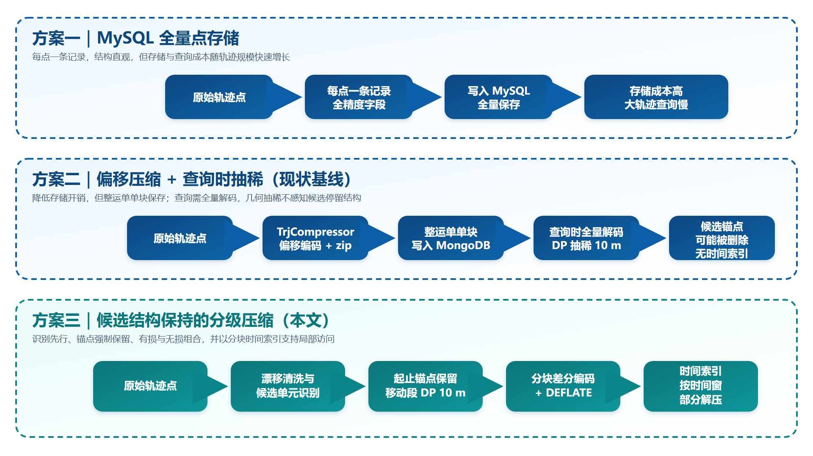
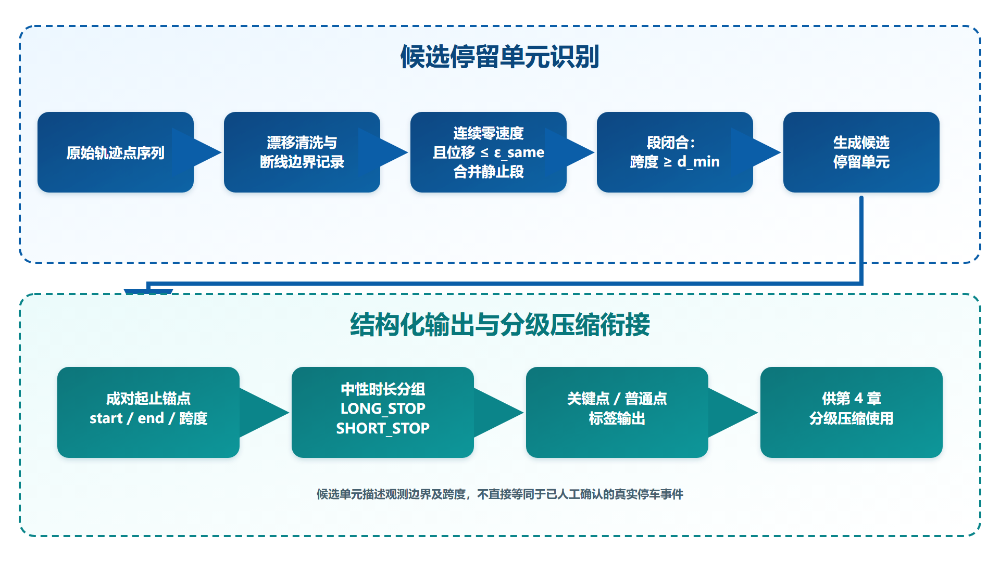
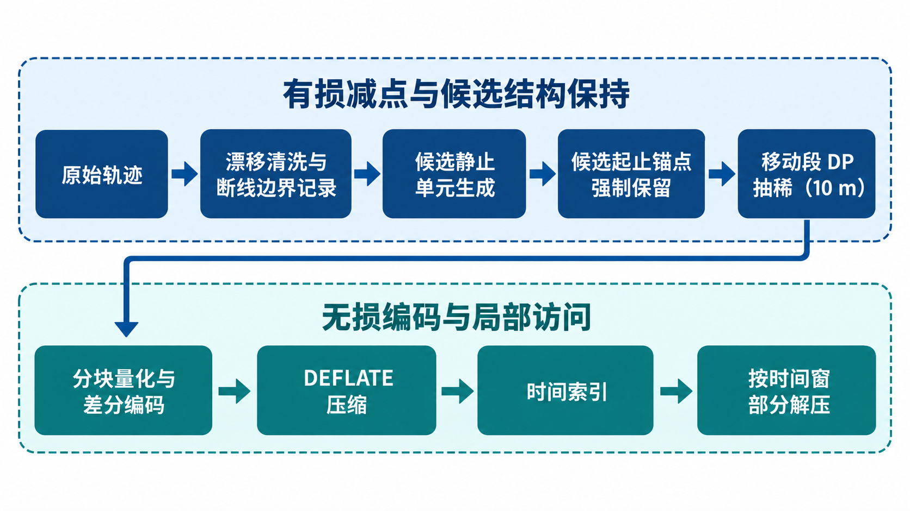
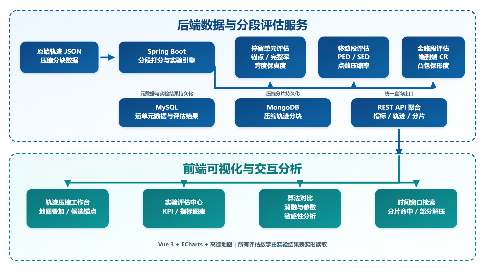

# 面向大宗物流轨迹的候选停留单元识别及分级压缩方法及系统实现

> 04版修订记录（2026-09-29）：本版采用本文、DP 和 TD-TR 三种方法的统一编码对照，集中重跑第 6 章主实验与补充实验；移除无独立人工真值支撑的模拟实验章节，保留候选结构内部保持与外部检测有效性的明确边界。图 5-1 已修正遮挡；文献综述增补采样间隔、标注验证和查询驱动简化研究。正文只使用不含可识别运单信息的系统结构图。

## 摘要

针对大宗物流轨迹数据全量存储导致的存储成本高、查询响应慢及几何压缩易破坏停留时间结构等问题，本文提出一种面向大宗物流的轨迹停留锚点保持与分级压缩方法，并实现配套原型系统。方法首先依据货车北斗终端采样特征，以“近同位置 + 速度为零”合并连续静止点，生成候选静态停留单元及成对起止锚点；继而对候选停留锚点强制保留、对移动段采用 Douglas-Peucker 抽稀，并对保留点序列进行分块偏移量变长编码，建立时间索引支持按时间窗部分解压。实验数据包含 5,224 条运单、4,374,309 个原始轨迹点，漂移清洗后为 4,280,695 点。方法共检测候选停留单元 56,521 个、关键锚点 120,980 个；对这些候选单元，压缩后全部锚点保留率为100%，含有效候选的单元完整率和候选边界观测跨度保持率由规则保证为100%。在本文、DP 和 TD-TR 叠加相同分块编码器的受控比较中，本文完整方案的全局编码负载压缩率为 16.33，低于无候选边界约束 DP 的 17.21，高于 TD-TR 的 13.30；轨迹约 60% 位置的 1 小时时间窗查询，逐运单平均命中约 17.8% 的编码负载。结果表明，本文方法的主要价值不是取得单一最高压缩率，而是在候选停留结构保持、几何误差、存储开销与局部访问能力之间形成面向物流回放场景的折中。停留检测本身尚缺少独立人工真值，其外部有效性仍需进一步验证。

**关键词**：大宗物流轨迹；候选停留单元；边界保持；分块压缩；时间窗查询

## Abstract

To reduce the storage and retrieval cost of bulk-logistics trajectories while preserving the temporal structure of stationary episodes, this paper proposes a stop-anchor-preserving hierarchical compression method and implements a prototype system. Based on the sampling characteristics of BeiDou vehicle terminals, the method merges consecutive zero-speed points at nearly identical locations into candidate stationary-stop units and represents each unit with paired start/end anchors. It then forcibly retains these anchors, applies Douglas-Peucker simplification to moving segments, encodes the retained points using block-wise differential variable-length coding, and builds a temporal index for partial decompression. The data set contains 5,224 waybills and 4,374,309 raw trajectory points, of which 4,280,695 remain after drift filtering. The method detects 56,521 candidate stop units and 120,980 key anchors; for these candidate units, all-anchor retention is 100%, while unit integrity and candidate-boundary span retention are 100% for trajectories with eligible candidate units by construction. In a controlled comparison where the proposed method, DP, and TD-TR all use the same block encoder, the proposed pipeline achieves a global encoded-payload compression ratio of 16.33, below unconstrained DP at 17.21 and above TD-TR at 13.30. For a one-hour window placed at about 60% of each trajectory, the mean fraction of encoded payload selected per waybill is 17.8%. The main contribution is therefore not a universally maximal compression ratio, but a practical trade-off among candidate-stop preservation, geometric error, storage cost, and local access. Independent human ground truth is not yet available for validating the stop detector itself.

**Keywords**: bulk-logistics trajectory; candidate stop unit; boundary preservation; block compression; time-window query

---

## 目录

1. 第 1 章 绪论
   1.1 研究背景与意义
   1.2 国内外研究现状
   1.3 研究内容
   1.4 论文组织结构
2. 第 2 章 相关理论与技术基础
   2.1 轨迹数据与存储演进
   2.2 时空数据挖掘与语义识别
   2.3 有损轨迹压缩理论
   2.4 无损压缩与熵编码理论
   2.5 面向查询的轨迹存储与部分解压
   2.6 本章小结
3. 第 3 章 物流轨迹静态停留识别
   3.1 概述与问题提出
   3.2 数据源采样规则与停留形态
   3.3 同坐标静止段合并算法
   3.4 选型论证：为何不采用围栏区分装卸货与 ST-DBSCAN 聚类
   3.5 复杂度分析与输出
   3.6 本章小结
4. 第 4 章 语义感知的分级压缩与无损编码方法
   4.1 分级压缩框架
   4.2 静止段锚点保真与移动段统一抽稀
   4.3 分块偏移量可变长无损编码器
   4.4 分块时间索引与部分解压
   4.5 本章小结
5. 第 5 章 轨迹压缩效果评估与可视化对比系统
   5.1 系统概述
   5.2 评估子系统设计
   5.3 可视化子系统设计
   5.4 评估流程
   5.5 本章小结
6. 第 6 章 实验与结果分析
   6.1 实验设计
   6.2 候选静止单元生成结果与分析
   6.3 层次一：有损抽稀与候选停留结构保持
   6.4 层次二：无损编码与分块索引
   6.5 层次三：完整组合方案端到端对比
   6.6 时间索引与部分解压实验
   6.7 消融与参数敏感性
   6.8 本章小结
7. 第 7 章 总结与展望
   7.1 研究工作总结
   7.2 主要创新点
   7.3 研究局限
   7.4 未来展望
参考文献

---

## 数据来源与脱敏说明

本文实验数据来源于网络货运平台大宗物流运单轨迹数据，由数据所属企业授权本课题研究使用。为扩大实验规模、覆盖更长的观测周期，实验集合并了两批企业导出数据（2025 年 4 月批次与 2026 年 8 月批次），统一坐标系与字段格式，并在合并阶段剔除点数少于 100 的噪声轨迹，最终纳入 **5,224 个运单、4,374,309 个原始轨迹点**（涉及云南、广西等地电煤、煤炭等大宗货物运输）。实验管线随后按 120 km/h 的相邻点推算速度阈值剔除 93,614 个漂移关联点，得到 **4,280,695 个清洗后轨迹点**；全文凡涉及停留识别、压缩率及误差评价，均以清洗后点列为算法输入，原始点数仅用于说明数据接收规模。正文实验表格只报告聚合统计；公开逐运单导出应去掉运单号、车牌号、司机信息与精确地址。原型系统内部仍可按原始运单检索，不能据此称数据库已匿名化。地图线路本身也可能构成再识别线索，因此旧业务轨迹截图不作为公开论文材料。论文送审与公开所需的数据使用及知识产权授权尚待正式书面确认，本文结论仅针对上述单一企业样本。

---


---

# 第 1 章 绪论

## 1.1 研究背景与意义

### 1.1.1 大宗物流轨迹数据的存储与查询挑战

近年来，车联网与物流信息平台的发展使货运车辆的 GPS 轨迹数据呈现爆发式增长。以大宗物流（煤炭、建材、大宗原材料等）运输企业为例，其运营系统每天需要采集海量定位点位。每个点位通常包含经纬度、速度、方向角、海拔、里程、上报时间等多维属性，构成以"轨迹—运单—车辆—电子围栏"为主线的关联数据体系。

早期系统的轨迹存储方案为**轨迹点位全量存储于关系型数据库**：每个点位对应一条数据记录，经纬度以全精度小数（最高 6–11 位）存储。该方案在数据量较小时简单可用，但随着业务增长暴露三方面问题：

1. **存储成本高**：点位级全量存储导致数据量随业务线性膨胀，存储与索引开销巨大；
2. **查询响应慢**：历史轨迹查询需在大表上扫描、跨表关联，响应时间从秒级到数十秒不等，影响前端展示体验；
3. **压缩处理与语义保真缺失**：传统压缩多基于几何信息，忽略装卸货、加油、休息等业务语义，压缩过程易丢失关键业务点。

上述问题在数据量达到 TB 级后尤为突出，已成为制约物流平台数据资产利用效率的核心瓶颈。

### 1.1.2 轨迹压缩研究的两难困境

轨迹压缩的根本目标是**在尽量小的存储/传输开销下，尽量保留轨迹的有效信息**。现有方法大体分为两类：

- **有损压缩（几何简化）**：如 Douglas-Peucker（DP）[1]、方向保持简化[2]、在线启发式 SQUISH[3] 等。这类方法可减少点数，但可能删除关键业务点；原始 SQUISH 不应与后续具有严格误差保证的变体混同。
- **编码压缩**：如 Trajic 的预测残差编码[4]与 Polyline Encoding。编码可在不同精度与残差处理策略下形成有损或无损表示；若要求精确还原，直接编码原始点通常不能利用允许删除的冗余点。

单一使用任一类方法，都无法同时满足大宗物流"高压缩率 + 业务语义保真 + 高效局部查询"的实际需求。

### 1.1.3 研究意义

**应用价值**：本研究直接源于企业物流轨迹数据治理中的真实挑战。在异常追踪、私停核查等场景中，“在哪一位置出现连续静止观测、其首尾观测跨度多长”具有分析价值。通过“候选静止单元生成 + 锚点约束抽稀 + 分块无损编码 + 时间索引部分解压”，可避免压缩阶段进一步删除已生成的候选边界，并降低存储与局部查询开销。候选单元是否对应真实停车仍需人工或独立业务记录核验。

**理论价值**：本研究把候选静止单元的成对边界作为显式压缩约束，并通过“分块独立编码 + 时间索引”研究候选结构保持、压缩率与局部查询能力之间的权衡，为面向查询的组合式轨迹压缩提供可复用的实验框架。

## 1.2 国内外研究现状

### 1.2.1 轨迹压缩算法研究

轨迹简化的早期主线是几何形态保持：DP 算法按最大垂距递归保点[1]，快速多边形近似与 DP 加速工作讨论计算成本[5][6]；Meratnia 等引入时间同步误差，为 TD-TR 一类方法提供依据[7]。方向保持简化研究关注航向失真[2][8]，在线算法则包括 SQUISH[3] 和单遍误差有界的 OPERB[9]；Trajic 采用预测残差编码[4]。这些方法的输入、误差承诺和输出表示不同，不能仅凭相同的数值阈值认定为同预算比较。Zhang 等对多种轨迹简化算法的实验研究指出质量评价应考虑查询用途[10]；Lin 等进一步比较了误差有界算法的压缩率、运行时间、数据老化与查询友好性[11]。国内方法评价和国际综述分别梳理了典型算法及在线/离线、误差约束和表示形式的区别[12][13]。

语义约束并非本文首先提出。Zhou 等将同步距离与信息熵结合评价时空语义相似性[14]；CADP 纳入环境和语义上下文[15]；DOTSSA 已把 stay areas 纳入在线简化[16]。这些工作直接限制了本文“语义感知压缩”的新颖性声明。本文所讨论的增量更窄：在大宗物流终端的零速与心跳采样条件下，输出带观测边界的候选单元，并检验其边界约束、压缩字节与局部查询成本。面向 AIS 的综述[17]和国内改进 DP 船舶轨迹研究[18]说明应用场景会影响算法选择；本文不将其结果直接外推到货车数据。

### 1.2.2 轨迹语义识别与停留点检测

停留识别可由时空聚类、距离—时长规则或车辆状态信号驱动。ST-DBSCAN 定义空间和时间邻域并通过密度扩展形成簇[19]；Zheng 等把 GPS 轨迹中的停留位置用于出行序列挖掘[20]；语义轨迹综述强调原始移动记录与解释性事件之间还存在标注与语境建模步骤[21]。在运输场景，集卡拖车研究利用轨迹几何特征识别语义停留点[22]。本文的零速近同位置合并是针对已知终端上报机制的候选生成规则，不应称为新的通用停留检测理论。两次近同位置上报之间的无观测时间只能形成候选跨度，不能证明车辆连续静止；Zheng 的轨迹挖掘综述[23]指出由位置记录到行为含义需要额外推断。Nishida 等研究了含离群点和缺失点的非规则停留区域提取[24]；STAGA 数据集提供带人工记录的停留与行程标注[25]，Kato 等进一步考察 GPS 上报间隔变化对停留检测评价的影响[26]。这些研究说明采样机制与独立真值会改变评估解释，但其人群移动数据不能直接充当本研究的货运真值。货运场景中，Yang 等结合重型货车 GPS、路网与 POI 推断城市货运行程端点[27]，体现了“候选停车”与“货运目的地事件”之间仍需业务上下文筛选。本文没有独立人工或车辆状态真值，也不能从候选数量推断识别优于 ST-DBSCAN。

### 1.2.3 面向查询的压缩轨迹存储与组织

压缩后的查询能力已有重要先例。TrajStore 研究轨迹数据的自适应存储[28]；PRESS 将路网轨迹的空间路径与时间表示拆开，并支持不完全解压的时空查询[29]；PPQ-Trajectory 用时空量化表示支持大规模轨迹库查询[30]；TrajCompressor 则利用路网匹配与车辆航向信息进行在线压缩[31]。轨迹数据管理综述也把预处理、存储和查询视作统一链路[32]。因此，分块或局部访问不是本文独有算法。本文采用不要求路网匹配的固定时间块，记录候选观测边界并提供点窗口与候选区间两种检索结果；与这些方法的表示前提不同，性能数字也不可直接横比。近年的查询驱动轨迹简化直接以查询准确度而非单一几何误差评价点集[33][34]；VRE 则在系统层面联合讨论存储组织、查询类型与运行成本[35]。因此，局部读取收益应同时报告负载字节、索引与候选元数据成本，且区分命中块解码与端到端数据库访问。本文尚未对查询结果准确度与物理数据库总占用给出同系统比较。

### 1.2.4 研究现状评述

已有研究分别提供了语义约束、候选停留、预测或路网压缩、可查询表示等成熟组件。本文的研究空白是更具体的工程与方法结合问题：在单一大宗物流企业数据及其心跳采样条件下，候选边界作为硬约束加入抽稀后，其字节成本、几何与时间误差、可恢复性和窗口访问成本如何变化。本文将“压缩内部保持”和“停留检测外部有效性”分开报告；前者可由原始轨迹与编码结果验证，后者需要独立真值，不能用压缩前候选作为自身真值。

## 1.3 研究内容

针对上述问题，本研究设计并实现一个集"语义识别—分级压缩—分块存储—可视化评估"于一体的物流轨迹压缩系统，主要研究内容如下：

**研究内容一：基于北斗采样规则的候选静止单元与分级模型。** 依据货车北斗终端采样特征，将连续近同位置零速度点合并为候选静止段，输出成对起止锚点与观测时间跨度，形成关键点/普通点标注，作为后续压缩输入；同时明确跨无观测间隔续接的不确定性。

**研究内容二：语义感知的分级压缩与无损编码方法。** 关键点强制保留、非关键段可调容差有损简化；对抽稀后点序列做分块偏移量可变长无损编码；建立"时间范围→块"索引实现按时间窗部分解压。

**研究内容三：轨迹压缩效果可视化评估与对比系统。** 构建基于 Web 的多算法并行对比与多维指标可视化平台。

## 1.4 论文组织结构

本文共七章，组织结构如下：第 1 章为绪论；第 2 章介绍相关理论与技术基础；第 3 章研究语义识别与分级模型；第 4 章研究语义感知分级压缩与无损编码方法（核心）；第 5 章介绍可视化评估与对比系统；第 6 章为实验与结果分析；第 7 章为总结与展望。

---


---

# 第 2 章 相关理论与技术基础

## 2.1 轨迹数据与存储演进

本节从企业轨迹存储的演进角度，梳理三套方案及其关系。三者对应论文叙事的"现状—问题—改进"主线。

### 2.1.1 方案一：轨迹点位全量存储（MySQL）

最初系统将每个轨迹点位作为一条记录存入 MySQL 关系库，经纬度以全精度小数存储。该方案直观、易查询，但存在存储成本高、查询慢、压缩缺失等问题（见 1.1.1）。

### 2.1.2 方案二：偏移量压缩 + 查询时抽稀（现状基线）

为降低存储，企业开发了偏移量压缩组件 `TrjCompressor`：将一条运单的轨迹点编码后压缩存入 MongoDB。该方案在存储上取得显著收益（存储大小下降约 38.5 倍、总占用空间下降约 52.6 倍、全量查询响应由秒级降至百毫秒级），但存在两大缺陷：

1. **关键轨迹点可能被稀释**：查询路径上的几何抽稀（固定 10 米阈值）不感知业务语义，可能删除装卸货等关键点；
2. **缺少时间索引**：整条运单存为单个压缩块，查询部分时间段需全量解码，无法部分解压。

### 2.1.3 方案三：语义感知分级压缩 + 分块时间索引（本研究）

在方案二基础上，本研究：先基于采样规则做静态停留识别（同坐标静止段合并、保留成对起止锚点）；将抽稀前移到压缩阶段并做语义感知分级（关键点强制保留）；对抽稀后点序列分块偏移量编码；建立时间索引实现按时间窗部分解压。图 2-1 给出三套方案流程对比。



**图 2-1 企业轨迹存储三套方案演进对比**

## 2.2 时空数据挖掘与语义识别

### 2.2.1 轨迹数据挖掘概述

轨迹数据挖掘 [23] 旨在从原始轨迹中发现行为模式与语义信息。本文采用“原始轨迹 → 静态候选单元生成 → 候选锚点标记”的处理流程，为分级压缩提供关键点标签；候选标记不等于经外部真值核验的行为语义。

### 2.2.2 数据源采样规则与静止段定义

货车北斗定位终端的上报行为由既定采样规则支配，并随终端工况变化：行驶/ACC 档约 30 s 上报一次，拔钥匙后进入心跳模式仍会以 5–6 min 为主的间隔上传定位点，直至小电瓶耗尽或断大闸后彻底停止，弱信号时段上报中断、信号恢复后按原始时间戳补传。这使得轨迹中的“停车”在数据上表现为同一位置上一段或密或疏的点序列，而“行驶”则必然伴随速度非零或位移变化。上述采样规则的完整归纳、实测统计及其对停留识别算法设计的含义见 3.2 节（表 3-1），此处仅作为相关理论背景，不再展开。

### 2.2.3 ST-DBSCAN 时空聚类（对比基线）

ST-DBSCAN [19] 扩展 DBSCAN 至时空域，同时考虑空间半径与时间阈值（本文比较参数为 epsM=50 m、epsTS=300 s、minPts=3），可发现时空邻近点簇。物流轨迹中，密集上报和稀疏心跳之间的大间隔会影响在这一组参数下形成的簇边界；不能据此断言真实长停留被漏检或时长被低估。本文在第 6 章将其作为输出特征对照，而不是具有外部真值的准确率基线。

### 2.2.4 电子围栏业务先验（对比基线）

物流企业掌握装卸货地点的电子围栏（多边形或圆心+半径）。早期方案曾设想将其作为区分装卸货段的强约束，将围栏内轨迹点直接标记为业务关键点。然而已有描述性统计中，收货地址坐标与轨迹末端附近候选静止位置的距离有 51% 超过 2 km（P95 为 22 km）。该对照位置并非人工确认的真实卸货点，不能据此断言围栏识别准确率；但地址坐标与候选位置不一致提示其不宜作为无条件强锚点。因此本文只把围栏重叠作为弱业务参照，不用作主候选生成规则。

## 2.3 有损轨迹压缩理论

### 2.3.1 Douglas-Peucker 算法

DP 算法 [1] 是经典线简化算法：在给定容差 ε 下，递归寻找偏离当前线段距离最大的点，若超过 ε 则保留该点并递归二分。本文非关键段的抽稀采用 DP 的工程实现 `GisDouglasUtil`，通过两点间大圆距离计算点到线段的垂直距离。

### 2.3.2 方向保持与误差有界算法

方向保持简化[2]以方向误差为目标；SQUISH[3]是在线简化启发式。本文以 DP 为基座，选择纯 DP 与以同步欧氏距离为分裂准则的 TD-TR 作为实测基线；方向保持方法与 SQUISH 仅作相关研究讨论。

## 2.4 无损压缩与熵编码理论

### 2.4.1 差分编码与 ZigZag

相邻 GPS 点经纬度差值远小于绝对值，用差值（偏移量）替代绝对值可显著降低取值范围。对可能为负的偏移量，采用 ZigZag 变换将负数映射为正整数（符号存于最低位），便于后续编码。

### 2.4.2 变长分片编码（类 Varint）

对量化后的整数偏移量，每 5 位取一个分片，末分片不设标记、非末分片置第 6 位作为"后续还有分片"的边界标记，再整体加 63 转为 ASCII 可打印字符。该编码可无歧义解码，且小偏移量占字节少。

### 2.4.3 熵编码二次压缩

对变长编码得到的 ASCII 序列再施以 zip（DEFLATE），利用大量重复字节进一步压缩。量化后的整数序列经“差分 → ZigZag → 5 位分片 → ASCII → zip”可逆；进入该链之前的浮点量化有损。单遍编解码复杂度 O(n)。

### 2.4.4 零阶经验熵参照

设 ZigZag 后的非负整数为 z。5 位分片以 32 为数值基数，字符数为 L(z)=1（z=0）或 ⌊log₃₂z⌋+1（z>0）；每个分片最终占一个 ASCII 字节，故编码长度为 8L(z) bit。第 6 章以各字段偏移量的零阶经验熵作参照，比较实际 DEFLATE 后字节率；该参照只对应独立符号模型，不能称为任意上下文编码器的普适下界。

## 2.5 面向查询的轨迹存储与部分解压

### 2.5.1 整块存储的问题

方案二将整条运单编码为单个 blob 存储。对"查询某运单某时间段的轨迹"这类局部查询，必须解码整条轨迹后过滤，存在 I/O 与 CPU 浪费，且无法并行处理。

### 2.5.2 分块独立编码

将抽稀后的点序列按固定时间窗切块，每块以块首点为基准、块内点存相对偏移，每块独立编码、可独立解压。块首点作为锚点保证编解码一致性。

### 2.5.3 时间索引与部分解压

建立稀疏时间索引（运单号、块号、起止时间、点数、字节偏移、长度、是否含关键点）。查询某时间窗时，仅读取并解压命中块；边界块只取窗内点。块长是压缩率与局部查询粒度间的权衡参数。

## 2.6 本章小结

本章从轨迹存储演进出发，梳理了"MySQL 全量 → 偏移量压缩+查询时抽稀 → 语义感知分级压缩+分块时间索引"三套方案，介绍了货车北斗终端的采样规则与静止段定义、语义识别（ST-DBSCAN、电子围栏作为对比基线）、有损压缩（DP 等）、无损编码（差分、ZigZag、变长分片、熵编码）与分块部分解压相关的理论基础，为后续章节的方法设计提供支撑。

---


---

# 第 3 章 物流轨迹静态停留识别


---

## 3.1 概述与问题提出

本章解决“什么该保”的问题——在压缩之前，从原始轨迹中生成可能具有业务价值的候选停留单元，为后续分级压缩（第 4 章）提供强制保留的锚点。

### 3.1.1 问题的提出

物流轨迹的价值不仅在于“车辆走过哪些路”，还在于其可能反映装货、卸货、途中休息和交通停驻等业务过程。这些过程常伴随车辆在局部空间范围内保持静止，但仅凭轨迹形态不能直接判定具体事件类别。因此，本文首先检测**候选静态停留**，其目标是提取“近同位置上的观测时间跨度”，而不是直接识别装卸货、加油或休息等真实业务事件 [23][20]。

在传统轨迹压缩中，停留段是最具挑战性的部分：

- 停留簇的点在空间上**近乎重合**，几何简化算法（如 Douglas-Peucker）会因点间距离极小而大量删除；
- 更关键的是，几何算法**不理解停留的语义结构**——它只保留几何上"重要"的点（如偏离直线最远的拐点），而停留簇的几何特征恰恰是"没有拐点"，因此往往只保留簇的两端或一个孤立点；
- 结果：**"车辆在此停留 20 分钟加油"和"车辆瞬时经过此处"在压缩后无法区分**，停留时长这一关键业务语义丢失。

对大宗物流企业而言，轨迹回放重点关注“**候选停留出现在哪里、两个静止观测边界相隔多久**”，而非停留期间的点位密度。因此，压缩前需要把候选静止点序列作为一个结构单元提取出来，而不能只保留孤立单点。需要强调的是，在长时间无观测的区间内，仅凭首尾同位置点无法排除车辆离开后返回等情况；本文恢复的是观测边界定义的时间跨度，其物理真实性仍需独立标注或业务记录验证。

### 3.1.2 本章思路

本文提出“**候选停留单元**”的概念，将关键点处理从“识别单点”扩展为“**候选停留单元（开始点 + 结束点成对）**”。每个单元携带起、终两个锚点的时间戳，使压缩后能够恢复该候选静止段的观测起止时刻与时间跨度；锚点本身不提供无观测区间内车辆状态的直接证据。

识别依据来自企业数据源确认的北斗车载终端采样规则。本文将“连续零速度且近同位置”作为候选静态停留的可观测判据：在有点上报的区间内，静止点应保持在 GPS 漂移容忍范围内；出现 spd>0 或明显位移时则闭合当前候选段。据此，本文采用**近同位置静止段合并**作为主方法：

- 依据实测数据归纳北斗终端采样规则与停留形态（3.2 节）；
- 以同坐标容差 ε_same 合并"spd=0 且位移极小"的连续点，跨大间隔（心跳点/补传点）合并为静止段，段闭合生成停留单元（3.3 节）；
- 从收货地址围栏与候选位置的偏差、当前聚类参数下的输出差异及参数耦合三个角度说明不采用“围栏区分装卸货 + ST-DBSCAN 聚类”作为主候选生成规则（3.4 节）。

本章整体框架如图 3-1 所示。



**图 3-1 语义识别总体框架**

### 3.1.3 符号与停留单元定义

一条运单的原始轨迹为有序点序列：


**公式：** T = {p_1, p_2, …, p_n}；p_i = (lat_i, lon_i, t_i, spd_i, f_i)


其中 lat_i, lon_i 为经纬度，t_i 为时间戳，spd_i 为终端上报速度，f_i 为其他辅助属性（方向角、海拔、状态字等，若可获取）。

**定义 3-1（静止段）** 轨迹 T 的一个子序列 p_a, p_b, …, p_c，若其任意相邻两点速度均为零（spd = 0）且空间位移不超过同坐标容差 ε_same，即


**公式：** 对任意 i ∈ [a+1, c]，spd_(i−1) = spd_i = 0，且 dist(p_(i−1), p_i) ≤ ε_same


则称该子序列为一个静止段（候选停留段）。

**定义 3-2（候选停留单元）** 由时间跨度满足 Δ t = t_c - t_a ≥ D_min 的静止段抽象出的结构对象：


**公式：** S = (p_start, p_end, Δt, ℓ)


其中 p_start 为开始点、p_end 为结束点、Δ t=t_end-t_start 为观测时间跨度，ℓ∈LONG_STOP,SHORT_STOP 为中性时长分组标签。既有实现中的 REST/TRAFFIC 在论文展示层统一映射为 LONG_STOP/SHORT_STOP，不再把时长阈值解释为休息或交通拥堵事件。

### 3.1.4 为什么是"开始/结束点成对"

停留单元的语义信息主要包含两点：

1. **出现了符合规则的候选静态观测**（空间证据）；
2. **首末观测边界相隔多久**（时间证据，Δ t）。

其中时间跨度必须由两个时间戳才能表达。若只保留候选静止段中的任意一个点，则 t_start 与 t_end 无法同时恢复。因此：

- **开始点 p_start**：候选单元的首个观测点；
- **结束点 p_end**：候选单元的末个观测点；
- 二者**成对保留**，是压缩时不可删除的锚点（见第 4 章 4.2）；
- 停留段中间的点因空间近似重合，对几何贡献极小，可不参与压缩（见 3.3.3）。

这一“成对锚点”设计将候选静止段的观测时间跨度物化为两个时间戳。只要锚点成对保留，候选单元的观测边界即可无损恢复。第 6 章分别评价停留检测结果与压缩保持结果：100% 锚点保持是算法约束产生的内部一致性结果，不等同于停留检测相对于真实车辆状态的准确率。

### 3.1.5 停留时长下限

为避免把"短暂减速"或"等红灯"误判为业务停留，设置最短停留时长 D_min。静止段时长小于 D_min 的，**降级为普通点**，不构成停留单元。默认 D_min = 3\ min（180 s，可配置，见 3.3.1）。


---

## 3.2 数据源采样规则与停留形态

停留识别方法的设计必须从数据本身的产生机制出发。本节归纳企业北斗车载终端的采样规则，并结合全量实测数据给出停留的形态特征，为 3.3 节算法提供依据。

### 3.2.1 北斗终端采样规则

企业授权的大宗物流轨迹数据来自货车北斗终端。经向数据源方确认，终端在不同工况下的上报行为如表 3-1 所示。

| 场景 | 上报行为 |
|---|---|
| 行驶中 / ACC 档（通电未打火） | 30 秒上报一次定位 |
| 拔钥匙 / 司机离开驾驶舱 | 进入心跳模式，心跳点仍会上传轨迹数据（低频点位） |
| 心跳点实测间隔 | 以 5–6 min 为主（全数据 300 s~1 h 心跳点共 1396 个，其中 5–6 min 档 1268 个），与标称 10 min 有出入，以实测为准 |
| 小电瓶维持时间 | 约 2–5 小时（期间心跳点照常上传，之后静默） |
| 断大闸（总电源断开） | 彻底失联，无任何上报 |
| 弱信号（隧道/山区/地库） | 上报中断，信号恢复后按原始时间戳补传 |

**表 3-1 北斗终端采样规则**

表3-1表明终端可在低频模式下继续上报近同位置点。因此候选生成需要允许跨分钟级大间隔连接观测边界；小时级无观测区间的真实运动状态无法由此确定，不能直接归并为同一次真实停车。

### 3.2.2 实测数据事实

在本批 5,224 个运单的 4,374,309 个原始定位点上，先按 120 km/h 相邻点推算速度阈值执行漂移剔除，删除 93,614 个与异常高速边关联的点，形成 4,280,695 个清洗后定位点。以下停留形态统计以清洗后点列为基础；原始点数用于说明数据接收规模。

1. **采样间隔**：平均 45.0 s、中位 30 s；主档位 15 s / 30 s，两档合计约 58.3%（行驶段以 30 s 为主）。
2. **候选判据的描述性统计**：经纬度完全相等的相邻点对仅占2.5%，但“前点 spd=0 且位移≤10 m”的相邻点对占42.8%；严格同坐标点对中97.4%的前点 spd=0。该统计说明严格坐标相等过窄，支持采用10 m容差生成候选；它不构成真实停车的准确率或概率估计。实际算法还要求相邻两点速度均为零。
3. **静止段形态**：按"连续点 spd=0 且位移 ≤10 m"合并，共得静止段 98,142 段；段内点数中位 6 个、P90 35 个；段时长中位 249 s、P90 2,342 s、最长 212.0 h；段时长 <1 min 占 22.9%、3–10 min 占 32.8%、>30 min 占 12.2%。
4. **长间隔观测**：间隔>10 min的点对7,928个（0.18%），其中80.5%前后点 spd=0且位移≤100 m；该现象与停车后低频上报相容，但无法排除信号丢失、离开后返回等原因。
5. **心跳点证据**：静止段内部间隔落在 300 s~1 h 的点对共 137,871 个，其中 **5–6 min 档 129,211 个（93.7%）**——心跳点确实以 5–6 min 为主进入轨迹数据，与 3.2.1 的采样规则相符（与标称 10 min 不符，论文以实测为准），也说明停留识别必须能够跨越该量级的大间隔。
6. **覆盖率**：99.9%（5,218/5,224）的运单至少含 1 个静止段，每运单段数中位 17 段。

### 3.2.3 停留的物理形态

上述事实支持一个可操作的候选定义：若连续观测点速度为零且相邻位移足够小，记录其首末观测跨度。该规则不能保证未观测时间内始终静止，也不能保证整段点集的空间直径不超过相邻点阈值。示意形态如下：

```
样例A(短停):  spd=0 同坐标 +15s, +4s, +299s(心跳), +854s(心跳) → 起步
样例B(过夜):  30s×4 个同坐标点(ACC段) → 静默3.9h → 1个同坐标心跳点(小电瓶) → 静默1.4h → 起步
```

两个样例揭示两个对算法设计有决定意义的性质：

- **密集段往往只有几十秒**：候选长停的密集簇常只有 4 个点左右（≈90 s），其后可能由稀疏心跳点续接。若只使用密集簇跨度，可能把长时间同位置观测拆成短段；反之，跨无观测间隔续接也可能把离开后返回误并，因此只能作为候选生成规则；
- **大间隔可形成候选**：样例B中3.9 h与1.4 h静默段两端仍为近同位置零速度观测，规则可连接为一个候选单元；是否为同一次真实停车需要外部证据。

这两点是3.3节候选合并规则的设计依据；其与 ST-DBSCAN 的输出差异见3.4节，不能据此认定后者检测失效。


---

## 3.3 同坐标静止段合并算法

### 3.3.1 算法参数

同坐标静止段合并方法仅需三个物理意义明确的参数，均可在工程中直接配置：

| 参数 | 含义 | 默认值 |
|---|---|---|
| ε_same | 同坐标容差（GPS 漂移容忍），两点位移不超过此值视为"同一位置" | 10 m |
| d_minS | 最短停留时长（即 D_min），静止段时长不小于此值才生成停留单元 | 180 s（3 min） |
| T_long | 候选长/短停分组阈值 | 1800 s（30 min） |

**表 3-2 同坐标静止段合并参数**

三个参数依据数据分布与业务经验设置：ε_same 对应 GPS 漂移量级；d_min 用于滤除极短候选段；T_long 只作观测跨度分组，不直接判定休息或交通拥堵。参数外部有效性仍需标注集验证。

### 3.3.2 合并过程

漂移清洗首先剔除异常点，并在相邻点时间差大于 600 s 处记录连续子段边界；该边界用于后续 DP 抽稀，避免跨断线区间进行几何插值。停留识别随后在完整清洗点列上按时间升序单遍扫描，因而 600 s 子段边界本身不阻断近同位置零速度点的候选合并。扫描过程维护当前候选静止段起点 start：对相邻点对 (p_i-1, p_i)，若两点速度均为零且位移不超过 ε_same，则继续当前段；否则闭合 [start,i-1] 并令 start=i。形式化如下。

**算法 3-1：同坐标静止段合并**

```
输入：清洗后轨迹点 pts（时间升序），参数 ε_same, d_min, T_long
输出：停留单元集合 S = {S_1, ..., S_m}

1  start ← 0；S ← ∅
2  for i = 1 .. n-1：
3      sameStationary ← spd(pts[i]) == 0 且 spd(pts[i-1]) == 0
4                       且 dist(pts[i-1], pts[i]) ≤ ε_same
5      if sameStationary == false：
6          if i-1 > start 且 time(pts[i-1])-time(pts[start]) ≥ dMinS：
7              S ← S ∪ { 生成StopUnit(pts, start, i-1) }
8          start ← i
9  if n-1 > start 且 time(pts[n-1])-time(pts[start]) ≥ dMinS：
10     S ← S ∪ { 生成StopUnit(pts, start, n-1) }
11 return S
```

### 3.3.3 段闭合与停留单元生成

段闭合时（算法 3-1 第 7、10 行）按下述规则判定并生成停留单元：

- **闭合条件**：段长 > 1（至少两个点）且段时长 Δ t = t_end - t_start ≥ d_minS；
- **类别标注**：


**公式：** 当 Δt ≥ T_long 时，ℓ = LONG_STOP；否则，ℓ = SHORT_STOP


- **锚点保留**：该段**只保留 start、end 两个锚点**（startIdx、endIdx 下标对应的首尾点），段内其余点不参与压缩。

其中“只保留起止锚点”是压缩联动设计：候选段内部点在空间上近重合，对轨迹形状贡献较小；成对时间戳足以恢复压缩前候选单元的首尾观测跨度。因此内部点删除不会破坏本文定义的候选边界结构，但可能丢失段内采样密度和微小漂移等信息。Δ t 按首尾点时间差计算，是观测边界跨度，不是经人工真值确认的实际停车时长。

### 3.3.4 跨大间隔合并及其适用边界

算法 3-1 具有两个对停留识别至关重要的性质：

1. **跨大间隔形成候选单元**：合并条件只检查“相邻观测点速度为零且位移 ≤ ε_same”，不设置额外时间上限。漂移清洗阶段虽然在间隔大于 600 s 处生成连续子段边界，但实现中的停留合并仍扫描完整清洗点列；因此相隔 >300 s 乃至数小时的近同位置零速度观测点可以进入同一候选单元，Δ t 按首尾观测时间差计算。
2. **有观测行驶点时及时切断**：若相邻观测中出现 spd>0 或位移超过 ε_same 的点，算法立即闭合当前候选段，避免把已观测到的行驶过程合并进静止段。

上述机制能够续接稀疏心跳观测，但不能证明无观测间隔内车辆始终静止。若车辆在断线上报期间离开后返回近同位置，算法仍可能误合并。此外，当前判据约束相邻点距离而非整段最大直径，连续小位移可能产生链式漂移。本文因此将输出称为“候选停留单元”，并在 7.3 节把无观测状态与链式漂移列为局限；严格识别精度需要由独立人工标注或外部车辆状态记录评价。


---

## 3.4 为何不采用围栏区分装卸货 + ST-DBSCAN 聚类（选型论证）

在方法设计初期，本文曾考虑以"电子围栏强匹配锁定装卸货 → ST-DBSCAN 时空聚类发现其余停留 → 运动学阈值精修边界"的多层路线作为主识别。但实测数据与原型对照表明，该路线在企业数据上存在三处结构性缺陷，故仅将其降为对比基线（第 2 章理论背景 + 第 6 章选型对比实验），主方法收敛为 3.3 节的静态合并。

### 3.4.1 收货地址围栏与候选位置的偏差

围栏匹配依赖“收货地址坐标 → 实际卸货位置”的准确对应。现有轨迹描述性统计中，收货地址到轨迹末端附近**候选静止位置**的距离有 51% 超过 2 km，P95 为 22 km。候选位置不等于已确认的卸货地点，该统计只能证明地址坐标与候选位置存在明显偏差，不能直接得出围栏真实识别率或“大面积失效”的结论。由于缺少真实卸货位置标注，本研究不把收货地址围栏当作主候选生成的强约束。

### 3.4.2 ST-DBSCAN 与静态合并的输出差异

ST-DBSCAN [19] 同时以空间邻域 ε 与时间邻域 ε_t 定义点的邻域，其连通性要求邻域内点对在 ε_t 时间内相邻。当 ε_t = 300 s 时，稀疏心跳点（间隔 5–6 min 乃至数小时）**连不上**前序密集点，成为噪声点，导致：

- **候选跨度差异**：当密集点后接稀疏心跳点时，所选 ε_t=300 s 的 ST-DBSCAN 可能只输出短时簇；静态合并规则可跨较大间隔连接近同位置零速度观测。该差异不能证明长间隔内真实持续停车，也不能据此断言 ST-DBSCAN 漏检。
- **候选类型差异**：ST-DBSCAN 额外输出的部分簇含 0~11 km/h 的低速点，静态合并则只关注零速度近同位置序列。两种输出反映不同规则，业务价值需要独立标注或场景验证。

### 3.4.3 装卸货内事件锚点多阈值耦合难标定

若进一步在装卸货段内做“角度 + 距离 + 累计时间”的事件锚点细分，需引入多个互相耦合的阈值。这些阈值缺乏独立真值支撑，难以可靠标定。本文候选生成使用三个参数（ε_same、d_min、T_long），其敏感性与适用边界在第 6 章报告。

### 3.4.4 实测对比

在同一批 5,224 个运单上，用工程原型对静态合并（本文方法）与 ST-DBSCAN（epsM = 50 m / epsTS = 300 s / minPts = 3）做对照，结果如表 3-3 所示。

**表 3-3 静态合并 vs ST-DBSCAN 停留识别对比（5,224 运单）**

| 指标 | 静态合并（本文方法） | ST-DBSCAN |
|---|---|---|
| 停留单元总数 | **56,521** | 45,018 |
| 长停（>30 min） | **11,986** | 11,731 |
| 时长中位 / 最大 | 540 s / **212.0 h** | 635 s / 40.7 h |
| 与围栏装卸货单元时间重叠数 | 2,073 | 2,494 |
| 交集 / 仅静态 / 仅 ST-DBSCAN | 36,359 / **20,162** / 8,659 | — |

表3-3显示：静态合并比 ST-DBSCAN **多输出11,503个候选单元（+25.6%）**，仅静态合并输出20,162个，仅 ST-DBSCAN 输出8,659个；最大候选观测跨度分别为212.0 h与40.7 h。前者只表示规则跨心跳间隔连接了两个近同位置观测边界，长间隔内车辆状态未知。长跨度候选数量两者接近（11,986 vs 11,731），且与围栏装卸货单元的时间重叠数 ST-DBSCAN 略高（2,494 vs 2,073）。围栏本身是弱参照；没有人工标注真值，不能由输出数量、最长跨度或围栏重叠数推断哪种方法的检测准确率更高。

本文选择静态同坐标合并作为候选生成规则，理由是其输出边界便于后续压缩保持且参数较少；其外部检测有效性仍待独立标注验证。


---

## 3.5 复杂度分析与输出

### 3.5.1 复杂度分析

算法 3-1 对按时间排序的轨迹做**单遍扫描**，每个点只与相邻点比较并至多触发一次段闭合，因此识别扫描为 O(n)，除输出外只维护当前段的常数状态。ST-DBSCAN 需要邻域查询与簇扩展，其实际复杂度取决于索引、邻域规模及实现，不能统一写成 O(n log n)。两种方法的计算目标不同；本文仅据此说明规则扫描的实现开销较低，不从复杂度推断检测质量。

### 3.5.2 输出结构

每条运单轨迹经算法 3-1 处理后，输出：

1. **候选单元集合** S=S_1,S_2,…,S_m，每个单元携带成对锚点 (p_start,p_end)、观测跨度 Δ t 与中性类别 ℓ∈LONG_STOP,SHORT_STOP；
2. **关键点/普通点标注**：
   - **关键锚点**：所有停留单元的 p_start, p_end（每个单元 2 个，成对保留）；
   - **普通点**：其余点（含被剔除的静止段内部点与纯移动段点），可在分级压缩中按更大容差抽稀。

据此，原始轨迹被划分为两类区段：

- **停留段（关键段）**：仅保留起止锚点，强制保留、不做有损简化；
- **移动段（非关键段）**：统一以 DP 容差做有损简化。

这一划分直接为第 4 章"语义感知分级压缩"提供输入。


---

## 3.6 本章小结

本章从企业北斗终端的采样规则出发，把“相邻近同位置且均为零速的观测”定义为候选静止证据，并将候选生成收敛为**近同位置静止段合并**规则；该定义不证明未观测区间内始终停车：

- 以 ε_same = 10 m 同坐标容差合并"spd=0 且位移极小"的连续点，跨大间隔（心跳/补传点）合并为静止段，段时长按首尾点时间差计；
- 段闭合（段长 >1 且观测跨度不小于 d_min=180 s）生成候选单元，类别按 T_long=1800 s 分为 LONG_STOP / SHORT_STOP；
- 每个停留单元**只保留 start/end 成对锚点**，内部点不参与压缩，从而把"停留时长"这一业务语义物化为两个时间戳，保证压缩后仍可无损恢复；
- 从收货地址围栏偏差、当前 ST-DBSCAN 参数下候选簇与心跳间隔的关系、以及参数和工程复杂度三个角度说明主规则的选择；两法检测质量仍需外部标注比较。

本章输出的停留单元集合与关键/普通点标签，是第 4 章语义感知分级压缩的直接输入。第 4 章将介绍如何将成对锚点嵌入压缩流程，并设计移动段的有损简化与分块无损编码。

---


---


---

# 第 4 章 语义感知的分级压缩与无损编码方法


---

## 4.1 分级压缩框架

### 4.1.1 问题定义

第 3 章已将轨迹划分为**静止段**（停留单元所在区段）与**移动路段**（纯行驶区段），并输出成对的开始/结束锚点。本章在此基础上设计压缩方法，需同时满足三个目标：

1. **高压缩率**：在存储空间上取得显著收益；
2. **候选结构保持**：规则生成的候选起止锚点及其观测跨度不被压缩阶段删除；该目标不等同于真实停车事件识别正确；
3. **可检索**：压缩后的轨迹支持按时间窗的部分解压，而不是每次全量解码。

### 4.1.2 总体流程

本章方法采用"**有损抽稀（减点数）→ 无损编码（减字节）→ 分块存储（可检索）**"三段式流水线：



**图 4-1 候选锚点保持的分级轨迹压缩总体流程**

- **有损层（4.2）**：以第 3 章停留单元锚点为输入，静止段只保留起止锚点、移动段统一 DP 抽稀，压缩点数量；
- **无损层（4.3）**：对抽稀后的点序列做分块偏移量可变长编码 + zip，压缩每点字节数；
- **存储层（4.4）**：每块独立编码，建立时间索引，支持按时间窗部分解压。

### 4.1.3 压缩率口径

本文分别报告点数压缩率、编码层字节比和端到端编码负载字节比：

- **有损层压缩率**（减点数）：CR_lossy = N_clean / N_kept，即清洗后点数 / 抽稀后保留点数；
- **无损层压缩率**（减每点字节数）：CR_lossless = B_naive / B_zipped，即保留点规范文本字节数 / 编码存储字节数；
- **端到端编码负载压缩率（主指标）**：CR_e2e = B_clean,text / B_payload；跨运单汇总使用 ΣB_clean,text / ΣB_payload。
- **内部组合量**：CR_total = CR_lossy × CR_lossless，仅用于分层诊断。

其中 N_clean 为清洗后点数、N_kept 为抽稀后保留点数；B_clean,text 与 B_naive 分别为完整清洗点列和保留点列按相同规则序列化的规范文本字节数，B_payload 为分块偏移量编码 + DEFLATE 的负载字节数。该负载不含数据库文档与索引开销。

> 当完整点列与保留点列的平均文本字节/点不相等时，CR_lossy × CR_lossless 不等于 CR_e2e。两者关系为 CR_e2e = CR_total × (B_clean,text/N_clean) / (B_naive/N_kept)。旧批次全局端到端字节比约16.33，全局分层乘积约16.48，不能以四舍五入解释其差异。

## 4.2 静止段锚点保真与移动段统一抽稀

### 4.2.1 压缩策略的两级划分

第 3 章输出的候选单元由成对的首末静止观测锚点（p_start, p_end）标识。单元只要求相邻点位移不超过 ε_same，并不要求整个单元严格同坐标或保持在同一半径内。据此，本文将轨迹划分为两类区段并施以不同压缩策略：

1. **候选静止段内部**：只保留首末两个锚点，**内部不执行 DP**。这样能精确保留压缩前候选的首末观测时间差 Δt，但会删除段内采样密度与微小空间漂移；跨无观测间隔的 Δt 不是经验证的实际停车时长。链式近同位置位移还可能累积，因此不能把该策略称为空间无损；
2. **移动路段（相邻停留单元之间）**：统一用 Douglas-Peucker 抽稀 [1]，容差 ε_move（04版主实验为 10 m）。移动段是压缩收益的主要来源——高速/直线段几何冗余大，抽稀充分。

据此，压缩策略**收敛为两级处理**：静止段锚点保真 / 移动段有损抽稀。不再沿用"关键段细容差 / 非关键段粗容差"的双容差分级——静止段的保真由"锚点强制保留 + 内部点全部丢弃"这一离散操作保证，而非靠更小的容差逼近；移动段统一单一容差即可，避免了多容差参数难以标定的问题。

### 4.2.2 锚点保真的抽稀算法

以 Douglas-Peucker 抽稀为基础，扩展为"**带锚点的抽稀**"：将第 3 章输出的停留单元开始/结束锚点设为**禁删点**，作为线段划分的固定锚点，仅对移动路段执行 DP 抽稀；静止段内部点直接丢弃，不进入 DP。

**算法 4-1：静止段锚点保真 + 移动段统一 DP 抽稀**

```
输入：清洗后轨迹点序列 T（时间升序），停留单元集合 S = {S_j = (p_start, p_end, Δt, ℓ)}
     移动段容差 ε_move（默认 10 m）
输出：抽稀后保留点序列 T'
1  构造锚点集合 A ← {所有 S_j 的 p_start, p_end} ∪ {轨迹起止点 p_1, p_n}
2  按时间序，用 A 将 T 划分为交替的静止段与移动路段：
3      静止段 I_j ← [p_start, p_end]（第 j 个停留单元内部）
4      移动路段 M_k ← 相邻两个锚点之间的纯行驶子段
5  T' ← {轨迹起止点}
6  for each 静止段 I_j：
7      T' ← T' ∪ {p_start, p_end}         // 内部同坐标点不参与 DP，直接丢弃
8  for each 移动路段 M_k：
9      T' ← T' ∪ DP(M_k, ε_move)          // 统一容差 DP 抽稀
10 return 按时间序拼接去重后的 T'
```

### 4.2.3 两级处理的差异化效果

**表 4-1 静止段与移动路段的差异化处理**

| 区段 | 锚点 | 压缩策略 | 效果 |
|---|---|---|---|
| 候选静态段内部 | start/end **强制保留** | 内部点全丢，不跑 DP | 保持候选首末观测边界及跨度；不保证内部形状或真实停车时长 |
| 移动路段 | 两端为相邻锚点 | 统一 DP（ε_move=10 m） | 减少保留点，几何误差按PED/SED实测报告 |
| 轨迹起止点 | 强制保留 | — | 保证轨迹整体连通 |

### 4.2.4 为什么能保持"停留时长"

停留单元 S_j 的时长 Δ t = t_end - t_start。由于 p_start, p_end 被强制保留，压缩后仍可从这两个锚点的时间戳恢复 Δ t。这正是"关键点从单点升级为成对锚点"的意义所在：**保留的是时间证据，而不仅仅是空间点**。

删除候选内部点后，成对锚点的时间戳仍可精确恢复**压缩前规则定义的首末静止观测跨度**；它不一定是车辆实际停车的起止时刻。内部点可能分布在非零空间范围内，删除后可能产生几何误差和采样信息损失。本文能够严格保证的是候选边界成对保留，而不是空间形状或外部停车事件的完全保真（见 4.2.5）。

### 4.2.5 与固定阈值抽稀的对比

现状方案（方案 A）在查询时对全量点做固定 10 m 的 DP 抽稀。几何 DP 只按偏离近似线段的距离判断重要性；近同位置零速点通常提供较少几何增益，故部分候选的成对边界可能被删除。它并非必然将每段都压到仅剩 1 点，实际保持率由第 6 章实测给出：

- **停留时长不可恢复**：只剩单点后，t_start 与 t_end 同时丢失，无法知道"停了多少久"；
- **"停留"与"路过"无法区分**：压缩后"在此停留 30 分钟加油"与"瞬时经过此地"在点序列上无法分辨，关键业务语义被破坏。

这一差异是本文方法的核心设计之一：几何抽稀从空间误差出发，近重合点最容易被删除；本文则把规则生成的候选边界作为禁删点。第 6 章量化同压缩率下候选锚点与候选单元结构保持率的差距。该实验评价的是压缩保持性，不评价候选检测正确性。

## 4.3 分块偏移量可变长无损编码器

### 4.3.1 编码总体结构

对抽稀后的点序列，先**分块**，再对每块做"量化 → 差分偏移 → ZigZag → 5 位分片变长编码 → ASCII → zip"的编码。分块与编码的详细设计如下。

### 4.3.2 分块策略

将抽稀后的点序列按**固定时间窗**切块（块长参数化，本文默认 1 h/块）。每块满足：

- **块首点存绝对坐标**，作为该块锚点；
- **块内点存相对前一点的偏移**（差分）；
- 每块**独立编码、独立可解压**；
- 关键锚点（停留单元 start/end）所在块标记为"含关键锚点"，确保解压后仍可获得锚点。

### 4.3.3 字段量化与精度

轨迹点 p_i 的每个数值属性 x_i（经纬度、海拔、速度等）先量化：


**公式：** v_i = round(x_i × 10^p)


其中 p 为保留小数位数（默认 6）。量化后 v_i 为整数，在统一坐标系下（经纬度单位一致）进行差分。坐标量化误差随 p 变化，取 p=6 时最大约 0.08 m，远小于 GPS 定位噪声与移动段抽稀容差（实测见 6.4.3）。

### 4.3.4 差分偏移与 ZigZag

相邻点同一属性的偏移量为：


**公式：** Δ_i = v_i − v_(i−1)


对可能为负的偏移量做 ZigZag 变换，映射为非负整数：


**公式：** 估计偏移量 Δ̂_i：当 Δ_i ≥ 0 时取 2Δ_i；当 Δ_i < 0 时取 −2Δ_i − 1


ZigZag 将符号信息存于最低位，负值不再占用符号位，小绝对值偏移量编码更紧凑。

### 4.3.5 5 位分片变长编码（类 Varint）

对 Δ̂_i 按每 5 位取一个分片，从低位到高位；非末分片在第 6 位置 1（`0x20`）作为"后续还有分片"的边界标记，末分片不置位：

```
while (ẟ >= 0x20) { 输出 ((0x20 | (ẟ & 0x1f))) + 63; ẟ >>= 5; }
输出 (ẟ + 63)
```

- 加 63 转为 ASCII 可打印字符，产生大量重复字节，便于后续熵编码；
- 边界标记保证**解码无歧义**：解码循环以"字节值 − 63 ≥ 0x20"判断是否还有分片。

**算法 4-2：块内偏移量编码（对应 TrjCompressor.write）**

```
输入：块内量化值序列 [v_0, v_1, ..., v_m]（多字段按点序交错）
输出：ASCII 字符串 out
1  for each 字段 f：
2      prev ← 默认值(0)
3  for i ← 0 .. m：
4      for each 字段 f：
5          offset ← v_i[f] − prev[f]
6          prev[f] ← v_i[f]
7          offset ← ZigZag(offset)
8          while offset ≥ 0x20：out += char((0x20 | (offset & 0x1f)) + 63); offset >>= 5
9          out += char(offset + 63)
10 return out
```

### 4.3.6 zip 熵编码二次压缩

对分块编码得到的 ASCII 序列再施以 DEFLATE（zip），利用变长编码产生的重复字节进一步压缩。整体无损编码链：


**编码流程：** 轨迹 → 量化 → 差分 → ZigZag → 5 位分片 → ASCII → DEFLATE → 编码负载


**算法 4-3：解码（对应 TrjCompressor.read + decode）**

```
输入：压缩存储数据（zip 后）
输出：还原点序列
1  s ← zip 解压(压缩数据)
2  for each 块：
3      vals[f] ← 0（各字段累计值初始为 0）
4      i ← 块起点
5      while i < 块终点：
6          for each 字段 f：
7              (result, i) ← Read 5位分片(s, i)      // 带边界标记的变长读
8              magnitude ← result >> 1
9              去 ZigZag：offset ← (result & 1) ? ~magnitude : magnitude
10             vals[f] += offset
11             若 f 为经纬度/速度/高程/航向角：point[f] ← vals[f] / 10^p；若 f 为时间：point[f] ← vals[f]（epoch秒）
12     输出该块所有点
```

### 4.3.7 编码特性

**表 4-2 分块偏移量编码特性**

| 特性 | 说明 |
|---|---|
| 可逆性 | 差分+ZigZag+分片边界标记对量化整数序列可逆；原始高精度浮点值进入编码前的量化不属于无损操作 |
| 复杂度 | 编码/解码均单遍扫描，每点每字段常数次位运算，**O(n)** |
| 流式 | 分块后各块独立，可流式/并行处理 |
| 偏移量统计优势 | 相邻 GPS 点偏移量集中在小值，5 位分片对小数占位更少 |

### 4.3.8 与零阶经验熵参照的对比

设字段偏移量 Δ 的经验分布为 p(v)，其零阶经验熵 H₀(Δ)=−Σ_v p(v)log₂p(v)，单位为 bit/符号。5 位分片是以 32 为数值基数的字符表示，每个字符最终占 1 B；DEFLATE 随后利用重复模式与上下文相关性压缩字节流。第 6 章将各字段零阶经验熵的合计作为**描述性参照**，报告编码后 bit/点与它的比值。由于字段间、时间上的相关性和块头等结构未纳入该模型，H₀ 合计不是任意编码方案的普适物理下界，也不能据差值直接归因于单一编码步骤。

> 说明：本章编码器对物流轨迹数值字段（经纬度/速度等）的差分编码是工程化设计；其学术增量不在于差分或变长分片本身，而在于分块独立、候选边界恢复与局部检索的组合及其成本验证（见 4.4 与第 6 章）。

## 4.4 分块时间索引与部分解压

### 4.4.1 问题：整块存储的局限

若将整条运单编码为单个 blob 存储（现状方案 A），对"查询某运单某时间段轨迹"这类**局部查询**，必须解码整条轨迹后过滤，I/O 与 CPU 浪费，且无法并行。

### 4.4.2 稀疏时间索引

对每条运单的分块结果，建立稀疏时间索引表：

**表 4-3 稀疏时间索引字段**

| 字段 | 含义 |
|---|---|
| waybill_id | 运单号 |
| chunk_id | 块号（0,1,2,…） |
| t_start / t_end | 块覆盖的时间范围 |
| point_count | 块内点数 |
| byte_offset / length | 编码数据在存储中的偏移与长度 |
| has_key_point | 是否含关键锚点（停留单元） |

该"时间范围 → 块"索引与 TrajStore 等面向大规模轨迹的自适应存储系统的分块检索思路一致 [28]，但本文块首点存绝对坐标、块内点存偏移，使每块可独立解压。

**算法 4-4：时间范围查询与部分解压**

```
输入：运单号 id，时间窗 [t1, t2]
输出：解压后落在窗口内的轨迹点
1  从索引表取出该运单所有块
2  命中块 ← 满足 t_start ≤ t2 且 t_end ≥ t1 的块
3  for each 命中块：
4      读 byte_offset 起的 length 字节
5      块内解码（算法 4-3）
6      边界块仅保留 t ∈ [t1, t2] 的点
7  return 所有命中块的点（按时间序拼接）
```

### 4.4.3 块长权衡

**表 4-4 块长权衡**

| 块长 | 局部查询粒度 | 压缩率 | 索引行数 |
|---|---|---|---|
| 短（如 5 min） | 细 | 略降（块内偏移比整链偏移大） | 多 |
| 长（如 1 h） | 粗 | 略高 | 少 |

第 6 章给出了"块长–压缩率–部分解压延迟"权衡曲线的实测结果。

### 4.4.4 锚点一致性与编解码一致性

- 块首点为绝对坐标锚点，块内点相对累积还原，块间由各块锚点保证坐标一致；
- 与现状方案"以第一个点为基准、后续点存相对前一点偏移"的语义一致，仅把基准从"整条链首个点"改为"每块块首点"；
- 关键锚点（停留单元 start/end）所在块被标记，解压后可直接恢复停留单元。

## 4.5 本章小结

本章设计并实现了"**静止段锚点保真与移动段统一抽稀 → 分块偏移量可变长无损编码 → 分块时间索引与部分解压**"三段式压缩方法：

1. **4.2 有损层**：以第 3 章停留单元成对锚点为禁删点，静止段内部不执行 DP、只保留起止锚点（起止时间戳承载停留时长语义），移动路段统一 DP 抽稀（容差 10 m），在保持停留语义（时长）的前提下提高压缩率；
2. **4.3 分块无损编码**：基于"量化→差分→ZigZag→5 位分片→ASCII→zip"的编码链，O(n) 复杂度、可逆、可流式，每点字节数大幅降低；编码器/分块/索引与第 3 章识别方法解耦；
3. **4.4 分块时间索引**：块内独立编码 + 稀疏时间索引，支持按时间窗部分解压，避免全量解码。

三者结合后，在候选结构保持、字节压缩与局部查询之间形成统一流水线。第 5 章介绍可视化评估与对比系统，第 6 章给出三层对比实验。

---


---


---

# 第 5 章 轨迹压缩效果评估与可视化对比系统


---

## 5.1 系统概述

### 5.1.1 为什么需要评估系统

第 3 章、第 4 章分别提出了语义识别与分级压缩方法，但要证明其有效性，仅凭抽象数值指标难以直观说明 [23]：

1. **指标多、关联复杂**：压缩涉及压缩率、位置误差、语义保留、耗时等多个维度，单一数值表格难以综合呈现；
2. **需要直观对比**：答辩与企业技术选型时，需要把"压缩前后""不同算法"的差异可视化呈现；
3. **评估要落地到业务语义**：不能只看"压了多少"，更要看"在哪停、停多久"等关键语义保住了没有。

因此本章设计一个**轨迹压缩效果评估与可视化对比系统**，作为方法的验证平台与展示工具。

### 5.1.2 系统定位

系统由两部分构成：

- **评估子系统（打分引擎）**：对一条轨迹/一次压缩结果，按"停留单元（静止段）—移动路段—全路段"分段打分，输出多维评估指标（含第 4 章锚点保真对应的语义保真指标）；
- **可视化子系统（Web）**：地图叠加对比、指标图表、候选锚点标记，为论文与答辩提供直观展示。

整体架构如图 5-1 所示。



**图 5-1 轨迹压缩效果评估与可视化对比系统架构**

## 5.2 评估子系统设计

### 5.2.1 分段框架

受企业运单轨迹评价系统的启发，本章评估子系统沿用其"**按段打分**"框架：一条轨迹按语义划分为三类评估对象，每类独立评估、指标独立呈现，避免"整体平均掩盖局部差异"。

- **停留单元（静止段）**：以第 3 章输出的每个停留单元为对象，重点检查压缩后起/终锚点是否**成对保留**、停留时长是否可恢复；
- **移动路段**：相邻停留单元之间的纯行驶区段，重点检查压缩是否过度删点、是否造成密度/速度失真；
- **全路段**：整条轨迹，重点检查整体几何保形（凸包）。

三类评估对象分别对应三个独立的评估规则（停留单元评估 / 移动段评估 / 全路段评估），评估规则可配置。

### 5.2.2 候选单元评估：内部结构完整率与观测跨度保真度

针对第 4 章“静止段锚点强制保留”的效果，本节量化两个候选结构内部保持指标：

- **候选单元完整率**（内部指标）：压缩后开始/结束锚点成对保留的候选单元数，除以压缩前候选单元总数。该指标只说明算法生成的候选结构是否被压缩破坏。设压缩前候选单元集合 S = S_1, …, S_m，压缩后保留点集合 T'，则：


**公式：** R_unit = |{S_j：p_start 和 p_end 均属于 T′}| / m


- **候选单元观测跨度保真度**（内部指标）：压缩后可由成对锚点恢复的观测时间跨度之和，除以压缩前候选单元观测跨度之和。若某单元的起/终锚点均保留，则 估计(Δ t)_j = t_end - t_start = Δ t_j；若任一端丢失，恢复跨度按 0 计：


**公式：** R_span = Σ(估计 Δt_j) / Σ(Δt_j)；若 p_start、p_end 均属于 T′，估计 Δt_j = Δt_j；否则取 0

统计只纳入 Δt_j>0 的候选单元；无有效候选时该指标记为“不适用”，不计入运单宏平均。单运单 R_span 是跨度加权值；跨运单主结果再次汇总分子、分母形成全局跨度加权值，不能把逐单元均值或逐运单均值改名后直接引用。历史 `dwellFidelity` 实现的是“各候选内首末保留点跨度占原候选跨度的比例，再按单元平均”，与本指标不同；本版表 6-9、表 6-15 已按上述定义重新计算。


> 这两个指标均属于内部一致性指标：前者按单元计数，后者按观测跨度加权。二者不能替代相对于人工真值的 Precision、Recall、F1 或边界时间误差。

### 5.2.3 移动段评估：移动段缺失率与重构边速度阈值超限比例

移动路段重点检查"有损抽稀是否过度"：

- **移动段缺失率**：移动路段被抽稀删除的点数 / 移动路段原始点数。该量仅表示点数减少，不能单独解释为几何失真；静止候选段内部虽按设计删除中间点，但近同位置不等于严格同坐标，微小漂移和采样密度仍可能丢失。
- **重构边速度阈值超限比例**：用压缩后相邻保留点的距离除以时间差，统计超过预设速度阈值的边比例。这是重构轨迹的诊断量，不是相对于原始轨迹的速度误差；删去中间点也不必然使平均速度增大。
- **移动段完整性**：压缩后移动路段不应被压成空（至少保留两端锚点）。

### 5.2.4 全路段评估：凸包保形度评估

借鉴评价系统的 Graham 扫描凸包算法，对全路段计算压缩前后的**凸包面积比**：


**公式：** R_hull = A_compressed / A_clean


- 凸包由压缩前后各自的轨迹点构成（均含轨迹起止点，保证可比）；
- 凸包面积只对外轮廓极值点敏感，可能漏掉内部路线的显著变化；退化为线或点的轨迹不纳入面积比统计，另报有效样本数。
- 该指标是"整体几何未压坏"的**基础检查**，不承载细粒度语义（区分度较低，第 6 章将如实呈现各方法均 ≈1 的结果）。

### 5.2.5 评估指标汇总

综合第 4 章压缩率口径与上述分段指标，评估子系统输出的核心指标如下：

**表 5-1 压缩评估核心指标**

| 维度 | 指标 | 区段 |
|---|---|---|
| 有损层（点数） | 压缩率 CR | 全路段 |
| 有损层（几何） | SED / PED 位置误差 | 全路段 |
| **候选结构层** | **候选单元完整率**（起终锚点成对保留） | 候选单元 |
| **候选结构层** | **候选单元观测跨度保真度**（跨度加权恢复） | 候选单元 |
| 移动段诊断 | **移动段缺失率**、重构边速度阈值超限比例 | 移动路段 |
| 整体几何 | **凸包保形度**（面积比） | 全路段 |
| 无损层 | 字节压缩率、编码/解码耗时 | 全路段 |
| 查询 | 全量解压 vs 部分解压延迟 | 全路段 |

### 5.2.6 评估的工程实现

评估子系统基于企业运单轨迹评价系统重构，主要工程特点：

- **可配置规则**：分段权重、阈值（速度上限、缺失率区间）通过配置管理，无需改代码即可调整评估口径；
- **并发评估**：三类评估并行执行，单运单评估毫秒级完成；
- **漂移点预处理**：评估前复用漂移点剔除，剔除相邻速度异常的漂移点，避免噪声点干扰缺失率与凸包计算；
- **解耦与复用**：统一的评估结果结构（指标项 + 分值），便于可视化子系统直接消费。

> **指标语义说明**：企业内部评价系统面向运单轨迹异常，本章面向压缩表示。这里的重构边速度阈值超限比例只描述重构序列本身，不直接量化与原始逐段速度的差值；凸包面积比也只描述外轮廓，不能代表停留真实性或完整几何误差。

> 04版口径说明：候选边界跨度加权保持率 R_span 已由 `boundary-span-v2` 批次重新计算；旧批次中的同名字段不可混用。凸包主结果仅使用轨迹点，围栏中心增强结果单列为敏感性分析。可视化原型的功能与入口见 5.3.4、5.4。

## 5.3 可视化子系统设计

### 5.3.1 功能需求

可视化子系统服务于三方面：论文插图、答辩演示、企业技术选型。核心功能：

1. 多算法并行对比（本系统 vs 方案 A vs 纯几何 DP 等）；
2. 压缩前后轨迹叠加展示；
3. 候选停留单元锚点的保留状态标记；
4. 多维指标图表（雷达图、散点图、柱状图）。

### 5.3.2 地图叠加对比

地图叠加是评估系统最核心的视图：把"原始轨迹"与"压缩后轨迹"放在同一张底图上，让"压缩到底丢了什么"一眼可见。本文实现要点：

- **两条轨迹分色分层**：原始轨迹画**蓝色**实线（更宽、压在下层），压缩后轨迹画**绿色**实线（较窄、压在上层）。两线几何高度重合，故重合段呈"蓝边绿芯"、两条线同时可见；而在抽稀抄近道（DP 丢掉拐点）处，蓝线绕弯、绿线走直线，**压缩带来的形状变化直接呈现**；
- **被有损压缩删除的点高亮**：后端对原始轨迹逐点标注"是否被有损层保留"，前端把被删除的点画成**橙色圆点**压在最上层。图上橙色越密，说明该处被丢弃的点越多；悬停可见该点时间。为避免密集点糊成一片，单运单高亮点超过 3000 个时按等间隔抽样并在图上注明；
- **行驶方向与起讫点**：沿绿线按里程均匀绘制方向箭头（自绘 SVG，不依赖地图 SDK 的方向线支持），起、终点用"起/终"白底徽标标注，避免"一条线看不出往哪开"；
- **收发地标记**：从运单业务数据取发货地/收货地坐标，以标签牌落图，为"轨迹是否到达收发地、在何处停留"提供业务参照；
- **候选锚点标记**：候选单元起止锚点单独标记，悬停显示起止时间与首末静止观测跨度。

工作台以地图叠加显示清洗后轨迹、保留点及被删除点，并在侧栏列出同一运单的压缩指标。该页面直接使用业务运单与精确线路；考虑到运单号、车牌和线路的可再识别性，正文不放原始运单截图。图 5-1 展示系统结构，界面功能以接口与测试结果说明；获得数据方授权后可在受控答辩环境演示实际页面。

### 5.3.3 指标可视化

- **实验评估中心（Dashboard）**：选择主实验批次后展示该批次的 KPI、三种方法的压缩率与候选结构保持、几何误差等综合图；块长权衡曲线单独读取最近一次成功的块长扫描批次，并在图旁标明来源批次。主实验与扫描实验采用相同的数据集及参数快照，其结果不被误认为同一批次直接产出。页面支持答辩展示与图表导出。
- **算法压缩效果对比页**：在选定批次内比较本文、DP 和 TD-TR，支持指标与图形切换、按运单下钻；逐运单统计与总体汇总分别标明口径。
- **消融与参数敏感性页**：分别读取最近一次成功的消融、DP 容差扫描、块长扫描结果，并展示三个来源批次；对应数据缺失时明确提示，不将缺值绘成 0。

前端通过结果来源接口查询三类实验的有效批次，避免原先只用主比较批次查询而导致消融、参数和块长图无数据。新实验运行完毕后，Dashboard 的块长曲线与消融页均可显示已入库数据。

**单运单下钻：各算法保留轨迹地图对比**：在相同清洗轨迹上重跑本文、DP 与 TD-TR；可切换轨迹线和保留点图层，查看候选锚点是否仍在压缩结果中。轨迹图涉及可识别业务路线，本论文不展示原始运单截图。候选区间时长均标为“首末静止观测跨度”，不视为经独立证实的实际停车时长。

### 5.3.4 技术选型

- **前端**：Vue 3 + Vite + TypeScript，Element Plus 组件库，ECharts 图表库，高德地图 JS API（地图叠加与停留锚点标注）；
- **后端**：Spring Boot + MyBatis-Plus + Spring Data MongoDB，提供运单查询、轨迹压缩、分块存储、时间窗部分解压与实验结果查询的 REST 接口；
- **数据存储**：轨迹原始文件与运单业务信息入 MySQL（元数据），压缩分片入 MongoDB（只存压缩块，不存原始点数组），第 6 章实验结果入 MySQL 结果表；
- **可复现性**：每次实验批次把参数快照写入结果表，前端按批次切换查看，杜绝"论文数字与系统展示不一致"。

时间窗口接口同时返回窗口内保留点和与窗口相交的候选区间；候选区间由持久化元数据恢复，窗内无保留点不表示没有候选。接口分别报告点数、六字段与顺序、SHA-256 一致性，并区分命中分片负载与完整存储占用。表 6-16 给出离线批量验证；在线页面延迟受数据库、网络及缓存影响，不直接等同于离线解码耗时。

## 5.4 评估流程（一次压缩评估的完整链路）

```
输入：原始轨迹 + 压缩后轨迹 + 算法生成的候选停留单元
  → 1. 分段（停留单元 / 移动路段 / 全路段）
  → 2. 三类并行评估（候选单元完整率 · 观测跨度保真度 / 移动段缺失率 · 失真速度比 / 凸包保形度）
  → 3. 聚合：指标列表 + 压缩率/位置误差/耗时及其统计口径
  → 4. 可视化：地图叠加 + 指标图表 + 候选锚点标记
输出：分批次实验评估结果（供论文第 6 章实验与答辩演示）
```

> 系统演示应使用取得授权的样例：在工作台切换原始、压缩与被删点图层，再于时间窗口页检查命中分片和候选区间。未经授权的业务运单及精确线路不纳入公开图件。


## 5.5 本章小结

本章设计了轨迹压缩效果评估与可视化对比系统，并基于第 6 章抽样轨迹与聚合结果实现了可交互可视化原型：

- **评估子系统**按候选静态段、移动段和全路段组织指标；候选单元完整率与新版 R_span 评价压缩阶段的内部保持性。第 6 章使用新版指标批次；移动段与凸包辅助指标按各自定义解释，不作为外部检测真值；
- **可视化子系统**已实现为在线原型（前端 Vue 3 + ECharts + 高德地图，后端 Spring Boot + MongoDB），提供轨迹叠加、聚合实验评估、算法对比、消融与参数扫描、单运单下钻及时间窗部分检索。系统架构见图 5-1；正文不披露可识别的业务运单界面。每个聚合图只读取其标明的实验批次与指标版本，块长、容差和消融图明确展示各自的来源批次。

---


---


---

# 第 6 章 实验与结果分析

## 6.1 实验设计

### 6.1.1 实验环境

实验为单机批处理，全部算法以 Java 11 实现，数据加载与指标统计使用 Jackson 解析 JSON、无第三方数值库，保证算法口径可控。环境配置见表 6-1。

**表 6-1 实验环境**

| 类别 | 配置 |
|---|---|
| CPU | Intel Core i5-1155G7 @ 2.50GHz（4 核 8 线程） |
| 内存 | 16 GB |
| 操作系统 | Windows 11 家庭中文版 |
| 运行环境 | JDK 11.0.27（编译目标 Java 8）、Maven 3.8.2 |
| 数据形态 | 企业导出 JSON（`source_data_full/`，两批导出统一格式后合并），单进程顺序批处理 |

全量 5,224 个运单的**完整管线**（数据加载 → 清洗 → 语义识别 → 分级压缩 → 无损编码 → 部分解压 → 指标统计，含 4 种基线算法）为单机顺序批处理，单运单均值约 36 ms（含 IO 与结果入库，非严格微基准；编码/解码的严格耗时基准见表 6-13）。

### 6.1.2 实验数据集

实验数据来自公司授权的大宗物流运单轨迹数据，按"轨迹–运单–电子围栏–车辆属性"四元关联组织。两批导出数据的轨迹逐点记录（时间戳、经纬度、瞬时速度、高程、航向）已统一为同一 JSON 结构存于 `source_data_full/`；运单业务信息（收发货地址经纬度、装货/卸货时间、车牌与货物属性）存于运单库，按运单号与轨迹关联。入湖前已剔除点数少于 100 的噪声轨迹（多为设备离线产生的零星点位）。数据统计见表 6-2。

**表 6-2 实验数据集统计**

| 项目 | 数值 |
|---|---|
| 运单总数 | 5,224 |
| 有效运单（清洗后点数 ≥ 5） | 5,224 |
| 原始轨迹点合计 | 4,374,309 |
| 漂移清洗剔除点数 | 93,614 |
| 有效运单轨迹点合计（清洗后） | 4,280,695 |
| 单运单点数：均值 / 中位数 / 最长 | 819 / 676 / 15,700 |
| 有停留的运单 | 5,191（99.4%） |
| 识别停留单元总数 | 56,521（单运单均值 10.8、中位数 9、最长 106） |
| 关键锚点总数 | 120,980（单运单均值 23.2、中位数 20） |

从原始导出到实验输入的数据流转见表 6-2a。两批数据合并阶段的“少于 100 点”过滤决定了最终纳入的运单集合；进入算法管线后不再按 100 点重复过滤，而是先执行漂移剔除，再以清洗后不少于 5 点作为有效性检查。本批 5,224 条运单均通过该检查。

**表 6-2a 数据流转与统计口径**

| 阶段 | 运单数 | 点数 | 处理说明 |
|---|---:|---:|---|
| 两批数据统一格式并完成小轨迹过滤后 | 5,224 | 4,374,309 | 原始输入规模；合并时剔除少于 100 点的轨迹 |
| 漂移清洗后 | 5,224 | 4,280,695 | 剔除 93,614 个与推算速度超过 120 km/h 的异常边关联点 |
| 本文有损层保留后 | 5,224 | 1,257,300 | 候选停留锚点强制保留，移动段 DP 容差 10 m |

清洗代码先在原始序列上标记漂移点，随后在清洗点列中把相邻时间差大于 600 s 的位置记录为连续子段边界。该边界用于分段运行 DP、避免跨断线区间插值；停留识别实现仍扫描完整清洗点列，因此可跨该边界连接近同位置零速度观测点。这一执行顺序与两类规则的作用范围在 3.3.2 节和 6.1.5 节分别说明。

### 6.1.3 评估指标与压缩率口径

实验按三个层次报告压缩效果。层次一只评价有损抽稀，回答不同方法保留多少点以及造成何种几何和候选停留结构损失；层次二固定本文保留点序列，只评价无损编码、分块代价和部分访问能力；层次三把每一种有损方法的输出都送入同一分块编码器，以统一输入字节和编码负载直接计算完整组合方案的端到端压缩率。

有损层与本文保留点序列上的无损层指标定义为：


**公式：** CR_lossy = N_clean / N_kept；CR_lossless = B_kept,text / B_payload；CR_total = CR_lossy × CR_lossless


其中 N_clean 为清洗后点数、N_kept 为有损抽稀后保留点数；B_kept,text 为保留点按统一字段格式形成的规范文本字节数，B_payload 为分块偏移量编码 + DEFLATE 后的压缩负载。CR_total 保留为本文方案内部的分层诊断指标，但不再用于与只执行有损抽稀的基线直接比较。

层次三的主要比较指标为端到端编码负载压缩率：


**公式：** CR_e2e,global = Σ_w B_clean,text^(w) / Σ_w B_payload^(w)


其中所有方法使用同一清洗点列规范文本作为输入，输出均经过相同的量化精度、1 h 分块、差分/5 位分片与 DEFLATE。该指标直接使用全局字节合计，不受逐运单压缩率算术均值的重尾影响。本文同时报告逐运单端到端压缩率的均值与中位数，用于呈现运单间分布。受控实验统计编码负载及块数，不包含 MongoDB/BSON 文档封装、集合索引和数据库管理开销，因此不能直接等同于生产数据库占用。

**表 6-3 压缩率口径说明**

| 指标 | 定义 | 聚合口径 |
|---|---|---|
| CR_lossy（有损层/点数） | 清洗后点数 ÷ 抽稀后保留点数 | 同时报告全局总点数比、逐运单均值/中位数 |
| CR_lossless（无损层/字节） | 保留点规范文本字节 ÷ 编码负载字节 | 全局合计口径 |
| CR_total（内部组合指标） | CR_lossy × CR_lossless | 仅用于本文方案内部诊断，不与未编码基线比较 |
| CR_e2e,global（端到端编码负载压缩率） | 清洗后完整点列规范文本总字节 ÷ 编码负载总字节 | 所有方法叠加同一编码器后的主要公平比较口径 |
| CR_lossy,global（全局点数压缩率） | 全部运单清洗后点数合计 ÷ 保留点数合计 | 全局合计口径 |

> 口径说明：31.70 是“逐运单 CR_lossy× CR_lossless 后取均值”，而 DP 等有损层结果只表示点数压缩率，两者不能直接比较。因此，31.70 仅作为本文方案内部诊断结果，完整方案比较统一采用表 6-15 的 CR_e2e,global。本文全局点数压缩率为 4,280,695/1,257,300=3.40；完整点列规范文本总量为 273,073,284 B，本文编码负载为 16,724,572 B，对应全局端到端编码负载压缩率 16.33。

几何与语义指标：

- **位置误差 PED**：原始点到压缩折线的垂直距离（Haversine + 海伦公式，口径与公司 `GisDouglasUtil` 一致），统计平均值与最大值；
- **同步欧氏距离 SED**：原始点到"按时间比例落在压缩折线上的同步点"的距离，衡量压缩是否破坏时间对齐；
- **锚点保留率 SR_all**：压缩后保留的关键锚点数 / 锚点总数。当前实验代码的锚点集合包含候选单元起止点及轨迹首末点；若报告仅候选边界的 SR_stop，须另行计算，不得把 SR_all 改名为 SR_stop。本文方法对全部锚点强制保留，理论恒为 100%；
- **候选单元完整率**：起/终锚点成对保留的候选单元数 / 候选单元总数（任一端丢失即该单元不完整）；
- **候选边界观测跨度保持率 R_span**：压缩后成对锚点均保留的候选观测跨度总和 / 正跨度候选单元观测跨度总和；无有效候选记为不适用，跨运单主值由分子、分母合计后计算。历史 `dwellFidelity` 属于另一旧指标，表 6-9 和表 6-15 已换成 `boundary-span-v2` 新批次值；
- **部分解压**：按固定时间窗 [t_1,t_2] 查询，记录命中块字节占比（部分解压字节比）；正确性同时校验点数、时间戳、经纬度、速度、方向、高程、点顺序及规范序列 SHA-256，不再把“点数相同”作为唯一判据。

> SR_all、候选单元完整率与 R_span 均属于压缩内部保持指标，其中 SR_all 还包含轨迹端点；这些值不能替代外部停留检测真值指标。本文未取得独立人工标注，故不报告停留检测的 Precision、Recall 或 F1。

### 6.1.4 对比方法

**层次一（有损抽稀）**对比本文分级 DP、纯 DP 与 TD-TR。三种方法作用于同一清洗轨迹，本文移动段 DP 与纯 DP 使用相同的 10 m 垂距容差；TD-TR 采用 10 m 同步欧氏距离阈值。两种阈值的几何含义不同，数值相同不构成严格同预算比较，因此除固定阈值结果外，6.3.4 还报告相近点数压缩率下的探索性对照。本文与纯 DP 的主要差异来自候选边界硬约束。

| 方法 | 说明 |
|---|---|
| **本文：候选锚点 + 移动段 DP** | 候选单元起止锚点强制保留；移动路段 DP 垂距容差 10 m |
| DP [1] | 纯 Douglas-Peucker，垂距容差 10 m，不使用候选锚点 |
| TD-TR [7] | 以同步欧氏距离（SED）为分裂准则，阈值 10 m |

原先名为 DPS 的代码仅在 DP 后按转角回插点，并非文献[2]的原始方向保持算法；原先名为 Trajic 的代码也未实现文献[4]的预测残差编码系统。这两个实现不纳入本版比较，以免将启发式结果误认为原论文复现。文献[2][4]仍用于说明相关研究。

**识别层**：ST-DBSCAN [19] 与电子围栏匹配用于 6.2.3 的输出特征和弱业务参照比较，不作为检测精度优劣的依据；两种方法共用 5,224 条运单。

**层次二（无损编码与分块索引）**固定使用本文有损层保留点，对比分块偏移量编码、整流编码与通用熵编码，评价字节效率、分块代价及局部访问能力（见 6.4）。

**层次三（完整组合方案）**分别将本文、DP 与 TD-TR 的保留点序列送入同一个分块编码器，统一量化精度、块长与 DEFLATE 参数，比较编码负载字节和 CR_e2e,global（见 6.5）。

### 6.1.5 参数设置

全部超参数集中配置（`trajectory.experiment.*`，运行时快照随每个实验批次写入数据库，保证可复现），见表 6-4。

**表 6-4 实验参数设置**

| 模块 | 参数 | 值 |
|---|---|---|
| 清洗 | 漂移速度阈值 | 120 km/h |
| | 断线子段标记间隔 | 600 s（>10 min；用于分段 DP，不直接阻断候选停留合并） |
| | 最小有效点数 | 5 |
| 停留识别 | 同坐标容差 ε_same | 10 m（容忍 GPS 抖动） |
| | 最短停留时长 dMinS | 180 s |
| | LONG_STOP 分组阈值 | 1800 s（30 min） |
| 压缩 | 移动段 DP 容差（本文与基线统一） | 10 m |
| | 基线阈值（DP/TD-TR，误差定义不同） | 10 m |
| 无损编码 | 量化精度（×10^p） | 6 |
| | 块长（固定时间窗） | 3600 s（1 h） |
| | DEFLATE 压缩级别 | 6 |
| 部分解压 | 查询时间窗 | 3600 s（1 h），位于轨迹约 60% 处 |
| ST-DBSCAN（对比基线）[19] | 空间邻域 εs | 50 m |
| | 时间邻域 εt | 300 s |
| | 最小点数 MinPts | 3 |

实现顺序为：先执行漂移点剔除并在清洗点列上生成 600 s 断线子段元数据，再运行候选停留识别。`CleanedTrack.segments` 被 DP 与 TD-TR 用来避免跨断线区间进行几何抽稀；当前 `StationaryMerger` 接收的是完整 `cleaned.points`，未以该子段元数据为硬边界，因而仍可跨大于 600 s 的间隔连接近同位置零速度观测。该设计服务于心跳点续接，但也带来无观测期间状态不可确认的局限。

---

## 6.2 候选静止单元生成结果与分析

### 6.2.1 数据源采样规则调研

货车北斗终端的采样规则（行驶/ACC 档约 30 s 上报、拔钥匙后进入心跳模式且心跳点继续上传、小电瓶维持约 2–5 h、断大闸失联、弱信号补传）已在 3.2 节（表 3-1）详述。数据规模分为两个口径：原始输入为 4,374,309 点；剔除 93,614 个漂移关联点后，停留识别与压缩实验使用 4,280,695 个清洗点。以下统计事实均应结合具体统计脚本的输入阶段解释，停留段统计以清洗点列为准：

1. **采样间隔**：平均 45.0 s、中位 30 s，主档位 15 s/30 s（两档合计约 58.3%）；
2. **停车判据**：严格同坐标点对仅占 2.5%（其中 97.4% 前点 spd=0），而**"前点 spd=0 且位移 ≤10 m"占 42.8%**——故本文判据取"速度为零 + 10 m 容差"而非严格同坐标；
3. **静止段形态**：共 98,142 段，段内点数中位 6 个、段时长中位 249 s，>30 min 的长段占 12.2%；静止段内部 300 s~1 h 的心跳间隔共 137,871 个，其中 **5–6 min 档 93.7%**。该现象解释了 ST-DBSCAN 与静态合并的输出差异，但在缺少人工真值时不能解释为前者“漏检”或后者“识别正确”；
4. **长间隔（>10 min）**：7,928 个（0.18%），其中 80.5% 前后点 spd=0 且位移 ≤100 m，即绝大多数为"停车休眠"（小电瓶耗尽/断大闸）而非信号丢失；有静止段的运单占 **99.9%**，每运单段数中位 17 段。

据此，本文候选生成采用**近同位置零速合并**（算法与参数见 3.3 节）。收货地址与末端候选位置的描述性偏差较大，且缺少确认卸货点，因此不依赖围栏直接区分装卸货事件。

### 6.2.2 静态停留识别结果

在 5,224 个运单上，近同位置静止段合并共检测候选停留单元 **56,521 个**（单运单均值 10.8、中位数 9、最长 106），**5,191/5,224 运单存在候选停留**（33 个运单无 ≥3 min 候选静止段），生成关键锚点 **120,980 个**（均值 23.2、中位数 20）。关键锚点由各候选单元的成对起止锚点与各运单的轨迹起止点组成：56,521 个候选单元提供 113,042 个起止锚点，5,224 个运单提供至多 10,448 个轨迹端点，两者按轨迹下标去重 2,510 个后合计 120,980 个。候选单元的时长分组见表 6-5。

**表 6-5 停留单元类别分布（5,224 运单，56,521 单元）**

| 类别 | 单元数 | 占比 |
|---|---|---|
| LONG_STOP（候选长停，观测跨度 ≥30 min） | 11,986 | 21.2% |
| SHORT_STOP（候选短停，观测跨度 <30 min） | 44,535 | 78.8% |
| 合计 | 56,521 | 100% |

> 说明：论文统一采用 LONG_STOP/SHORT_STOP 中性名称。既有实现和历史导出中的 REST/TRAFFIC 仅作兼容映射，不表示已经识别出真实休息或交通拥堵。本文未对装卸货、加油、休息和堵车做事件分类。

候选静止段观测时间跨度分布见表 6-6。该数值由段首尾点时间戳差直接给出，可以跨心跳点续接；它描述两个静止观测边界之间的跨度，不等同于已经由独立真值确认的真实停车时长。

**表 6-6 停留时长分布（5,224 运单，56,521 单元）**

| 指标 | 数值 |
|---|---|
| 中位停留时长 | 540 s（9.0 min） |
| P90 停留时长 | 4,320 s（1.2 h） |
| 最长观测时间跨度 | 约 212.0 h（跨周候选单元，由近同位置零速度点跨大间隔续接得到） |

### 6.2.3 静态合并 vs ST-DBSCAN 选型对比

为比较两种候选停留提取策略的输出特征，对同一批 5,224 运单分别运行本文静态合并与 ST-DBSCAN [19]（εs=50 m / εt=300 s / MinPts=3），结果见表 6-7。由于没有独立人工真值，表中单元数量、最长跨度和围栏重叠均属于输出特征或弱锚定观察，不能直接解释为 Precision、Recall 或方法优劣。

**表 6-7 静态合并 vs ST-DBSCAN 对比（5,224 运单）**

| 指标 | 静态合并（本文） | ST-DBSCAN [19] |
|---|---|---|
| 停留单元总数 | **56,521** | 45,018 |
| 长停留单元数（>30 min） | **11,986** | 11,731 |
| 停留时长中位 | 540 s | 635 s |
| 停留时长 P90 | 1.2 h | 1.4 h |
| 停留时长最长 | **212.0 h** | 40.7 h |
| 与围栏装卸货单元时间重叠数 | 2,073 | 2,494 |
| 交集单元数 | 36,359 | 36,359 |
| 仅本方法独有 | 20,162 | 8,659 |

选型结论（如实呈现，含对本方法不利的数据）：

1. **候选输出数量不同**：静态合并输出 56,521 个候选单元，比所设参数下的 ST-DBSCAN 多 25.6%（45,018）；两法各自独有候选为 20,162 与 8,659 个。静态规则可连接部分短跨度零速观测，ST-DBSCAN 则受 MinPts=3 与时空邻域约束。数量差异不代表真实事件覆盖率或召回率；
2. **长跨度候选数量相当，上限不同**：两者>30 min候选数接近（11,986 vs 11,731），最大观测边界跨度分别为212.0 h与40.7 h。所选 ST-DBSCAN 时间邻域 εt=300 s 无法连接部分稀疏点，静态合并则允许跨大间隔续接；这解释输出差异，不构成真实停车时长或漏检的证据。候选跨度中位数分别为540 s与635 s；
3. **围栏锚定不作为判据**：两方法与围栏装卸货单元的时间重叠数分别为 2,073 与 2,494（占各自单元 3.7% / 5.5%），ST-DBSCAN 略高。原因见 6.2.1：本数据集轨迹与收发货地址常有数公里偏差，围栏+装卸货时窗仅能锚定少量单元，本身就是弱基准；且无独立人工标注真值，故**本节不把围栏重叠数当作识别精度证据**，仅作业务先验的间接观察。

综合上述数据与 6.2.1 的采样特征，本文选择静态合并作为候选单元生成方法，理由是：能够跨心跳间隔续接观测边界、规则轻量且可解释，并减少 εs/εt/MinPts 的联合调参需求。其代价包括候选短停较多、围栏弱锚定比例较低，以及长时间无观测区间的真实状态不可确认。ST-DBSCAN 保留为输出特征对比基线；两者的检测准确性需要在独立标注集上进一步评价。

---

## 6.3 层次一：有损抽稀与候选停留结构保持

### 6.3.1 整体指标对比

各方法在 5,224 个运单上的有损层指标均值（括号内为中位数）见表 6-8。

**表 6-8 有损层整体指标对比（5,224 运单，均值/中位数）**

| 方法 | CR_lossy | PED_avg(m) | SED_avg(m) | SR(%) |
|---|---|---|---|---|
| **本文 静态锚点分级压缩** | 11.03 / 3.02 | 1.26 | 10.82 | **100** |
| DP [1] | **12.01 / 3.25** | 1.78 | 251.48 | 24.2 |
| TD-TR [7] | 10.18 / 2.28 | 0.74 | **1.39** | 80.4 |

> **层次一口径说明**：本表只比较有损抽稀后的点数压缩率与几何/候选结构指标，不混入无损编码收益。本文移动段和 DP 使用 10 m 垂距容差，TD-TR 使用 10 m 同步欧氏距离阈值；数值相同不代表严格相同的误差预算。6.3.4 另给出相近逐运单均值点数压缩率下的探索性对照；三种有损输出均接入相同无损编码器的字节对照见 6.5。

结果分析：

1. **有损层压缩率与候选边界存在权衡**：本文 CR_lossy 均值 11.03 / 中位 3.02，高于 TD-TR（10.18），低于纯 DP（12.01）。DP 会删除近重合点而不保候选单元边界，其 SR 为 24.2%；本文强制保留成对锚点，因此保留点更多；
2. **本层不比较总字节压缩率**：本文不能把“本文有损+无损”的结果与“基线仅有损”的结果直接比较。统一编码后的端到端结果见 6.5；在该口径下，DP 的纯字节压缩率略高于本文，而本文的优势体现为候选停留结构保持与字节压缩之间的折中；
3. **位置误差 PED**：本文运单级 PED 均值为 1.26 m。移动段使用 10 m 分裂容差，运单级 PED 最大值的均值约 9.36 m；这两个均值不能保证每个点或每个候选段都低于 10 m。候选段保留首尾锚点并删除内部点，近同位置内部点仍可能有非零重构误差。业务是否接受这些误差尚需按具体应用阈值判断；
4. **时间对齐 SED**：本文运单级 SED 均值 10.82 m，高于 TD-TR 的 1.39 m。DP 的空间分裂条件不直接控制同步时刻插值误差，删除候选段内部点也会影响该指标。TD-TR 以 SED 为分裂准则，其较低的实测均值说明时间对齐指标具有区分度；均值小于 10 m 不能证明逐点误差均满足 10 m 上界。

### 6.3.2 已识别候选结构保持（内部指标）

按运单一对一比较本文与各基线的锚点保留率 SR，结果见表 6-9。

**表 6-9 候选锚点与单元结构保持率对比（5,224 运单，配对均值）**

| 指标 | 本文 | DP [1] | TD-TR [7] |
|---|---:|---:|---:|
| SR（锚点保留率，%） | **100** | 24.2 | 80.4 |
| 候选单元完整率（%，仅含有效候选运单） | **100（规则保证）** | 5.95 | 62.48 |
| 候选边界观测跨度保持率 R_span（%） | **100（规则保证）** | 8.59 | 65.13 |

> 本表取自 2026-09-29 全量重跑的有损比较批次 `TRAJECTORY-EVAL-20260929-113310`，指标版本 `boundary-span-v2`。单元完整率为 5,191 个含有效候选运单的宏均值；R_span 汇总所有有效候选的完整边界观测秒数后除以原候选总观测秒数。旧版 `dwellFidelity` 的逐单元内部保留点跨度均值不再混用。

本文方法将候选静止单元首末锚点作为抽稀的强制保留点，**SR_all 在保留轨迹端点及候选锚点后恒为100%；含有效候选的运单，其单元完整率与 R_span 由规则保证为100%**。基线 SR 下降的机理在于候选内点接近，纯几何简化可能删除成对边界；本批次 DP 的 SR_all 为 24.17%、有效候选运单单元完整率为 5.95%。基线的不同保持率只衡量相同候选结构在各点子集中的存留，不是外部检测准确率。

这里的 100% 是**压缩前算法输出与压缩后结果之间的内部结构保持率**，说明已生成的候选锚点没有被压缩阶段删除；它不等于停留检测 Precision/Recall，也不能证明候选单元均为真实停车。外部有效性需要独立人工或车辆状态真值，本研究尚未完成此项验证。

### 6.3.3 讨论：误差与压缩率的权衡

- **PED 实测均值较低**：本文运单级 PED_avg 为 1.26 m；10 m 是移动段 DP 的分裂容差而非全局严格上界，候选段内部仍可能有非零误差。是否满足具体业务要求需另设可接受阈值并报告尾部误差；
- **SED 是本文的短板，也是后续融合方向**：长停留、慢速跟车段的 SED 偏大（均值 10.82 m）。这是因为本文分级策略把压缩收益主要放在移动段，而停留段只留锚点后时间对齐仍可能失配。若应用需要严格的时间对齐（如等时插值回放），可在分级 DP 中引入 TD-TR 的同步点准则（以 SED 作为移动段分裂的次级判据）——作为第 7 章展望的改进方向，不在本章展开；
- **有损层的压缩收益来源与其边界**：候选静止段内部只保留成对锚点，移动段以 10 m 容差抽稀。需如实指出，**该策略的有损层压缩率（11.03）低于无约束 DP（12.01）**，因为本文额外保留候选单元边界；其价值在于已识别候选结构的可恢复性，而不是本层点数压缩率绝对最高。

### 6.3.4 候选结构保持曲线：相近逐运单均值压缩率对比

6.3.1/6.3.2 是固定参数对比。为考察点数压缩率与已识别候选锚点保持的关系，对 DP 与 TD-TR 扫描 5/10/15/20/30 m 阈值，得到“逐运单点数压缩率均值—候选锚点保持率”曲线。两种阈值的误差定义不同；本扫描仅用于各方法内部的参数趋势及探索性相近压缩率比较。结果见表 6-10。

**表 6-10 基线容差扫描下的候选锚点保留率 SR（%，5,224 运单）**

| 方法 | 5 m | 10 m | 15 m | 20 m | 30 m |
|---|---|---|---|---|---|
| DP [1] | 28.3 | 24.2 | 22.9 | 22.3 | 21.8 |
| TD-TR [7] | 88.7 | 80.4 | 73.0 | 67.8 | 60.5 |

本文方法在全部容差档位下的 SR、候选单元完整率和 R_span 均为 100%，这是强制保留规则的预期结果。纯 DP 在 10 m 主实验档的有效候选运单完整率为 5.95%；其他容差档主要报告锚点 SR 和点数压缩率，不把旧口径完整率移植过来。本文 10 m 档全局点数压缩率 CR_lossy,global=3.40（逐运单均值 11.03）。上述指标仍是内部保持指标，不代表候选检测准确率。

**近似均值预算的插值对比**：这里的 CR 是“逐运单点数压缩率的算术均值”，与 6.5 的全局字节 CR 以及“总点数相同”的预算均不同。基线 CR 随容差增大而上升，可在已实跑的相邻档位之间线性插值读取指定 CR 处的 SR（表 6-11），但插值数值不是一次真实同预算重跑。取展示位置 **CR≈11.08**，位于本文 [10.46–12.68]、DP [11.08–14.41]、TD-TR [9.74–11.72] 的均值范围交集下沿；本文 10 m 档的实际均值为 11.03，与展示位置相差 0.05。

**表 6-11 相近逐运单均值点数 CR（约 11.03–11.08）下的候选锚点 SR（探索性插值）**

| 方法 | 近似均值 CR 下的 SR | 相对本文 |
|---|---|---|
| **本文（移动容差 10 m 档）** | **100%** | — |
| DP [1] | 28.3%（5 m 档，CR=11.08） | −71.7 pt |
| TD-TR [7] | ≈67%（容差插值 ≈21 m） | −33 pt |

在这个**相近逐运单均值点数 CR 的探索性位置**，本文对已识别候选锚点的 SR 高于 DP、TD-TR 约 33～72 个百分点。由于未以全局保留点数或相同编码字节重新调参，该表不能称为严格的同预算优劣检验；它仅辅助解释显式锚点约束避免候选结构被几何抽稀破坏的机制，也不能证明候选检测本身准确。

---

## 6.4 层次二：无损编码与分块索引

对同一抽稀后点序列（5,224 运单合计 1,257,300 点、37,701 个块）做分块偏移量编码 + DEFLATE，无损层结果见表 6-12。

**表 6-12 无损层压缩结果（5,224 运单合计，1,257,300 点）**

| 指标 | 数值 |
|---|---|
| 朴素文本字节（基准，6 字段各保留 6 位小数） | 80,939,028（约 64.38 B/点） |
| 分块偏移量编码 + DEFLATE 后字节 | 16,724,572（**13.30 B/点**） |
| 规范文本整单 gzip 负载字节 | 20,819,249（无块级随机访问） |
| 规范文本同 1 h 分块 gzip 负载字节 | 21,903,269（可配置块索引） |
| 无损层压缩率 | **4.84×** |
| 部分解压与全量解压一致性（点数） | **5,224 / 5,224（100%）** |
| 部分解压与全量解压一致性（六字段及顺序逐点比较） | **5,224 / 5,224（100%）** |
| 部分解压与全量解压一致性（规范序列 SHA-256） | **5,224 / 5,224（100%）** |

> gzip 基线使用 Java `GZIPOutputStream` 默认级别；“整单”指每运单一条流，“同分块”沿用本文的 1 h 点分组，每块独立压缩。表中均为编码负载，不含索引/BSON，不是统一数据库实存对照。

分析：

1. **无损层整体贡献**：分块偏移量编码 + DEFLATE 在本文有损输出上实现 4.84×（全局合计字节口径；逐运单均值 4.60×）的字节压缩。本节只回答“同一保留点序列还能压缩多少字节”，不把该结果与仅完成有损抽稀的基线混比；完整端到端口径见 6.5；
2. **与规范文本 gzip 的受控比较**：对相同保留点和六字段规范文本，Java 默认级别 gzip 的整单负载为 20.82 MB，同 1 h 分块的 gzip 负载为 21.90 MB；本文分块整数偏移编码负载为 16.72 MB，分别少约 19.7% 和 23.6%。两种 gzip 对照与本文编码的数据对象相同，但表示方式不同；差异不能单独归因于 ZigZag、5 位分片或 DEFLATE 之一，也不证明优于 packed binary 或其他专用轨迹编码器。同分块 gzip 同样可以建立时间索引并独立解码，随机访问能力并非本文编码器独有；
3. **单点编码负载**：编码负载为 13.30 B/点，相对规范文本基准 64.38 B/点。上述三种编码负载均不含块索引、候选元数据及 BSON 包装；规范文本也不是 MySQL 或 MongoDB 的真实物理占用，因此只能说明受控负载收益，不能直接解释为数据库节省比例。完整实存基准尚未完成，列为 7.3 节局限。

### 6.4.1 编码/解码耗时基准

对 5,224 个运单的全部保留点（1,257,300 点）做 JVM 预热 3 轮并重复测量 30 轮。查询窗口按固定随机种子改变位置，并在 15、60、120 min 三种长度间轮换；编码环节只包含“分块编码 + DEFLATE”，不包含抽稀、磁盘读取、数据库查询、网络传输或 API 框架开销。结果见表 6-13。

**表 6-13 编码/解码内存微基准（5,224 运单 / 1,257,300 点，30 轮）**

| 环节 | 轮次总耗时P50(ms) | 单运单P50(ms) | 单运单P95(ms) | 单运单P99(ms) | 单运单标准差(ms) |
|---|---:|---:|---:|---:|---:|
| 编码（分块编码 + DEFLATE） | 1,938.68 | 0.3734 | 0.8609 | 1.3600 | 0.3205 |
| 全量解压 | 596.90 | 0.1135 | 0.2627 | 0.4300 | 0.1168 |
| 部分解压（随机 15/60/120 min 窗） | 125.61 | 0.0154 | 0.0824 | 0.1353 | 0.0735 |

> 2026-09-29 全量实验完成后，单独复测 3 轮 JVM 预热与 30 轮计时，避免与其他全量任务并行争用资源。轮次总耗时 P50 的全量/部分解压比为 4.75。该数值只描述当前 JVM、内存中编码负载和本批随机窗口下的纯解码微基准，不能外推为生产数据库或端到端 API 提速倍数。生产查询性能还受磁盘、MongoDB、网络、并发和缓存影响。

### 6.4.2 零阶经验熵参照

为描述编码前符号分布，统计 1,257,300 个保留点各字段量化后差分偏移量的零阶经验熵，并与编码后字节率并列，见表 6-14。两者模型不同，数值比只作参照，不是“距最优压缩仍差多少”的严格界。

**表 6-14 偏移量经验熵 vs 编码后字节率（1,257,300 点）**

| 指标 | 数值 |
|---|---|
| 零阶经验熵参照 | 49.73 bit/点 |
| 整流编码（整链单块）+ DEFLATE 后 | 89.63 bit/点（11.20 B/点） |
| 编码率 / 零阶经验熵参照 | **1.80×** |

分析：

1. **整流编码率**：DEFLATE 将整流（整链单块）字节率降至 89.63 bit/点（约 11.20 B/点），与 A4 的整流负载同量级；该值是零阶经验熵合计的 1.80 倍，仅描述两种统计量的相对大小；
2. **解释边界**：量化精度取 6 位小数；相邻偏移、跨字段和块内上下文可能相关，块头和 DEFLATE 的字节开销又会增加总量。因此不能把 49.73 bit/点称为通用最优编码下界，也不能把差值完全归咎于 DEFLATE。本文的主要工程价值是分块访问能力，非熵最优性证明。


### 6.4.3 量化精度与坐标误差

分块编码器对轨迹点各数值字段做 × 10^p 取整量化，量化位数 p 决定坐标在无损层存储中的小数位及其对应误差。为检验 p 的取值是否损失坐标精度，对 5,224 个运单的全部轨迹点，按不同精度 p 对经纬度做四舍五入取整，统计量化前后坐标的实测大圆距离误差，并与理论最坏上界对照。实测最大误差随 p 呈十倍递减：p=4（保留 4 位小数）约 7.51 m，p=5 约 0.75 m，p=6 约 0.075 m（7.5 cm），p=7 约 0.0075 m，p=8 约 0.0008 m；理论最坏上界为经纬度各自最多偏差 0.5×10^-p 度后的大圆距离，实测最大误差与之一致。相比 GPS 定位噪声（米级）与移动段 10 m 抽稀容差，p=6 的坐标误差（不超过 7.5 cm）可忽略。因此本文无损层默认取 p=6（保留小数点后 6 位）：相较 p=8 显著缩小差分偏移量的取值域、降低存储字节与偏移量熵（见 6.4.2），同时不损失业务所需的坐标精度。

---

## 6.5 层次三：完整组合方案端到端对比

为统一编码口径，本层将本文方法、DP 和 TD-TR 的有损输出全部接入**同一个** `BlockEncoder`：坐标精度均为 6 位小数、块长均为 3,600 s、DEFLATE 等级均为 6、编码字段与字节统计边界完全相同。压缩率的分子为同一批清洗后原始轨迹的六字段规范文本字节数，分母只统计编码负载，不含 MongoDB/BSON、索引和文档元数据开销。全局端到端压缩率定义为：


**公式：** CR_e2e,global = Σ_i B_input,i / Σ_i B_payload,i


**表 6-15 统一无损编码器下的完整方案对比（5,224 运单）**

| 方法 | 保留点数 | 全局点数 CR | 编码负载(B) | 全局端到端 CR | 逐运单 CR 均值/中位数 | SR_all(%) | 候选单元完整率(%) | R_span(%，新口径) | PED(m) | SED(m) | 块数 |
|---|---:|---:|---:|---:|---:|---:|---:|---:|---:|---:|---:|
| **本文候选锚点+DP** | 1,257,300 | 3.40 | 16,724,572 | **16.33** | 31.56 / 14.75 | **100** | **100** | **100** | 1.26 | 10.82 | 37,701 |
| DP [1] | 1,178,580 | **3.63** | **15,864,466** | **17.21** | 33.73 / 15.65 | 24.17 | 5.95 | 8.59 | 1.78 | 251.48 | 35,450 |
| TD-TR [7] | 1,661,042 | 2.58 | 20,532,949 | 13.30 | 28.69 / 11.94 | 80.36 | 62.48 | 65.13 | **0.74** | **1.39** | 38,258 |

> 点数、字节与新版内部保持指标取自 2026-09-29 统一编码重跑批次 `TRAJECTORY-EVAL-20260929-113310`，参数快照记录 `metricVersion=boundary-span-v2`；逐运单端到端 CR 的均值与分位数取相同输入、相同编码器的补充批次，逐单直接计算 `B_input/B_payload`，不使用旧的逐单有损率×无损率。全局端到端 CR 的分母仅为统一编码 payload，不含候选元数据、MongoDB 文档和索引实存；候选单元完整率只对 5,191 个含候选运单计算，R_span 为全局观测跨度加权值。

逐运单压缩率呈明显右偏和重尾，因此工程存储收益以全局总字节比为主，逐运单统计以中位数和四分位区间为主，均值仅作辅助。完整分位数见表 6-15a。

**表 6-15a 逐运单端到端压缩率分布**

| 方法 | P10 | P25 | P50 | P75 | IQR | P90 | P95 |
|---|---:|---:|---:|---:|---:|---:|---:|
| 本文候选锚点+DP | 8.72 | 10.66 | 14.75 | 19.91 | 9.25 | 32.90 | 92.39 |
| DP [1] | 9.18 | 11.39 | 15.65 | 21.53 | 10.14 | 37.57 | 101.21 |
| TD-TR [7] | 7.30 | 8.95 | 11.94 | 16.17 | 7.22 | 26.60 | 85.79 |

三种方法的统一输入字节数均为 273,073,284 B。结果表明，本文方案并非所有指标绝对最优：无约束 DP 的负载比本文少约 5.1%，全局端到端压缩率高约 5.4%（17.21 vs 16.33）；TD-TR 的 SED 最低。本文以有限的字节代价完整保留算法已识别的候选锚点、候选单元边界和观测跨度，端到端字节压缩率高于 TD-TR。该结果说明组合方案在压缩率、误差与候选结构保持之间存在可量化折中，不支持压缩率普遍领先的结论。

该实验完成了三层口径闭环：6.3 单独评价有损抽稀，6.4 单独评价无损编码与索引，6.5 在相同输入、相同编码器和相同字节边界下评价完整方案。表 6-15 的内部保持指标以参数快照带 `boundary-span-v2` 的 2026-09-29 主实验批次为准；同日补充输出 `table6_end_to_end_common_encoder.csv/md` 按同一新版定义复算，三种方法的点数、负载和内部保持值一致。逐运单 CR 由补充输出直接计算输入/负载比。

---

## 6.6 时间索引与部分解压实验

对每个运单在其轨迹约 60% 处取 1 小时查询窗，通过"时间范围→块"稀疏索引只解压命中块，验证部分解压的字节收益与正确性，结果见表 6-16。

**表 6-16 按时间窗部分解压结果（5,224 运单，均值）**

| 指标 | 数值 |
|---|---|
| 块长 | 3,600 s（1 h） |
| 部分解压字节比 | **0.178** |
| 与全量解压一致性（点数） | **5,224 / 5,224（100%）** |
| 与全量解压一致性（六字段及顺序） | **5,224 / 5,224（100%）** |
| 与全量解压一致性（SHA-256） | **5,224 / 5,224（100%）** |

> 内容级一致性由 2026-09-29 独立重跑批次 `TRAJECTORY-EVAL-20260929-114033` 验证。每条运单点数、六字段及顺序、规范序列 SHA-256 均须通过断言后批次才标记为 `SUCCESS`；该批 5,224/5,224 条通过。比较是在相同量化解码结果之间进行，不证明还原到原始高精度浮点输入。

结果分析：

1. **选择性读取的编码负载约为全量的 1/6~1/5**（逐运单均值 17.8%、全局字节口径 14.8%，见表 6-17）。部分解压与全量解压窗口结果在全部 5,224 个运单上实现点数、六字段、点顺序及规范序列 SHA-256 一致，验证不再只依赖“点数相同”；当前带在线校验的 API 还会额外读取和解码全部块，端到端总读取量不等于 17.8%；
2. **代价**：分块（1 h/块）使块间重复结构无法被跨块利用，字节率相比整流 DEFLATE 略有损失——这是"可随机访问"与"最大压缩"之间的固有权衡，即大纲实验设计中的"分块权衡曲线"（见 6.6.1）；
3. 部分解压的收益随轨迹时间跨度增大而增大，对"只查某时段"的定位/回放业务，节省的是全量解压的开销。

### 6.6.1 块长权衡曲线

块长是"压缩率 vs 局部查询粒度"的权衡参数。对同一批保留点（1,257,300 点）在不同块长下重编码，并测量同一 1 h 查询窗的部分解压字节比，结果见表 6-17。

**表 6-17 块长权衡（5,224 运单，同一保留点序列）**

| 块长 | 负载 B/点 | 总块数 | 全局命中负载比 | 逐运单均值 | 逻辑合计下界 B |
|---|---:|---:|---:|---:|---:|
| 5 min | 21.29 | 232,664 | 0.084 | 0.104 | 38,607,004 |
| 10 min | 17.96 | 138,958 | 0.090 | 0.111 | 31,331,566 |
| 15 min | 16.48 | 102,911 | 0.096 | 0.118 | 28,282,788 |
| 20 min | 15.61 | 83,352 | 0.102 | 0.125 | 26,541,724 |
| 30 min | 14.59 | 62,102 | 0.114 | 0.139 | 24,552,558 |
| 40 min | 14.00 | 50,456 | 0.125 | 0.151 | 23,426,393 |
| **1 h（默认）** | **13.30** | **37,701** | **0.148** | **0.178** | **22,132,164** |
| 2 h | 12.45 | 22,997 | 0.212 | 0.250 | 20,576,486 |
| 4 h | 11.84 | 14,144 | 0.376 | 0.426 | 19,510,587 |

> 逻辑合计下界＝编码负载＋每块 33 B 固定索引字段估计＋4,163,459 B 候选事件 UTF-8 侧车。它未包含 BSON 文档头、字段名和数据库索引页，不能解释为 MongoDB 实存字节。所有块长使用同一 1 h 查询窗；仅“命中负载比”不包含检索或元数据 I/O。2026-09-29 补充实验对 5 min–4 h 共 9 档重编码；同日主实验参数批次 `TRAJECTORY-EVAL-20260929-115937` 对其中 5、10、30、60、120、240 min 六档分别以 5,224 运单全量入库。2 h/4 h 不再引用旧的定向批次。

分析：

1. **块长越大负载越紧凑**：5 min 到 4 h 从 21.29 降至 11.84 B/点，源于块首重置和独立 DEFLATE 的次数减少；整流单块的 11.20 B/点仅为本编码器的无分块对照，并非通用极限。
2. **块长越大固定窗口的命中负载越多**：1 h 查询窗的全局比值从 0.084 升至 0.376。表中的逻辑下界随块长单调下降，但真实存储占用还需数据库层实测。
3. **默认 1 h/块是面向 1 h 查询窗的折中配置**：其编码负载为 13.30 B/点、全局命中负载比为 0.148；2 h 与 4 h 块进一步降低编码负载，但命中负载比升至 0.212 与 0.376。默认值不意味着所有业务负载下最优，块长应随窗口分布与元数据开销重新选择。

### 6.6.2 随机时间窗解码微基准

为检验固定在轨迹 60% 位置的查询窗是否过于特殊，在默认 1 h 分块上，对每条运单分别抽取 15、60、120 min 查询窗各 5 次，合计每档 26,120 次。随机数种子固定为 20260925，并按运单标识扰动；先预热一次，再计时内存中的块扫描、负载拷贝、解码和过滤。结果见表 6-18。

**表 6-18 随机时间窗内存解码微基准（每档 26,120 次）**

| 查询窗 | 全局命中负载比 | 平均命中块数 | 跨至少 2 块次数 | 解码 P50 (ms) | 解码 P95 (ms) |
|---|---:|---:|---:|---:|---:|
| 15 min | 0.138 | 0.693 | 2,058 | 0.0072 | 0.0473 |
| 60 min | 0.234 | 1.227 | 12,656 | 0.0124 | 0.0647 |
| 120 min | 0.346 | 1.916 | 17,991 | 0.0212 | 0.0876 |

随机窗口随长度增加，命中负载与解码耗时上升；短运单或轨迹时间间隙可使命中块数低于 1。表中耗时列取 2026-09-29 全量任务结束后的独立复测，查询次数与非计时指标取同日全量补充实验；两次的命中负载比、命中块数和跨块次数一致。该计时不含磁盘、MongoDB、候选侧车读取、网络或内容一致性校验，不能作为线上 API 的端到端延迟。线上时间窗接口为了返回校验标志，当前还会完整解码轨迹并比较结果；因此表 6-16 的局部字节比是**可选择性读取的负载比**，并非当前带校验 API 的总读取比。取消在线全量校验之前，不能声称该接口已经获得相同幅度的端到端提速。

### 6.6.3 同锚点近邻与独立事件侧车对照

为拆分“候选事件识别”“锚点保留”“几何抽稀”和“事件独立存储”的作用，另外比较同一候选锚点约束下的 TD-TR 与普通 DP 加独立候选事件侧车。三种表示共用分块编码器，均计入同一 4,163,459 B 的候选事件 UTF-8 逻辑侧车；结果见表 6-19。

**表 6-19 同锚点与独立候选元数据近邻对照（5,224 运单）**

| 方法 | 保留点 | 负载 B | 负载＋侧车 B | 端到端 CR | 点子集边界成对率 | 平均 SED (m) |
|---|---:|---:|---:|---:|---:|---:|
| 候选锚点＋DP | 1,257,300 | 16,724,572 | 20,888,031 | 13.07 | 100.0% | 10.82 |
| 同锚点＋TD-TR | 1,672,588 | 20,609,359 | 24,772,818 | 11.02 | 100.0% | 1.35 |
| DP＋独立候选元数据 | 1,178,580 | 15,864,466 | 20,027,925 | 13.63 | 1.11% | 251.48 |

> 这里 CR 的分母包含逻辑侧车，故与表 6-15 只计编码负载的全局 CR 不可直接比较；侧车尚未按 BSON 实存核算。成对率在此为候选单元总数上的全局比例，与表 6-9 的“含候选运单宏均值”口径不同。DP＋侧车能够恢复单独存储的事件记录，但点子集中的事件两端通常未被保留；“成对率”仅是压缩内部结构指标，不是停留检测准确率。若应用只要求事件记录而不要求轨迹点本身携带边界，该方案可用更少负载达到目的，说明锚点约束的价值依赖查询需求。SED 的定义与采样口径见 6.3，不能单独衡量停留语义。

---

## 6.7 消融与参数敏感性

为验证各创新模块的独立贡献，对完整方法（A0）做去模块消融，并补测第 5 章评估子系统的凸包保形度与压缩失真速度比。

### 6.7.1 消融实验

在 5,224 个运单上，对去锚点约束、去无损层、去分块 3 个模块消融与完整方法比较；A-TIGHT 仅是移动容差收紧的参数敏感性参照，不算“去模块”消融。结果见表 6-20。

**表 6-20 模块消融与移动容差参照（5,224 运单；内部组合 CR 为逐运单均值，R_span 为全局跨度加权值）**

| 变体 | 变化因素 | 内部组合 CR 均值 | 全局负载 CR | SR_all(%) | 含候选运单完整率(%) | R_span(%) | 负载字节 |
|---|---|---:|---:|---:|---:|---:|---:|
| **A0 完整方法** | 锚点＋移动 DP(10 m)＋1 h 分块 | **31.70** | **16.33** | **100** | **100** | **100** | 16,724,572 |
| A-TIGHT 参数参照 | 移动容差 10→8 m | 30.97 | 15.55 | 100 | 100 | 100 | 17,561,274 |
| A2 去锚点强制保留 | 候选边界约束 | 33.88 | 17.21 | 24.17 | 5.95 | 8.59 | 15,864,453 |
| A3 去无损层 | 分块编码 | 11.03* | 不适用 | 100 | 100 | 100 | 不适用 |
| A4 去分块 | 分块独立性 | 48.86 | 19.39 | 100 | 100 | 100 | 14,086,404 |

> 全局负载 CR 用相同清洗点列 273,073,284 B 规范文本输入除以各变体编码负载；A4 的结果不含随机访问能力，且各值不含索引、侧车和 BSON。*A3 关闭编码，内部组合量退化为有损点数比 11.03，故不计算字节 CR；其同一保留点序列的规范文本字节基准为表 6-12 的 80,939,028 B。

分析（各模块贡献）：

1. **移动段容差是压缩率旋钮，不改变候选结构保持规则**（A0 vs A-TIGHT）：容差 10→8 m 后内部逐运单 CR 从 31.70 降至 30.97、存储从 16.72 MB 增至 17.56 MB（+5.0%），而候选锚点 SR、候选单元完整率和观测跨度保真度不变；
2. **锚点强制保留是当前实现中候选边界保持的直接保障**（A0 vs A2）：去掉后 SR 从 100% 降至 24.17%、有效候选运单单元完整率为 5.95%、R_span 为 8.59%，与纯 DP 的新版对照结果接近。A2 的内部组合 CR 均值高于 A0，主要因为保留点变少；该差异以候选边界大量丢失为代价，不能解释成检测质量提高；
3. **A3 仅作模块依赖诊断**：关闭编码后，代码中的内部组合 CR 退化为有损点数比 11.03；它不是与 A0 同分母的字节压缩率，不能用 31.70/11.03 声称无损层独立贡献 2.9 倍。无损层的字节收益应使用表 6-12 的同一保留点规范文本与编码负载之比；
4. **分块独立编码存在负载开销**（A0 vs A4）：整流编码的负载为 14.09 MB，低于 1 h 分块的 16.72 MB；以整流负载为基准，分块多用约 18.7% 字节（反向看整流比 1 h 分块少约 15.8%）。这是块首重置和独立 DEFLATE 造成的 payload 差异，**尚未包含时间索引、候选元数据及 BSON 文档开销**，不能把 15.8% 称为随机访问的完整实存代价。整流单块也无法只解码命中时间段，块长对访问代价的影响见 6.6.1。

### 6.7.2 凸包保形度与压缩失真速度比

按第 5 章评估子系统口径，以清洗后纯轨迹点分别计算压缩前后的 Graham 凸包面积比；将装、卸货围栏中心点加入两侧的结果仅作为敏感性分析。重建边超阈值比例定义为压缩后相邻保留点推算速度超过 90 km/h 的边数占比，并非相对原轨迹的速度误差。比较见表 6-21。

**表 6-21 纯轨迹凸包、围栏增强凸包与重建边超阈值比例（有效面积样本 5,223 运单）**

| 方法 | 纯轨迹面积比均值 | 纯轨迹面积比中位数 | 围栏增强面积比均值 | 重建边超阈值比例 |
|---|---:|---:|---:|---:|
| 本文 静态锚点分级(10 m) | 0.9586 | 1.0000 | 0.9999 | 0.2902% |
| DP [1] | 0.9575 | 1.0000 | 0.9999 | 0.1203% |
| TD-TR [7] | 0.9590 | 1.0000 | 1.0000 | 0.3536% |

> 原始凸包零面积的 1 条轨迹不计入面积比均值；速度比例的分母为相邻保留点边数。面积比接近 1 仍可能漏掉凸包内部绕路或候选停留的改变。

分析：纯轨迹凸包面积比均值为 0.9575–0.9590，方法间差别很小；加入围栏中心后均值近 1，说明围栏外点会掩盖轨迹本身的面积变化。中位数均为 1，表明该指标对许多路线的内部变化不敏感，方法差异仍需结合 SED 和候选结构指标解读。重建边超阈值比例均低于 0.4%，但不能据此推断与原始速度序列的误差同样很小。

### 6.7.3 候选单元参数敏感性与基线参数扫描

为检验候选单元输出是否过度依赖单一阈值，在 5,224 个运单上采用单因素控制法扫描近同位置距离阈值 ε_same、最短观测跨度 d_min 与跨断线续接上限；其余参数保持与主实验一致。结果见表 6-22。

**表 6-22 静态候选单元参数敏感性（5,224 运单）**

| 参数 | 取值 | 候选单元数 | 含候选运单数 | 跨度 P50（s） | 跨度 P90（s） | 最大跨度（h） |
|---|---:|---:|---:|---:|---:|---:|
| ε_same（m） | 5 | 64,145 | 5,190 | 482 | 3,614 | 211.96 |
| ε_same（m） | **10（主实验）** | **56,521** | **5,191** | **540** | **4,416** | **211.97** |
| ε_same（m） | 15 | 52,925 | 5,191 | 577 | 4,884 | 211.97 |
| ε_same（m） | 20 | 50,531 | 5,191 | 603 | 5,213 | 211.97 |
| ε_same（m） | 30 | 47,600 | 5,192 | 630 | 5,730 | 211.97 |
| d_min（s） | 60 | 74,331 | 5,209 | 336 | 3,266 | 211.97 |
| d_min（s） | **180（主实验）** | **56,521** | **5,191** | **540** | **4,416** | **211.97** |
| d_min（s） | 300 | 40,875 | 5,168 | 855 | 6,356 | 211.97 |
| d_min（s） | 600 | 26,504 | 4,959 | 1,571 | 10,084 | 211.97 |
| 跨断线续接上限（s） | 1,800 | 56,781 | 5,190 | 513 | 3,647 | 40.73 |
| 跨断线续接上限（s） | 7,200 | 56,583 | 5,191 | 535 | 4,137 | 40.73 |
| 跨断线续接上限（s） | 18,000 | 56,520 | 5,191 | 539 | 4,257 | 48.51 |
| 跨断线续接上限（s） | **不限制（当前实现）** | **56,521** | **5,191** | **540** | **4,416** | **211.97** |

扫描结果表明：ε_same 从 5 m 放宽至 30 m 时，候选单元数由 64,145 降至 47,600，而含候选运单数基本不变，说明该参数主要改变相邻静止点的合并粒度；d_min 从 60 s 提高至 600 s 时，候选单元数下降 64.3%，是更敏感的数量控制参数。跨断线续接上限从“不限制”收紧至 18,000 s 后，候选单元总数仅减少 1 个、P50 仅变化 1 s，但最大跨度由 211.97 h 降至 48.51 h，说明给跨断线续接设置有限上限能够抑制极端长跨度，而对总体输出规模影响很小。由于本实验没有人工真值，这一结果只反映输出稳定性与风险控制效果，不能据此判定哪组参数识别更准确。

LONG_STOP/SHORT_STOP 仅是候选单元的中性时长分组。表 6-23 显示，阈值 T_long 不改变候选边界和总数，只改变两类数量，因此不能把某一档位解释为真实业务事件的最优分界。

**表 6-23 中性时长分组阈值敏感性**

| T_long（s） | LONG_STOP | SHORT_STOP | LONG_STOP 占比（%） |
|---:|---:|---:|---:|
| 900 | 19,902 | 36,619 | 35.21 |
| **1,800（主实验）** | **11,986** | **44,535** | **21.21** |
| 3,600 | 6,782 | 49,739 | 12.00 |

作为对比，对 ST-DBSCAN 的空间半径 ε_s、时间邻域 ε_t 与 MinPts 做参数扫描，结果见表 6-24。

**表 6-24 ST-DBSCAN 参数扫描（5,224 运单）**

| ε_s（m） | ε_t（s） | MinPts | 候选单元数 | 含候选运单数 | 跨度 P50（s） | 跨度 P90（s） | 最大跨度（h） |
|---:|---:|---:|---:|---:|---:|---:|---:|
| 30 | 300 | 3 | 49,193 | 5,193 | 615 | 4,350 | 40.73 |
| 30 | 600 | 3 | 45,334 | 5,198 | 652 | 5,088 | 40.73 |
| 30 | 1,800 | 3 | 45,399 | 5,200 | 787 | 5,378 | 53.74 |
| **50** | **300** | **3** | **45,018** | **5,198** | **635** | **5,215** | **40.73** |
| 50 | 600 | 3 | 40,191 | 5,203 | 671 | 6,341 | 40.73 |
| 50 | 1,800 | 3 | 38,466 | 5,205 | 796 | 7,103 | 53.76 |
| 100 | 300 | 3 | 46,045 | 5,214 | 550 | 5,548 | 40.73 |
| 100 | 600 | 3 | 40,001 | 5,214 | 536 | 7,127 | 40.73 |
| 100 | 1,800 | 3 | 36,667 | 5,214 | 540 | 8,478 | 53.85 |
| 50 | 300 | 2 | 46,333 | 5,198 | 611 | 5,057 | 40.73 |
| 50 | 300 | 5 | 39,678 | 5,156 | 669 | 3,693 | 40.73 |

ST-DBSCAN 在上述扫描中产生 36,667～49,193 个候选单元，参数组合会同时改变单元数量与跨度分布。因此，6.2.3 采用的 (ε_s,ε_t,MinPts)=(50\ m,300\ s,3) 只是预先固定的可复现实验点，而不是经真值集调优得到的最优参数。两类方法的最终参数选择都应在独立标注集上完成，并报告调参与测试数据的隔离方式。

## 6.8 本章小结

本章基于 5,224 个企业运单开展三层实验。数据处理口径为：原始 4,374,309 点，经漂移清洗删除 93,614 点后得到 4,280,695 点。

1. **候选单元生成**：静态规则生成候选单元 56,521 个、候选锚点 120,980 个；中位观测跨度 540 s，最长 212.0 h。与 ST-DBSCAN 的数量和跨度差异只能描述两种方法输出特征，因缺少人工真值，不能据此断言检测精度更高；
2. **层次一——有损抽稀**：本文有损层 CR_lossy 均值 11.03、全局点数 CR 为 3.40，低于无约束 DP 的点数压缩率；但对算法已识别的候选锚点、单元边界和观测跨度保持率均为 100%。这三项是内部结构保持指标，不是停留检测准确率；
3. **层次二——无损编码与索引**：在本文保留点序列上，分块偏移量编码 + DEFLATE 实现 4.84× 字节压缩和 13.30 B/点；其编码负载比相同点列的规范文本整单 gzip 少 19.7%、比同分块 gzip 少 23.6%。同分块 gzip 也支持块级访问，本文差异来自数值表示与编码链的组合，尚未比较物理数据库占用；
4. **层次三——完整方案**：本文、DP 和 TD-TR 均接入相同编码器后，本文全局端到端 CR 为 16.33，低于 DP 的 17.21，高于 TD-TR 的 13.30。以 DP 编码负载为基准，本文增加约 5.4% 的负载以保持候选结构，体现的是多目标折中而非压缩率绝对领先；
5. **查询与消融**：默认 1 h 查询窗的逐运单平均命中负载比为 17.8%，全局负载比为 14.8%；去除锚点强制后 SR_all 从 100% 降至 24.17%，有效候选运单完整率为 5.95%、R_span 为 8.59%。整流编码比 1 h 分块少约 15.8% 的**编码负载**，但失去按时间块解码能力；该差异不含数据库元数据开销；
6. **参数与块长权衡**：候选数量受 d_min 影响明显；完整块长扫描覆盖 5 min 至 4 h，展示超过默认 1 h 时的负载和局部读取权衡。跨无观测间隔连接近同位置零速点仍可能误并，无法由本研究的内部指标排除。

综上，实验支持“候选结构约束、有损抽稀、统一无损编码和分块查询可以组合工作”的结论。候选停留是否对应真实停车仍缺少独立真值验证，不能由压缩内部保持结果推断。


---


---

# 第 7 章 总结与展望


---

## 7.1 研究工作总结

本文面向大宗物流轨迹数据存储与查询问题，提出一套以候选停留结构保持为约束的有损—无损组合压缩方法，并实现配套评估与可视化系统。主要工作如下：

**（1）基于北斗采样规则的候选静止单元生成（研究内容一，第 3 章）。** 对连续近同位置零速度点进行合并，段观测跨度达到 180 s 时生成候选单元，并保留成对的起止锚点。论文按 1,800 s 阈值使用 LONG_STOP/SHORT_STOP 中性分组，不代表真实休息或拥堵。5,224 个运单上共生成候选单元 56,521 个、候选锚点 120,980 个。最长 212.0 h 表示两个近同位置零速度观测边界之间的跨度，长间隔内缺少观测，不能直接视为真实持续停车时长。与 ST-DBSCAN 的对比仅用于展示输出特征，检测优劣有待人工真值验证。

**（2）候选结构约束的有损—无损组合压缩（研究内容二，核心，第 4 章）。** 流水线由“候选锚点强制保留 + 移动段 DP 抽稀”“分块差分/变长编码 + DEFLATE”和“时间范围→块索引”组成。三种方法接入同一编码器后，本文全局端到端 CR 为 16.33，DP 与 TD-TR 分别为 17.21 和 13.30；本文不具备对 DP 的纯字节优势，但完整保持了压缩前算法输出的候选边界，而 DP 的有效候选运单单元完整率为 5.95%、R_span 为 8.59%。离线 1 h 时间窗实验的平均命中编码负载比为 17.8%，5,224/5,224 条运单与全量解压结果一致；带在线一致性校验的当前 API 还会额外读取全部块，故该比例不是现有接口的总读取比。

**（3）轨迹压缩效果评估与可视化对比系统（研究内容三，第 5 章）。** 实现点数压缩率、端到端字节压缩率、PED/SED、候选单元完整率、观测跨度保真度、部分解压一致性等指标，并提供多算法轨迹叠加和指标联动展示。系统指标区分内部保持与外部检测有效性，避免用锚点保留率替代停留检测准确率。

## 7.2 主要创新点

本文各项技术多建立在成熟算法之上，因此不把单一组件表述为原创编码算法；主要贡献及其与第 6 章证据的对应关系如下：

**贡献一（特定采样机制下的候选结构建模）：利用近同位置零速度序列构造候选静止单元，并以成对锚点表达观测边界。** 该设计针对企业北斗终端的行驶密采样与停车心跳采样特征。成对锚点使压缩结果能够恢复算法所生成候选单元的起止边界和观测跨度，但不把规则输出直接等同于真实业务事件。

**贡献二（锚点与轨迹抽稀联动）：将候选起止锚点设为禁删点，并只在移动段执行几何抽稀。** 第 6.3 节显示本文对候选结构的内部保持率为 100%，而纯几何基线会不同程度删除候选边界。

**贡献三（有损、无损与时间窗检索的一体化方案）：将候选锚点约束、DP 抽稀、分块编码和时间索引放入同一流水线。** 统一编码器实验中，本文全局端到端 CR 为 16.33，低于 DP 的 17.21，高于 TD-TR 的 13.30；以 DP 编码负载为基准，本文增加约 5.4% 的编码负载，主要用于保留候选边界；局部访问能力来自所有方法共用的分块编码器，不能归因于这部分差额。贡献在于可解释的组合与多目标权衡，而不是单一压缩率绝对领先。

**贡献四（真实企业数据实现与验证）：在 5,224 个企业运单上实现完整实验链与可视化对比系统。** 系统提供多算法并行对比、候选结构内部保持、PED/SED、端到端编码负载和部分解压等指标，并明确区分内部一致性与外部检测有效性。

## 7.3 研究局限

本文方法在真实数据上取得了预期效果，但也存在以下局限，需在后续工作中完善：

1. **缺少独立人工真值**：当前 100% 指标表示压缩后完整保留了压缩前算法生成的候选锚点，并非停留检测 Precision/Recall。LONG_STOP/SHORT_STOP 只是观测跨度分组，不能解释为真实休息或拥堵。围栏与地址偏差较大，只能作为弱锚点；因此本文尚不能证明候选单元均为真实停车，也不能据此断言检测性能优于 ST-DBSCAN；

2. **长时间断线与链式漂移风险**：漂移清洗阶段先记录相邻点时间间隔大于 600 s 的轨迹段边界，但当前 `StationaryMerger` 在整条清洗点列上扫描，并未把该边界作为候选静止单元的硬切分条件。因此两个近同位置零速度点可能跨长时间无观测区间被续接，212.0 h 只能解释为观测边界跨度。此外，合并条件只约束相邻点距离不超过 10 m，可能出现链式缓慢漂移而整体直径超过 10 m；

3. **同步欧氏距离 SED 仍有改进空间**：本文 SED 均值为 10.82 m，高于 TD-TR 的 1.39 m。移动段采用纯几何 DP，不显式约束时间对齐；对严格等时插值回放场景，应引入同步距离约束；

4. **编码负载不等于数据库真实占用**：本文 13.30 B/点和端到端 CR 只统计受控编码负载；规范文本 64.38 B/点也不是 MySQL 实际占用。虽已补做规范文本 gzip 的负载对照，实验尚未在同一环境统一计入 MySQL 数据与索引、MongoDB/BSON 文档、块头、时间索引、集合索引、packed binary、gzip 文本及企业现有 `TrjCompressor` 的真实物理空间。因此本文不把编码负载结果表述为数据库实存节省比例；

5. **可视化系统为单机演示原型**：第 5 章实现了 Vue 3、Spring Boot、MySQL 与 MongoDB 的在线流程，可对授权运单执行压缩、分块存储、时间窗部分解压和聚合结果展示；尚未接入生产流量，也未建立多用户权限与公开地图脱敏流程。正文只展示不含业务个体的系统结构图，公开演示须先落实数据授权与去标识化。

6. **实验环境与数据范围**：实验为单机批处理（i5-1155G7 / 16 GB），未涉及分布式并行与 TB 级数据；数据来自单一企业。原始点数为 4,374,309，漂移清洗后为 4,280,695，二者不可混用。结论仍需人工标注集及更多企业、车型和采样设备数据验证。

## 7.4 未来展望

基于上述总结与局限，后续工作可从以下方向展开：

1. **业务事件分类**：在候选静止单元基础上，结合 POI、电子围栏等外部语义源，对 LONG_STOP/SHORT_STOP 候选进一步标注装卸货、加油、休息、堵车等业务事件；

2. **候选停留的外部有效性验证**：未来若取得独立人工或车辆状态真值，可评估事件匹配与边界误差，并将检测性能与压缩内部保持指标分开报告；

3. **SED 与时间对齐的融合**：在移动段 DP 抽稀中引入 TD-TR 的同步欧氏距离准则（以 SED 作为抽稀的次级判据）[7]，或在有损层后增加"时间对齐后处理"，兼顾空间保真与时间对齐，弥补纯几何抽稀的 SED 短板；

4. **在线/增量压缩**：面向实时上报场景研究在线/增量压缩（结合 SQUISH、Dead Reckoning 等在线算法 [3]），使方法从离线批处理扩展到流式处理；

5. **自适应移动段容差**：按路段类型、车速分布动态调整移动段 DP 容差（可结合改进 DP 与上下文感知压缩思想[18][15]），在压缩率与保真度之间自动权衡，减少固定参数的人工标定；

6. **方案 A 与方案 B 的两级存储融合**：在分块索引基础上保留"无损在库"能力（如两级存储：热数据分块无损、冷数据全量无损），同时服务严格容差查询与高频时段回放；

7. **可视化评估系统的在线化与规模化验证**：将第 5 章原型升级为接入数据库与后端服务的在线形态，在更大规模数据（多企业、多车型、长周期）上开展交互验证，并补充候选单元完整率与外部检测指标的联动展示；

8. **工程化与分布式**：将分块编码与时间索引迁移到分布式存储（如列式存储、对象存储 + 元数据索引）[28]，研究块级并行编码/解码与跨节点查询优化。

综上，本文在真实企业数据上验证了候选锚点约束、有损抽稀、统一无损编码与按时间窗部分解压可以组合实现。统一口径下，本文不是纯字节压缩率最高的方法，其主要价值是以有限字节开销保持候选单元边界并支持局部查询；候选停留的外部有效性仍需人工标注实验确认。


---

# 参考文献
[1] DOUGLAS D H, PEUCKER T K. Algorithms for the reduction of the number of points required to represent a digitized line or its caricature[J]. Cartographica, 1973, 10(2): 112-122.
[2] LONG C, WONG R C W, JAGADISH H V. Direction-preserving trajectory simplification[J]. Proceedings of the VLDB Endowment, 2013, 6(10): 949-960. DOI: 10.14778/2536206.2536221.
[3] MUCKELL J, PATIL V, PING F, et al. SQUISH: An online approach for GPS trajectory compression[C]//Proceedings of the 2nd International Conference on Computing for Geospatial Research and Applications (COM.Geo). ACM, 2011: Article 13, 1-8. DOI: 10.1145/1999320.1999333.
[4] NIBALI A, HE Z. Trajic: An effective compression system for trajectory data[J]. IEEE Transactions on Knowledge and Data Engineering, 2015, 27(11): 3138-3151. DOI: 10.1109/TKDE.2015.2436932.
[5] CHEN M, XU M, FRÄNTI P. A fast O(N) multiresolution polygonal approximation algorithm for GPS trajectory simplification[J]. IEEE Transactions on Image Processing, 2012, 21(5): 2770-2785. DOI: 10.1109/TIP.2012.2186146.
[6] HERSHBERGER J, SNOEYINK J. Speeding up the Douglas-Peucker line-simplification algorithm[C]//Proceedings of the 5th International Symposium on Spatial Data Handling. 1992: 134-143.
[7] MERATNIA N, DE BY R A. Spatiotemporal compression techniques for moving point objects[C]//Advances in Database Technology—EDBT 2004, LNCS 2992. Springer, 2004: 765-782.
[8] LONG C, WONG R C W, JAGADISH H V. Trajectory simplification: On minimizing the direction-based error[J]. Proceedings of the VLDB Endowment, 2014, 8(1): 49-60. DOI: 10.14778/2735461.2735466.
[9] LIN X, MA S, ZHANG H, et al. One-pass error bounded trajectory simplification[J]. Proceedings of the VLDB Endowment, 2017, 10(7): 841-852. DOI: 10.14778/3067421.3067432.
[10] ZHANG D, DING M, YANG D, et al. Trajectory simplification: An experimental study and quality analysis[J]. Proceedings of the VLDB Endowment, 2018, 11(9): 934-946. DOI: 10.14778/3213880.3213885.
[11] LIN X, MA S, JIANG J, HOU Y, WO T. Error bounded line simplification algorithms for trajectory compression: An experimental evaluation[J]. ACM Transactions on Database Systems, 2021, 46(3): Article 11, 1-44. DOI: 10.1145/3474373.
[12] 梁明, 陈文静, 段平, 等. 轨迹压缩的典型方法评价[J]. 测绘通报, 2019(4): 60-64, 70. DOI: 10.13474/j.cnki.11-2246.2019.0113.
[13] SUN P, XIA S, YUAN G, LI D. An overview of moving object trajectory compression algorithms[J]. Mathematical Problems in Engineering, 2016: Article 6587309. DOI: 10.1155/2016/6587309.
[14] ZHOU Y, ZHANG Y, ZHANG F, et al. Trajectory compression with spatio-temporal semantic constraints[J]. ISPRS International Journal of Geo-Information, 2024, 13(6): 212. DOI: 10.3390/ijgi13060212.
[15] MEHRI S, HOOSHANGI N, MAHDIZADEH GHARAKHANLOU N. A novel context-aware Douglas-Peucker (CADP) trajectory compression method[J]. ISPRS International Journal of Geo-Information, 2025, 14(2): 58. DOI: 10.3390/ijgi14020058.
[16] HIROTA M. DOTSSA: Directed acyclic graph-based online trajectory simplification with stay areas[J]. Network, 2026, 6(1): 8. DOI: 10.3390/network6010008.
[17] LIU R W, ZHOU S, YIN S, et al. AIS-based vessel trajectory compression: A systematic review and software development[J]. IEEE Open Journal of Vehicular Technology, 2024, 5: 1193-1214. DOI: 10.1109/OJVT.2024.3443675.
[18] 舒田伦, 刘奕, 刘敬贤, 等. 基于改进DP算法的船舶轨迹自适应压缩方法[J]. 武汉理工大学学报(交通科学与工程版), 2024, 48(5): 1005-1010.
[19] BIRANT D, KUT A. ST-DBSCAN: An algorithm for clustering spatial-temporal data[J]. Data & Knowledge Engineering, 2007, 60(1): 208-221. DOI: 10.1016/j.datak.2006.01.013.
[20] ZHENG Y, ZHANG L, XIE X, MA W Y. Mining interesting locations and travel sequences from GPS trajectories[C]//Proceedings of the 18th International Conference on World Wide Web. ACM, 2009: 791-800. DOI: 10.1145/1526709.1526816.
[21] PARENT C, SPACCAPIETRA S, RENSO C, et al. Semantic trajectories modeling and analysis[J]. ACM Computing Surveys, 2013, 45(4): Article 42, 1-32. DOI: 10.1145/2501654.2501656.
[22] 袁泉, 陈航, 杨超, 等. 基于轨迹几何特征的集卡拖车语义停留点识别方法及应用[J]. 中国公路学报, 2025, 38(10): 324-336. DOI: 10.19721/j.cnki.1001-7372.2025.10.024.
[23] ZHENG Y. Trajectory data mining: An overview[J]. ACM Transactions on Intelligent Systems and Technology, 2015, 6(3): Article 29, 1-41. DOI: 10.1145/2743025.
[24] NISHIDA K, TODA H, KOIKE Y. Extracting arbitrary-shaped stay regions from geospatial trajectories with outliers and missing points[C]//Proceedings of the 8th ACM SIGSPATIAL International Workshop on Computational Transportation Science. ACM, 2015: 1-6. DOI: 10.1145/2834882.2834884.
[25] SPANG R P, PIEPER K, OESTERLE B, et al. The STAGA-dataset: Stop and trip annotated GPS and accelerometer data of everyday life[J]. The International Archives of the Photogrammetry, Remote Sensing and Spatial Information Sciences, 2022, XLVIII-4/W1-2022: 443-448. DOI: 10.5194/isprs-archives-XLVIII-4-W1-2022-443-2022.
[26] KATO R, LUO L, FOURIE P J, et al. Evaluating and validating stay point detection algorithms with different GPS log intervals[J]. Procedia Computer Science, 2024, 238: 803-808. DOI: 10.1016/j.procs.2024.06.095.
[27] YANG Y, JIA B, YAN X-Y, JIANG R, JI H, GAO Z. Identifying intracity freight trip ends from heavy truck GPS trajectories[J]. Transportation Research Part C: Emerging Technologies, 2022, 136: 103564. DOI: 10.1016/j.trc.2022.103564.
[28] CUDRÉ-MAUROUX P, WU E, MADDEN S. TrajStore: An adaptive storage system for very large trajectory data sets[C]//Proceedings of the 26th IEEE International Conference on Data Engineering. IEEE, 2010: 109-120.
[29] SONG R, SUN W, ZHENG B, ZHENG Y. PRESS: A novel framework of trajectory compression in road networks[J]. Proceedings of the VLDB Endowment, 2014, 7(9): 661-672. DOI: 10.14778/2732939.2732940.
[30] WANG S, FERHATOSMANOGLU H. PPQ-Trajectory: Spatio-temporal quantization for querying in large trajectory repositories[J]. Proceedings of the VLDB Endowment, 2021, 14(2): 215-227. DOI: 10.14778/3425879.3425891.
[31] CHEN C, DING Y, XIE X, et al. TrajCompressor: An online map-matching-based trajectory compression framework leveraging vehicle heading direction and change[J]. IEEE Transactions on Intelligent Transportation Systems, 2020, 21(5): 2012-2028. DOI: 10.1109/TITS.2019.2910591.
[32] WANG S, BAO Z, CULPEPPER J S, CONG G. A survey on trajectory data management, analytics, and learning[J]. ACM Computing Surveys, 2021, 54(2): Article 39, 1-36. DOI: 10.1145/3440207.
[33] WANG Z, LONG C, CONG G, JENSEN C S. Collectively simplifying trajectories in a database: A query accuracy driven approach[C]//2024 IEEE 40th International Conference on Data Engineering (ICDE). IEEE, 2024: 4383-4395. DOI: 10.1109/ICDE60146.2024.00334.
[34] SONG Y, GU Y, LI T, et al. Quantifying point contributions: A lightweight framework for efficient and effective query-driven trajectory simplification[J]. Proceedings of the VLDB Endowment, 2024, 18(2): 453-465. DOI: 10.14778/3705829.3705858.
[35] LAN H, XIE J, BAO Z, et al. VRE: A versatile, robust, and economical trajectory data system[J]. Proceedings of the VLDB Endowment, 2022, 15(12): 3398-3410. DOI: 10.14778/3554821.3554831.
